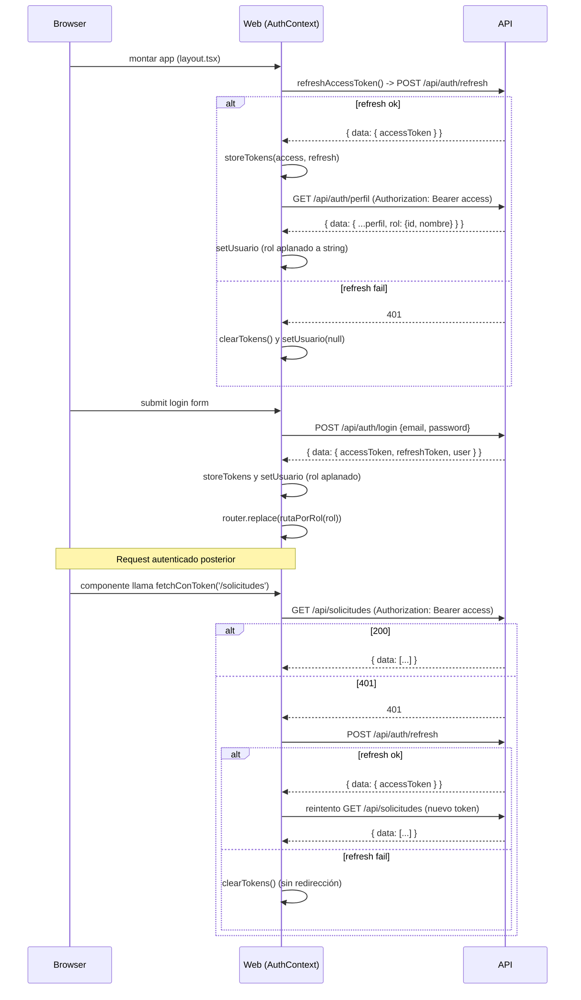

# Contrato de integración API ↔ Web — SIGEB / EDUVIAGT v1.1

## 1. Visión general

La web (Next.js) y la API (NestJS) son dos aplicaciones independientes que se comunican por HTTP/JSON. La integración se hace por **reverse-proxy en Next.js** (no por CORS en producción, aunque CORS está configurado en la API).

```
Browser ──► Next.js server ──► API NestJS ──► PostgreSQL
   │              │                  │
   │  /api/*      │  rewrite         │  /api/* (prefijo global)
   │  (relativo)  │  -> NEXT_PUBLIC_  │
   │              │    API_PROXY     │
   │              │                  │
   │  SSR fetch   │  API_INTERNAL_   │
   │  (absoluto)  │    URL           │
```

## 2. Contratos transversales

### 2.1 Prefijo global

Toda ruta de la API lleva el prefijo `/api` (`main.ts:11`: `app.setGlobalPrefix('api')`). Swagger en `/api/docs`.

### 2.2 Envelope de respuesta

`TransformInterceptor` (`common/interceptors/transform.interceptor.ts:15-33`) envuelve **toda** respuesta JSON en `{ data: ... }`. Respeta `headersSent` (no envuelve CSV/PDF ya enviados).

```json
// GET /api/convocatorias
{ "data": { "data": [ { "id": "...", "titulo": "..." } ], "total": 10, "page": 1, "limit": 20 } }
```

### 2.3 Formato de error

`AllExceptionsFilter` (`common/filters/http-exception.filter.ts:11-36`) normaliza a:

```json
{ "statusCode": 400, "message": "Los datos enviados no son válidos.", "timestamp": "2026-10-27T..." }
```

Mensajes traducidos a español por `formatearErroresValidacion` (`common/filters/mensajes-error.ts`).

### 2.4 Autenticación

- Header: `Authorization: Bearer <accessToken>`.
- Access token: `JWT_ACCESS_EXPIRATION` (default 15m), secret `JWT_SECRET`.
- Refresh token: `JWT_REFRESH_EXPIRATION` (default 7d), secret `JWT_REFRESH_SECRET` (distinto).
- El refresh **no es revocable** (no hay blacklist ni tabla de sesiones).

## 3. Los tres paths de comunicación

### 3.1 Path público (browser -> API directo vía proxy)

```
Browser -> GET /api/convocatorias -> Next.js rewrite -> API -> { data: ... }
```

El navegador siempre llama a `/api/*` (relativo). Next.js reenvía a `NEXT_PUBLIC_API_PROXY`. **No se envía token.**

### 3.2 Path autenticado (browser -> API con token)

```
Browser -> fetchConToken('/convocatorias') -> /api/convocatorias + Authorization: Bearer <localStorage>
```

`fetchConToken` (`lib/api-auth.ts`):
1. Lee `sigeb_access_token` de `localStorage`.
2. Adjunta `Authorization: Bearer <token>`.
3. Si la respuesta es 401 -> `refreshAccessToken()` (POST /api/auth/refresh con el refresh token) -> un reintento con el nuevo access token.
4. Si el refresh falla -> `clearTokens()` (no redirige a `/login`).

### 3.3 Path SSR (Server Component -> API directo)

```
Server Component -> httpData('/convocatorias') -> API_INTERNAL_URL (absoluto) -> API
```

El Server Component usa `API_INTERNAL_URL` (absoluto, sin token). Como el token está en `localStorage`, **ningún Server Component puede estar autenticado**.

## 4. Flujo de autenticación end-to-end



## 5. SSE de notificaciones

- Endpoint: `GET /api/notificaciones/stream?token=<JWT>` (el token viaja en **query string** porque `EventSource` no permite headers).
- Estrategia Passport: `sse-jwt` (`auth/strategies/sse-jwt.strategy.ts`).
- Formato: `text/event-stream`, heartbeat `hb` cada 25 s.
- Reconexión en el cliente: `onerror` -> `close()` -> `refreshAccessToken()` -> `setTimeout(conectar, 1000)`.

## 6. Variables de entorno (origen y efecto)

| Variable | Origen | Efecto |
|---|---|---|
| `DATABASE_URL` | `.env` raíz | Conexión Prisma (api) |
| `JWT_SECRET` | `.env` raíz | Firma access token |
| `JWT_REFRESH_SECRET` | `.env` raíz | Firma refresh token (distinto) |
| `JWT_ACCESS_EXPIRATION` | `.env` raíz | TTL access (default 15m) |
| `JWT_REFRESH_EXPIRATION` | `.env` raíz | TTL refresh (default 7d) |
| `PORT` | `.env` raíz | Puerto API (default 3000) |
| `HOST` | `.env` raíz | Interfaz de escucha (default 0.0.0.0) |
| `CORS_ORIGIN` | `.env` raíz | Origen permitido (default http://localhost:3001) |
| `STORAGE_PATH` | `.env` raíz | Ruta del adapter FS (default ./storage) |
| `AI_API_KEY` | `.env` raíz | Activa modo OpenAI; vacío -> fallback-kb |
| `AI_BASE_URL` | `.env` raíz | URL base OpenAI-compatible (default https://api.openai.com/v1) |
| `AI_MODEL` | `.env` raíz | Modelo (default gpt-4o-mini) |
| `AI_TIMEOUT_MS` | `.env` raíz | Timeout LLM (default 15000) |
| `CHROME_EXECUTABLE_PATH` | `.env` raíz | Chromium para constancia PDF |
| `NEXT_PUBLIC_API_URL` | `next.config.js` (env) + `lib/api.ts` | URL base del cliente (default /api) |
| `NEXT_PUBLIC_API_PROXY` | `next.config.js` (rewrites) | Destino del rewrite (default http://localhost:3000/api). Leído en runtime. Definida en `docker-compose.prod.yml` y `playwright.config.ts` |
| `API_INTERNAL_URL` | `next.config.js` (env) + `lib/api.ts` | URL absoluta para SSR (default NEXT_PUBLIC_API_PROXY ?? http://localhost:3000/api). Inlined en build ⚠️ |
| `POSTGRES_*`, `DB_PASSWORD`, `API_PORT`, `WEB_PORT` | `.env` raíz | Docker Compose prod |

## 7. Referencias

- `apps/api/src/main.ts` (prefijo, CORS, ValidationPipe, Swagger)
- `apps/web/next.config.js`
- `apps/web/src/lib/api.ts`, `apps/web/src/lib/api-auth.ts`, `apps/web/src/lib/auth.ts`
- `apps/web/src/context/AuthContext.tsx`
- `apps/api/src/common/interceptors/transform.interceptor.ts`
- `apps/api/src/common/filters/http-exception.filter.ts`
- `docs/architecture/frontend.md`
- `docs/architecture/ARQUITECTURA-REAL.md`