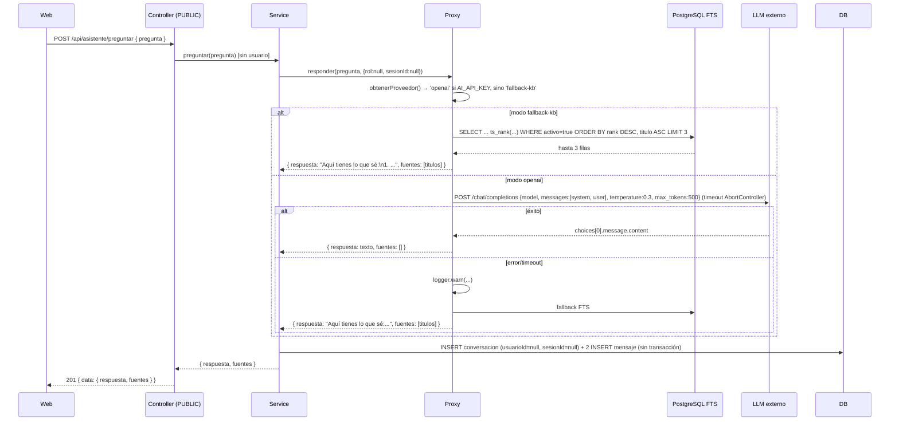

# Arquitectura del asistente IA — SIGEB / EDUVIAGT v1.1

> ⚠️ **Esto NO es RAG.** El asistente tiene dos modos **mutuamente excluyentes**: (a) recuperación léxica (Full-Text Search en PostgreSQL) y (b) LLM genista sin contexto recuperado. No hay embeddings, vector store, chunking ni re-ranking.

## 1. Contrato

Archivo: `apps/api/src/asistente/asistente.types.ts` (14 líneas)

```typescript
export interface ContextoIA {
  rol?: string | null;
  sesionId?: string | null;
}
export interface RespuestaIA {
  respuesta: string;
  fuentes: string[];
}
export interface ProveedorIA {
  responder(pregunta: string, contexto: ContextoIA): Promise<RespuestaIA>;
  readonly nombre: string;
}
```

## 2. Componentes

| Archivo | Rol |
|---|---|
| `asistente/asistente.controller.ts` | `POST /asistente/preguntar`, `@Public()`, sin `@CurrentUser()` |
| `asistente/asistente.service.ts` | Orquesta proxy + persiste conversación/mensajes |
| `asistente/asistente.proxy.ts` | Proxy: selecciona proveedor y degrada a fallback |
| `asistente/providers/openai.provider.ts` | Adapter OpenAI-compatible |
| `asistente/providers/fallback.provider.ts` | KB por FTS PostgreSQL |
| `asistente/dto/preguntar.dto.ts` | `{ pregunta: string }`, `@IsString @IsNotEmpty @MaxLength(500)` |

## 3. Flujo real — 2 modos excluyentes



### 3.1 Modo `fallback-kb` (default, sin `AI_API_KEY`)

1. `soloTerminos(pregunta)`: normaliza (lowercase + NFD + quita acentos + quita puntuación), filtra stopwords y términos ≤ 2 chars, une con espacio.
2. Si la consulta queda vacía → respuesta genérica "Hazme una pregunta...".
3. `buscarEnKb(consulta)`: query FTS exacta:

```sql
SELECT id, titulo, contenido, tags,
       ts_rank(to_tsvector('spanish', titulo || ' ' || contenido),
               websearch_to_tsquery('spanish', REPLACE($1, ' ', ' OR '))) AS rank
FROM "asistente_base_conocimiento"
WHERE activo = true
  AND to_tsvector('spanish', titulo || ' ' || contenido)
      @@ websearch_to_tsquery('spanish', REPLACE($1, ' ', ' OR '))
ORDER BY rank DESC, titulo ASC
LIMIT 3
```

Índice GIN funcional: `asistente_base_conocimiento_searchvector_gin` sobre `to_tsvector('spanish', titulo || ' ' || contenido)` (migración `20260829061028_asistente_tsvector`).

4. Si no hay filas → "No encontré información específica...".
5. Si hay filas → respuesta numerada con la **primera línea** de cada `contenido` + nota por rol (solo si `rol !== 'POSTULANTE'` y no null).
6. `fuentes = filas.map(f => f.titulo)`.

### 3.2 Modo `openai` (con `AI_API_KEY`)

- Endpoint: `POST {AI_BASE_URL}/chat/completions` (OpenAI-compatible).
- Modelo: `AI_MODEL` (default `gpt-4o-mini`).
- `temperature: 0.3`, `max_tokens: 500` (hardcodeados).
- Timeout: `AI_TIMEOUT_MS` (default 15000) vía `AbortController`.
- System prompt: 2 variantes (autenticado / no autenticado), con instrucción de acotamiento y no-revelación.
- **Mensajes: exactamente 2** (`system` + `user`). **Sin historial, sin contexto de KB, sin citas.**
- `fuentes: []` siempre.

### 3.3 Por qué esto NO es RAG

| Capacidad RAG | Implementación real |
|---|---|
| Embeddings / vector store | ❌ No existe (`grep embedding/vectorstore/pgvector` = 0) |
| Chunking de documentos | ❌ No existe |
| Recuperación semántica | ❌ Solo FTS léxica (tsvector) |
| Inyección de contexto al LLM | ❌ El LLM no recibe la KB |
| Citas estructuradas | ❌ `fuentes: string[]` (títulos sueltos) |
| Re-ranking | ❌ No existe |
| Recuperación léxica (FTS) | ✅ PostgreSQL `tsvector` + `websearch_to_tsquery` + `ts_rank` |
| Base de conocimiento curada | ✅ 33 documentos estáticos en `prisma/seed.ts` |
| Degradación LLM → KB | ✅ Si el LLM falla, se usa el fallback |

## 4. Por qué NO se acota por rol ni por sesión (bug)

`asistente.controller.ts:17-19`:

```typescript
preguntar(@Body() dto: PreguntarDto) {
  return this.asistenteService.preguntar(dto.pregunta);  // sin usuario
}
```

El controller es `@Public()` y **no usa `@CurrentUser()`**. Consecuencias en cascada:
1. `usuario` = `undefined` → `ContextoIA.rol` = `null` siempre.
2. El system prompt del LLM es **siempre** la variante "usuario NO autenticado".
3. La nota por rol del fallback **nunca** se emite.
4. `asistenteConversacion.usuarioId` = `null` siempre → **sin trazabilidad de quién preguntó**.
5. El test `asistente.service.spec.ts` ("vincula la conversación al usuario autenticado") valida un camino **no ejercido por la API real**.

Además, el frontend **no envía token**: `ChatWidget.tsx:99-102` y `MiniAsistente.tsx:64` llaman `httpData('/asistente/preguntar', { method:'POST', body:{...} })` sin `token` (consistente con `@Public()`).

## 5. Persistencia

`schema.prisma:687-726`:

```prisma
model AsistenteBaseConocimiento {
  id        String   @id @default(uuid())
  titulo    String
  contenido String
  tags      String[]
  activo    Boolean  @default(true)
  createdAt DateTime @default(now())
  updatedAt DateTime @default(now())
  @@index([activo])
  @@map("asistente_base_conocimiento")
}

model AsistenteConversacion {
  id        String   @id @default(uuid())
  usuarioId String?          // SIN FK a usuario
  sesionId  String?          // nunca se llena
  createdAt DateTime @default(now())
  mensajes  AsistenteMensaje[]
  @@map("asistente_conversacion")
}

model AsistenteMensaje {
  id             String   @id @default(uuid())
  conversacionId String
  rol            String     // 'usuario' | 'asistente'
  contenido      String
  contexto       Json?      // { fuentes: [...] } (solo fallback)
  createdAt      DateTime @default(now())
  conversacion   AsistenteConversacion @relation(..., onDelete: Cascade)
  @@map("asistente_mensaje")
}
```

**Observaciones:**
- `asistente_conversacion.usuarioId` es `String?` **sin relación Prisma** → sin FK, sin `onDelete`. Hoy siempre es `null`.
- `sesionId` también es `String?` sin FK → nunca se llena.
- `rol` es `String` libre, no enum.
- `tags` es `String[]` sin GIN sobre tags.
- **Sin transacción** en `asistente.service.ts`: `create` + `createMany` pueden dejar conversación huérfana.
- **Sin manejo de errores**: si falla la persistencia, la respuesta al cliente también falla (500) aunque el LLM ya haya generado la respuesta.

## 6. Seguridad y privacidad

### 6.1 Endpoint público sin rate limit

`@Public()` en `asistente.controller.ts:13`. No hay `@nestjs/throttler`. Riesgos:
- **DoS / abuso de cuota**: cada request puede disparar un LLM con `max_tokens: 500`.
- **Inflación de BD**: 3 filas por request (conversación + 2 mensajes). Sin retención ni limpieza.
- **PII sin dueño**: la pregunta se persiste sin `usuarioId`.

### 6.2 Sin sanitización ni defensa de prompt injection

- La pregunta se pasa **literal** al LLM: `{ role: 'user', content: pregunta }`.
- Sin escapado de delimitadores, sin wrappers, sin detección de "ignore previous instructions".
- Sin Guardrails/Moderation API ni validación post-generación.
- **Sin grounding en la KB**: el LLM responde de su conocimiento paramétrico y puede inventar datos de convocatorias/becas.

### 6.3 PII

- No se agregan PII al contexto (`ContextoIA` solo lleva `rol` y `sesionId`).
- Si el usuario escribe su CUI en la pregunta: esa PII se envía al proveedor externo, se persiste en BD sin dueño, y queda en los logs del proveedor.
- La KB expone información sensible a anónimos: estados de convocatorias (`seed.ts:1296-1300`), roles (`seed.ts:1371-1375`), proceso de evaluación y votación de comités (`seed.ts:1307-1315`), perfil financiero (`seed.ts:1342-1345`). Esto contradice la política del system prompt ("No reveles... puntajes internos ni decisiones de comités").

### 6.4 Deuda técnica (asistente)

| # | Hallazgo | Evidencia | Severidad |
|---|---|---|---|
| 1 | El controller no pasa el usuario → `rol`/`usuarioId`/`sesionId` siempre `null` | `asistente.controller.ts:17-19` | P0 |
| 2 | El modo LLM no es RAG → puede inventar datos | `openai.provider.ts:58-66` (sin contexto inyectado) | P0 |
| 3 | Endpoint público sin rate limit | `asistente.controller.ts` (sin `@nestjs/throttler`) | P0 |
| 4 | Sin sanitización ni defensa de prompt injection | `openai.provider.ts:64` (pregunta literal) | P1 |
| 5 | PII en la pregunta → BD sin dueño y a tercero | `asistente.service.ts:19-40` | P1 |
| 6 | KB demasiado permisiva para anónimos | `prisma/seed.ts:1296-1385` | P1 |
| 7 | `@@` de PostgreSQL ignora booleanos del tsquery → AND estricto, no OR | `fallback.provider.ts:76-89` | P2 |
| 8 | `tags` seleccionados pero nunca usados para filtrar | `fallback.provider.ts:81` (tags en SELECT, nunca filtrados) | P2 |
| 9 | Truncamiento `contenido.split('\n')[0]` pierde contenido multilínea | `fallback.provider.ts:61-64` | P2 |
| 10 | Sin cache → FTS y tokens duplicados | `asistente.service.ts` (sin cache) | P2 |
| 11 | Sin transacción ni try/catch en la persistencia | `asistente.service.ts:19-40` | P2 |
| 12 | Sin FK en `asistente_conversacion.usuarioId` | `schema.prisma:695` | P2 |
| 13 | `IsNotEmpty` sin trim → `"   "` pasa validación | `dto/preguntar.dto.ts` | P2 |
| 14 | `max_tokens` hardcodeado → incompatible con modelos que exigen `max_completion_tokens` | `openai.provider.ts:43` | P2 |
| 15 | El diagrama `docs/architecture/diagrams.md` (sección 8 anterior) mostraba KB→LLM con contexto — **falso** | Corregido en esta versión | — |

## 7. Tests

| Test | Ubicación | Qué valida |
|---|---|---|
| Unit proxy | `asistente.proxy.spec.ts` | Sin `AI_API_KEY` → fallback; con key → LLM; error → degradación |
| Unit service | `asistente.service.spec.ts` | Persistencia anónima + vinculación con usuario (**camino no ejercido por la API**) |
| E2E | `apps/api/test/asistente.e2e-spec.ts` | 201 con respuesta+fuentes; pregunta sin términos → "Hazme una pregunta"; vacía → 400; >500 chars → 400 |
| Entorno de test | `apps/api/test/setup-env.ts:14` | `AI_API_KEY = ''` → fuerza modo fallback en CI |

**Cobertura ausente:** no hay tests del `FallbackProveedor` (stopwords, ranking, `LIMIT 3`), ni del `OpenAIProveedor` (timeout, parseo, headers), ni de seguridad (prompt injection, rate limit, PII), ni de multi-turno.

## 8. Referencias

- `apps/api/src/asistente/*`
- `apps/api/prisma/schema.prisma:687-726`
- `apps/api/prisma/seed.ts:1240-1427` (33 documentos de KB)
- `apps/api/prisma/migrations/20260829061028_asistente_tsvector/migration.sql`
- `apps/web/src/components/chat/ChatWidget.tsx`, `apps/web/src/components/soporte/MiniAsistente.tsx`
- `docs/architecture/ARQUITECTURA-REAL.md` §3.14, §6
- `docs/architecture/diagrams.md` §8