# Schema de Base de Datos — EDUVIAGT

> Documentación completa del schema Prisma. Última actualización: Sprint 8 (2026-10-23).

---

## Resumen de entidades (31 total)

| Categoría | Entidades | Cantidad |
|---|---|---|
| **Seguridad** | Usuario, Rol, Permiso, RolPermiso, UsuarioPermiso, ConfiguracionUsuario | 6 |
| **Catálogos** | Genero, NivelAcademico, Departamento, Municipio, InstitucionEducativa | 5 |
| **Becas** | Beca, CriterioEvaluacion | 2 |
| **Convocatorias** | Convocatoria, ConvocatoriaDocRequerido, ConvocatoriaReglaMonto | 3 |
| **Solicitudes** | Solicitud, SolicitudPerfilAcademico, SolicitudPerfilFinanciero, SolicitudDocumento, HistorialEstado, SolicitudAprobacion | 6 |
| **Evaluaciones** | Evaluacion | 1 |
| **Comités** | Comite, ComiteMiembro, Sesion, SesionAgenda, Voto, Decision | 6 |
| **Auditoría** | AuditLog, BitacoraSistema | 2 |
| **Notificaciones** | Notificacion | 1 |
| **IA** | AsistenteBaseConocimiento, AsistenteConversacion, AsistenteMensaje | 3 |

---

## Diagrama ER completo

```mermaid
erDiagram
    %% SEGURIDAD
    ROL ||--o{ USUARIO : tiene
    ROL ||--o{ ROL_PERMISO : agrupa
    PERMISO ||--o{ ROL_PERMISO : asignado
    USUARIO ||--o{ USUARIO_PERMISO : excepciones
    PERMISO ||--o{ USUARIO_PERMISO : referenciado
    USUARIO ||--o| CONFIGURACION_USUARIO : preferencias

    %% CATÁLOGOS
    GENERO ||--o{ USUARIO : tiene
    GENERO ||--o{ SOLICITUD_PERFIL_ACADEMICO : genero
    NIVEL_ACADEMICO ||--o{ SOLICITUD_PERFIL_ACADEMICO : nivel
    NIVEL_ACADEMICO ||--o{ CONVOCATORIA : nivel
    DEPARTAMENTO ||--o{ MUNICIPIO : contiene
    DEPARTAMENTO ||--o{ USUARIO : reside
    DEPARTAMENTO ||--o{ SOLICITUD_PERFIL_ACADEMICO : depto
    MUNICIPIO ||--o{ USUARIO : reside
    MUNICIPIO ||--o{ SOLICITUD_PERFIL_ACADEMICO : municipio

    %% BECAS
    BECA ||--o{ CONVOCATORIA : convoca
    BECA ||--o{ CRITERIO_EVALUACION : define

    %% CONVOCATORIAS
    CONVOCATORIA ||--o{ CONVOCATORIA_DOC_REQUERIDO : exige
    CONVOCATORIA ||--o{ CONVOCATORIA_REGLA_MONTO : tiene
    CONVOCATORIA ||--o{ SOLICITUD : recibe
    DOCUMENTO_TIPO ||--o{ CONVOCATORIA_DOC_REQUERIDO : requerido

    %% SOLICITUDES
    USUARIO ||--o{ SOLICITUD : postula
    SOLICITUD ||--|| SOLICITUD_PERFIL_ACADEMICO : tiene
    SOLICITUD ||--|| SOLICITUD_PERFIL_FINANCIERO : tiene
    SOLICITUD ||--o{ SOLICITUD_DOCUMENTO : adjunta
    SOLICITUD ||--o{ HISTORIAL_ESTADO : registra
    SOLICITUD ||--o{ EVALUACION : recibe
    SOLICITUD ||--o{ VOTO : votada
    SOLICITUD ||--o| DECISION : resuelve
    SOLICITUD ||--o{ SOLICITUD_APROBACION : firmas
    SOLICITUD ||--o{ SESION_AGENDA : agenda
    DOCUMENTO_TIPO ||--o{ SOLICITUD_DOCUMENTO : tipo

    %% EVALUACIONES
    CRITERIO_EVALUACION ||--o{ EVALUACION : criterio
    USUARIO ||--o{ EVALUACION : evaluador

    %% COMITÉS
    COMITE ||--o{ COMITE_MIEMBRO : integra
    USUARIO ||--o{ COMITE_MIEMBRO : participa
    COMITE ||--o{ SESION : sesiona
    SESION ||--o{ VOTO : registra
    SESION ||--o{ DECISION : emite
    SESION ||--o{ SESION_AGENDA : agenda

    %% AUDITORÍA
    USUARIO ||--o{ AUDIT_LOG : genera
    USUARIO ||--o{ NOTIFICACION : recibe

    %% IA
    ASISTENTE_CONVERSACION ||--o{ ASISTENTE_MENSAJE : contiene
```



---

## Entidades detalladas

### Seguridad

#### Usuario
```prisma
model Usuario {
  id              String        @id @default(uuid())
  cui             String        @unique
  nombres         String
  email           String        @unique
  passwordHash    String
  telefono        String?
  fechaNacimiento DateTime?
  direccion       String?
  generoId        String?
  departamentoId  String?
  municipioId     String?
  rolId           String
  estado          UsuarioEstado @default(ACTIVO)
  eliminadoAt     DateTime?     // Sprint 8: soft-delete
  createdAt       DateTime      @default(now())
  updatedAt       DateTime      @updatedAt
}
```

#### Rol
```prisma
model Rol {
  id          String   @id @default(uuid())
  nombre      String   @unique
  descripcion String?
  createdAt   DateTime @default(now())
  updatedAt   DateTime @updatedAt
}
```

#### Permiso
```prisma
model Permiso {
  id        String   @id @default(uuid())
  modulo    String
  accion    String
  createdAt DateTime @default(now())
  @@unique([modulo, accion])
}
```

#### RolPermiso / UsuarioPermiso
```prisma
model RolPermiso {
  id        String   @id @default(uuid())
  rolId     String
  permisoId String
  createdAt DateTime @default(now())
  @@unique([rolId, permisoId])
}

model UsuarioPermiso {
  id        String        @id @default(uuid())
  usuarioId String
  permisoId String
  efecto    PermisoEfecto  // PERMITIR | DENEGAR
  createdAt DateTime      @default(now())
  @@unique([usuarioId, permisoId])
}
```

#### ConfiguracionUsuario (Sprint 8)
```prisma
model ConfiguracionUsuario {
  id                    String   @id @default(uuid())
  usuarioId             String   @unique
  notificacionesActivas Boolean  @default(true)
  sonidoNotificaciones  Boolean  @default(true)
  volumenSonido         Int      @default(40)
  createdAt             DateTime @default(now())
  updatedAt             DateTime @updatedAt
}
```

---

### Catálogos

| Entidad | Campos clave | Relaciones |
|---|---|---|
| `Genero` | id, nombre (unique), activo | → Usuario, SolicitudPerfilAcademico |
| `NivelAcademico` | id, nombre (unique), activo | → SolicitudPerfilAcademico, Convocatoria |
| `Departamento` | id, nombre (unique), activo | → Municipio, Usuario, SolicitudPerfilAcademico |
| `Municipio` | id, nombre, departamentoId, activo | → Usuario, SolicitudPerfilAcademico |
| `InstitucionEducativa` | id, nombre, nivel, sector, departamento, municipio, activa | (independiente) |

---

### Becas

#### Beca
```prisma
model Beca {
  id          String   @id @default(uuid())
  nombre      String
  descripcion String?
  activa      Boolean  @default(true)
  createdAt   DateTime @default(now())
  updatedAt   DateTime @updatedAt
}
```

#### CriterioEvaluacion
```prisma
model CriterioEvaluacion {
  id     String  @id @default(uuid())
  becaId String
  nombre String
  peso   Float
  activo Boolean @default(true)
}
```

---

### Convocatorias

#### Convocatoria (Sprint 8 extended)
```prisma
model Convocatoria {
  id                 String             @id @default(uuid())
  nombre             String
  descripcion        String?
  becaId             String
  nivelAcademicoId   String?
  cobertura          BecaCobertura?
  formulario         Json?
  estado             ConvocatoriaEstado @default(BORRADOR)
  fechaApertura      DateTime?
  fechaCierre        DateTime?
  evaluadoresMinimos Int                @default(2)
  maxCorrecciones    Int                @default(3)
  moneda             String             @default("GTQ")
  montoBase          Decimal?           @db.Decimal(12, 2)
  permiteParcial     Boolean            @default(true)
  usarReglasMonto    Boolean            @default(false)
  createdAt          DateTime           @default(now())
  updatedAt          DateTime           @updatedAt
}
```

#### ConvocatoriaDocRequerido
```prisma
model ConvocatoriaDocRequerido {
  id              String  @id @default(uuid())
  convocatoriaId  String
  documentoTipoId String
  obligatorio     Boolean @default(true)
  @@unique([convocatoriaId, documentoTipoId])
}
```

#### ConvocatoriaReglaMonto (Sprint 8)
```prisma
model ConvocatoriaReglaMonto {
  id             String   @id @default(uuid())
  convocatoriaId String
  nombre         String
  ingresoMin     Decimal? @db.Decimal(12, 2)
  ingresoMax     Decimal? @db.Decimal(12, 2)
  tipo           String   // FIJO | PORCENTAJE | COMPLETO
  montoFijo      Decimal? @db.Decimal(12, 2)
  porcentaje     Float?
  prioridad      Int      @default(0)
  activo         Boolean  @default(true)
  createdAt      DateTime @default(now())
}
```

---

### Solicitudes

#### Solicitud (Sprint 8 extended)
```prisma
model Solicitud {
  id                 String          @id @default(uuid())
  convocatoriaId     String
  usuarioId          String
  estado             SolicitudEstado @default(BORRADOR)
  correccionesCount  Int             @default(0)
  respuestas         Json?
  formularioSnapshot Json?
  montoOtorgable     Decimal?        @db.Decimal(12, 2)
  montoAprobado      Decimal?        @db.Decimal(12, 2)
  montoOrigenCalculo String?         // REGLA | MONTO_BASE | OVERRIDE
  montoCalculadoAt   DateTime?
  montoCalculadoPor  String?
  createdAt          DateTime        @default(now())
  updatedAt          DateTime        @updatedAt
}
```

#### SolicitudPerfilAcademico
```prisma
model SolicitudPerfilAcademico {
  id                 String  @id @default(uuid())
  solicitudId        String  @unique
  generoId           String?
  generoOtro         String?
  nivelAcademicoId   String?
  nivelAcademicoOtro String?
  institucion        String?
  carrera            String?
  promedio           Float?
  departamentoId     String?
  departamentoOtro   String?
  municipioId        String?
  municipioOtro      String?
}
```

#### SolicitudPerfilFinanciero
```prisma
model SolicitudPerfilFinanciero {
  id                   String  @id @default(uuid())
  solicitudId          String  @unique
  ingresoFamiliar      Float?
  numeroDependientes   Int?
  becasAnteriores      Boolean @default(false)
  descripcionSituacion String?
}
```

#### SolicitudDocumento
```prisma
model SolicitudDocumento {
  id                String                   @id @default(uuid())
  solicitudId       String
  documentoTipoId   String
  archivoUrl        String
  estado            SolicitudDocumentoEstado @default(PENDIENTE)
  version           Int                      @default(1)
  comentarioRechazo String?
  createdAt         DateTime                 @default(now())
  updatedAt         DateTime                 @updatedAt
}
```

#### HistorialEstado (Sprint 8 extended)
```prisma
model HistorialEstado {
  id          String   @id @default(uuid())
  solicitudId String
  estado      String
  comentario  String?
  usuarioId   String
  accion      String?  // Sprint 8
  resultado   String?  // Sprint 8: EXITOSO | RECHAZADO | ERROR
  ip          String?  // Sprint 8
  createdAt   DateTime @default(now())
}
```

#### SolicitudAprobacion (Sprint 8)
```prisma
model SolicitudAprobacion {
  id          String   @id @default(uuid())
  solicitudId String
  usuarioId   String
  rolNombre   String
  nivel       Int      // 1 = primera, 2 = segunda
  accion      String   // aprobar | rechazar | aprobar_segunda | devolver_a_revision
  resultado   String   // APROBADA | RECHAZADA | DEVUELTA_A_REVISION | PENDIENTE_SEGUNDA_APROBACION
  comentario  String?
  ip          String?
  userAgent   String?
  createdAt   DateTime @default(now())
}
```

---

### Evaluaciones

#### Evaluacion
```prisma
model Evaluacion {
  id                   String   @id @default(uuid())
  solicitudId          String
  criterioEvaluacionId String
  evaluadorId          String
  puntaje              Float?
  observaciones        String?
  completada           Boolean  @default(false)
  confirmImparcialidad Boolean  @default(false)
  createdAt            DateTime @default(now())
  updatedAt            DateTime @updatedAt
}
```

---

### Comités

#### Comite
```prisma
model Comite {
  id          String   @id @default(uuid())
  nombre      String
  descripcion String?
  activo      Boolean  @default(true)
  createdAt   DateTime @default(now())
  updatedAt   DateTime @updatedAt
}
```

#### ComiteMiembro
```prisma
model ComiteMiembro {
  id        String   @id @default(uuid())
  comiteId  String
  usuarioId String
  rol       String
  activo    Boolean  @default(true)
  createdAt DateTime @default(now())
  @@unique([comiteId, usuarioId])
}
```

#### Sesion
```prisma
model Sesion {
  id           String   @id @default(uuid())
  comiteId     String
  fecha        DateTime
  lugar        String?
  estado       String   @default("PROGRAMADA")
  quorumMinimo Int?
  createdAt    DateTime @default(now())
  updatedAt    DateTime @updatedAt
}
```

#### SesionAgenda
```prisma
model SesionAgenda {
  id          String   @id @default(uuid())
  sesionId    String
  solicitudId String
  createdAt   DateTime @default(now())
  @@unique([sesionId, solicitudId])
}
```

#### Voto
```prisma
model Voto {
  id            String   @id @default(uuid())
  sesionId      String
  solicitudId   String
  usuarioId     String
  voto          String
  observaciones String?
  createdAt     DateTime @default(now())
  @@unique([sesionId, solicitudId, usuarioId])
}
```

#### Decision
```prisma
model Decision {
  id            String   @id @default(uuid())
  solicitudId   String   @unique
  sesionId      String
  resultado     String
  observaciones String?
  fecha         DateTime @default(now())
}
```

---

### Auditoría

#### AuditLog
```prisma
model AuditLog {
  id        String   @id @default(uuid())
  usuarioId String
  accion    String
  entidad   String
  entidadId String?
  detalle   Json?
  ip        String?
  createdAt DateTime @default(now())
}
```

#### BitacoraSistema (Sprint 8)
```prisma
model BitacoraSistema {
  id                String   @id @default(uuid())
  fechaHora         DateTime @default(now())
  actorId           String?
  actorNombre       String?
  actorRol          String?
  actorCorreo       String?
  modulo            String
  entidad           String
  entidadId         String?
  accionClave       String
  accionHumana      String
  descripcionHumana String
  camposClave       Json?
  datosRelevantes   Json?
  resultado         String   // EXITOSO | RECHAZADO | ERROR
  motivo            String?
  ip                String?
  userAgent         String?
  origen            String   @default("API")  // WEB | API
  correlacionId     String?
  sessionId         String?
}
```

---

### Notificaciones

#### Notificacion
```prisma
model Notificacion {
  id        String    @id @default(uuid())
  usuarioId String
  tipo      String
  titulo    String
  cuerpo    String?
  leidaAt   DateTime?
  createdAt DateTime  @default(now())
}
```

---

### IA

#### AsistenteBaseConocimiento
```prisma
model AsistenteBaseConocimiento {
  id        String   @id @default(uuid())
  titulo    String
  contenido String
  tags      String[]
  activo    Boolean  @default(true)
  createdAt DateTime @default(now())
  updatedAt DateTime @updatedAt
}
```

#### AsistenteConversacion
```prisma
model AsistenteConversacion {
  id        String   @id @default(uuid())
  usuarioId String?
  sesionId  String?
  createdAt DateTime @default(now())
}
```

#### AsistenteMensaje
```prisma
model AsistenteMensaje {
  id             String   @id @default(uuid())
  conversacionId String
  rol            String
  contenido      String
  contexto       Json?
  createdAt      DateTime @default(now())
}
```

---

## Enums del sistema

```prisma
enum UsuarioEstado {
  ACTIVO
  INACTIVO
}

enum SolicitudEstado {
  BORRADOR
  ENVIADA
  EN_REVISION
  CORRECCION
  EVALUADA
  PENDIENTE_SEGUNDA_APROBACION
  APROBADA
  RECHAZADA
}

enum ConvocatoriaEstado {
  BORRADOR
  ABIERTA
  CERRADA
  EN_EVALUACION
  RESUELTA
  ARCHIVADA
}

enum PermisoEfecto {
  PERMITIR
  DENEGAR
}

enum SolicitudDocumentoEstado {
  PENDIENTE
  CARGADO
  RECHAZADO
}

enum BecaCobertura {
  PARCIAL
  COMPLETA
}
```

---

## Índices de rendimiento

```sql
-- Performance
CREATE INDEX idx_solicitud_estado ON solicitud(estado);
CREATE INDEX idx_solicitud_usuario ON solicitud(usuario_id);
CREATE INDEX idx_solicitud_convocatoria ON solicitud(convocatoria_id);
CREATE INDEX idx_convocatoria_estado ON convocatoria(estado);
CREATE INDEX idx_evaluacion_solicitud ON evaluacion(solicitud_id);
CREATE INDEX idx_voto_sesion ON voto(sesion_id);
CREATE INDEX idx_auditlog_usuario ON audit_log(usuario_id);
CREATE INDEX idx_auditlog_fecha ON audit_log(created_at);

-- Sprint 8
CREATE INDEX idx_bitacora_fecha ON bitacora_sistema(fecha_hora);
CREATE INDEX idx_bitacora_actor ON bitacora_sistema(actor_id);
CREATE INDEX idx_bitacora_entidad ON bitacora_sistema(entidad, entidad_id);
CREATE INDEX idx_aprobacion_solicitud ON solicitud_aprobacion(solicitud_id);

-- Búsqueda de texto completo (IA)
CREATE INDEX idx_bc_titulo ON asistente_base_conocimiento USING gin(to_tsvector('spanish', titulo));
CREATE INDEX idx_bc_contenido ON asistente_base_conocimiento USING gin(to_tsvector('spanish', contenido));
```

---

## Roles del sistema

| Rol | Descripción | Permisos clave |
|---|---|---|
| `ADMIN` | Acceso total, incluida la matriz de seguridad | Todos |
| `POSTULANTE` | Crea y gestiona su propia solicitud | `solicitud:crear`, `solicitud:ver` |
| `EVALUADOR` | Evalúa solicitudes asignadas | `evaluacion:crear`, `evaluacion:ver` |
| `COORDINADOR_COMITE` | Convoca sesiones, registra decisiones | `comite:crear`, `comite:editar`, `sesion:finalizar` |
| `MIEMBRO_COMITE` | Vota en sesiones | `sesion:votar` |
| `JEFE_BECAS` | Aprueba solicitudes de alto monto (segunda instancia) | `convocatoria:publicar`, `solicitud:aprobar-primera`, `solicitud:aprobar-segunda`, `solicitud:montos-override` |
| `STAFF` | Rol base para personal administrativo | Se afina vía excepciones de usuario |

---

*Última actualización: Sprint 8 (2026-10-23)*