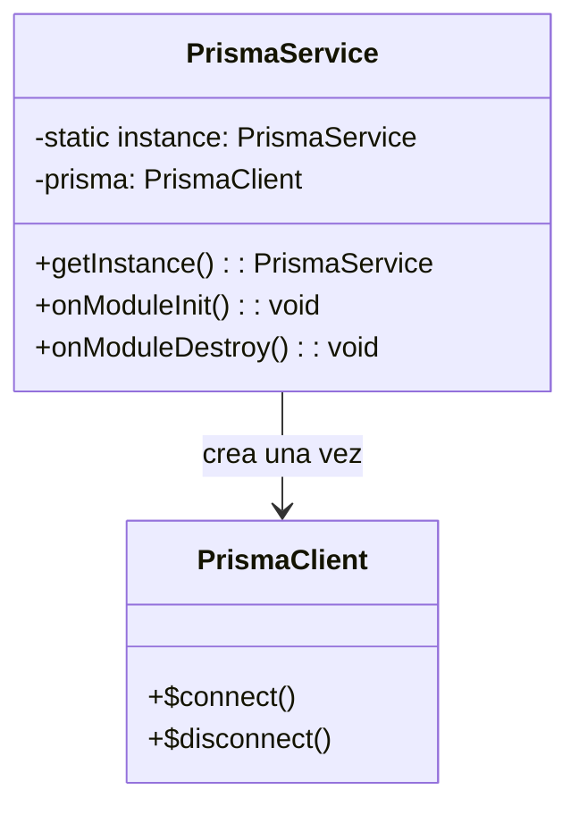
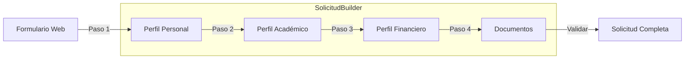
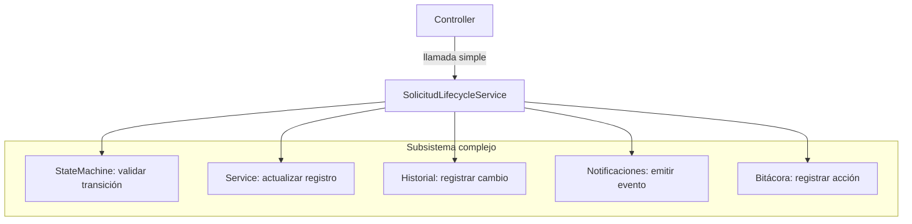
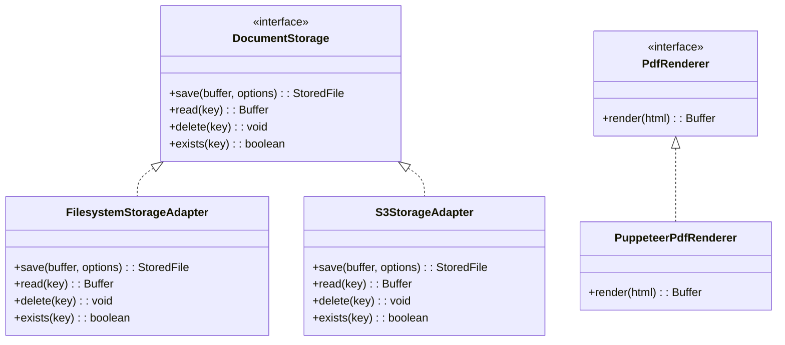
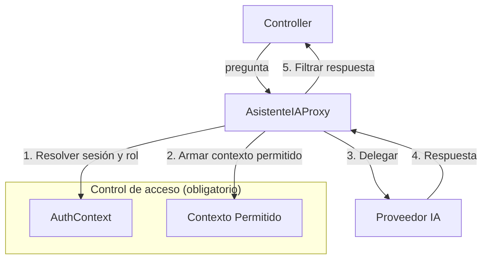
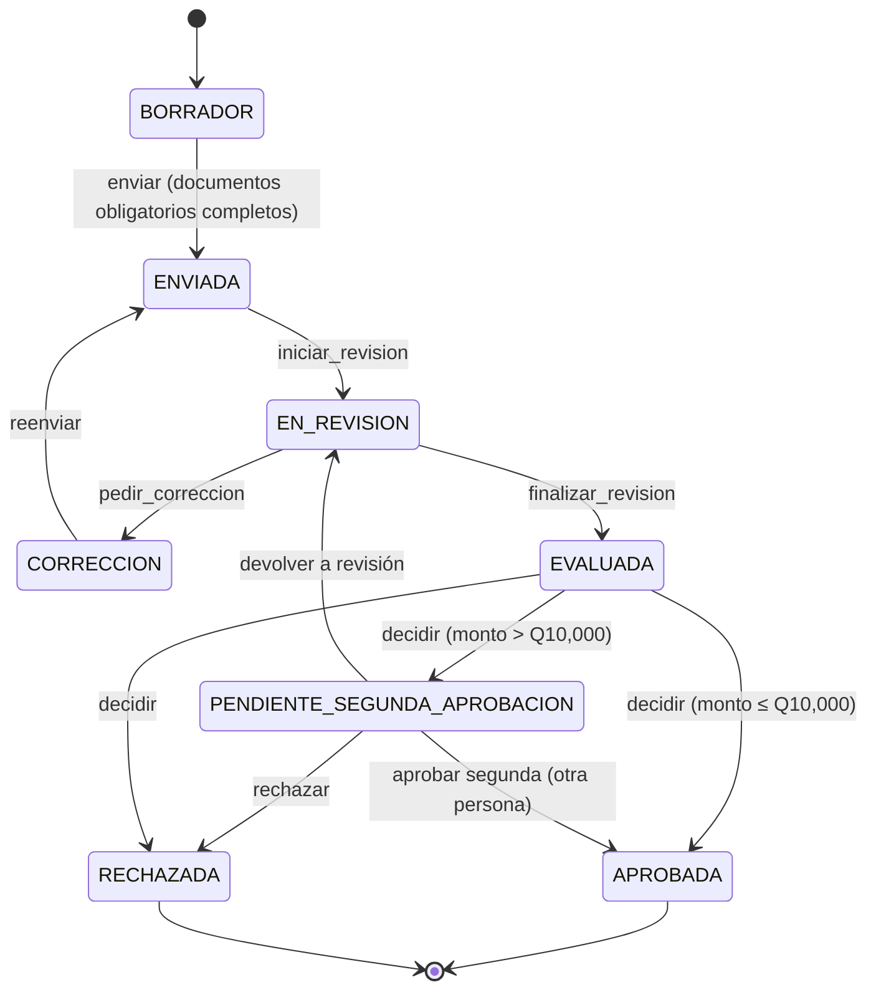
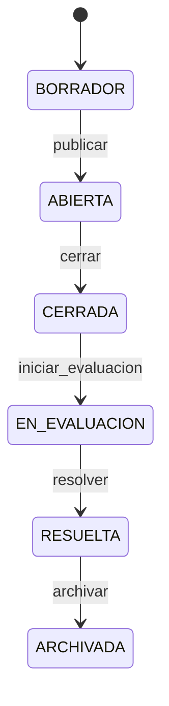
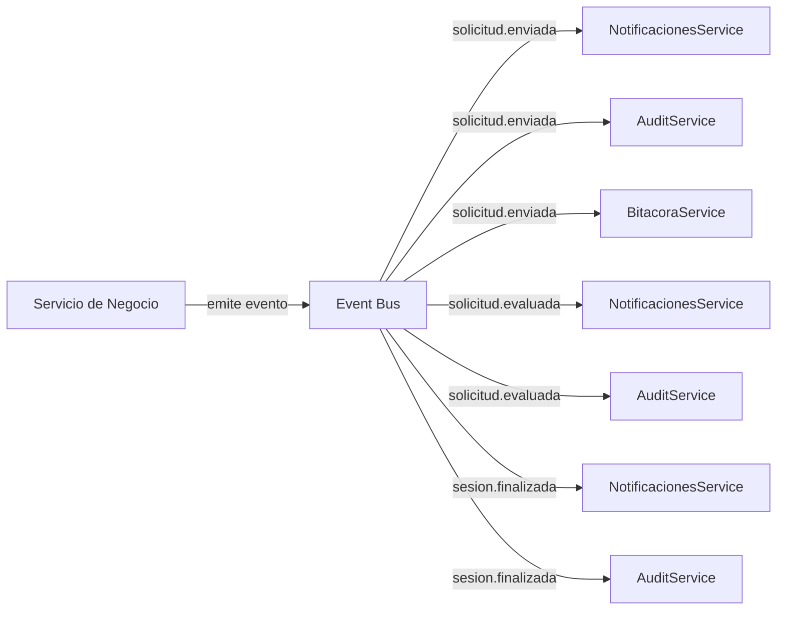
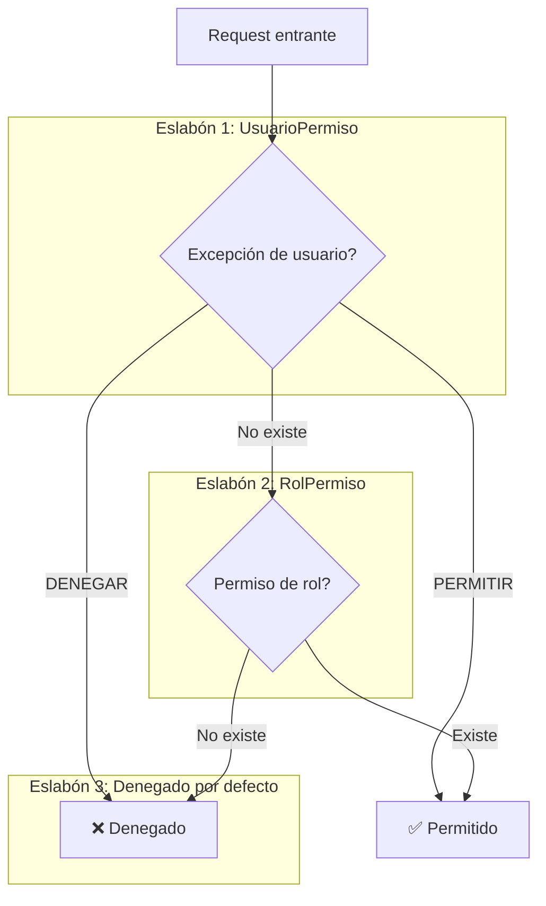
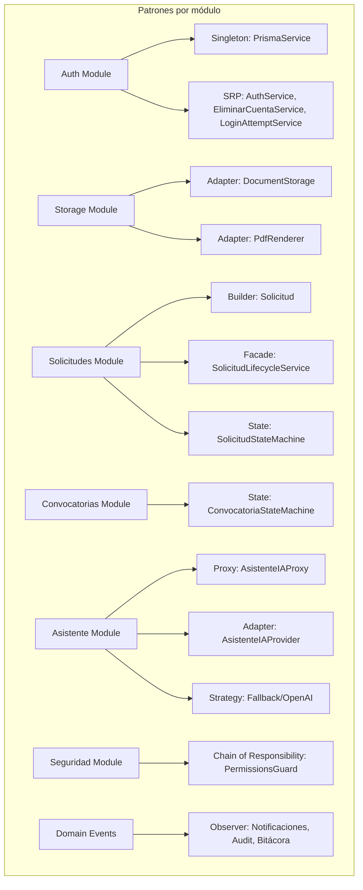

# Patrones de Diseño — EDUVIAGT

> Documentación de los patrones de diseño utilizados en el proyecto, con diagramas y ejemplos de código.

---

## Índice

1. [Singleton](#1-singleton)
2. [Builder](#2-builder)
3. [Facade](#3-facade)
4. [Adapter](#4-adapter)
5. [Proxy](#5-proxy)
6. [State](#6-state)
7. [Observer](#7-observer)
8. [Chain of Responsibility](#8-chain-of-responsibility)

---

## 1. Singleton

> Garantiza que una clase tenga una sola instancia y proporciona un punto de acceso global.

### Diagrama



### Dónde se usa
- **Archivo**: `apps/api/src/prisma/prisma.service.ts`
- **Propósito**: Una sola conexión a PostgreSQL compartida por toda la aplicación

### Por qué Singleton
- Evita múltiples pools de conexión
- Estado consistente entre módulos
- Fácil de testear con mocks

### Ejemplo de código
```typescript
@Injectable()
export class PrismaService extends PrismaClient implements OnModuleInit, OnModuleDestroy {
  async onModuleInit() {
    await this.$connect();
  }
  async onModuleDestroy() {
    await this.$disconnect();
  }
}
```

---

## 2. Builder

> Construye objetos complejos paso a paso, permitiendo crear diferentes representaciones del mismo objeto.

### Diagrama



### Dónde se usa
- **Archivo**: `apps/api/src/solicitudes/solicitudes.service.ts`
- **Propósito**: Construcción de `Solicitud` con perfil personal + académico + financiero + documentos

### Por qué Builder
- El objeto final tiene muchos campos opcionales
- Se completan en momentos distintos (pasos del formulario)
- Cada sección se valida independientemente antes de ensamblar

### Ejemplo de código
```typescript
// El formulario multi-paso mapea 1:1 con los pasos del builder
const solicitud = await this.solicitudesService.crear(convocatoriaId, usuarioId);
await this.solicitudesService.actualizarPerfilAcademico(solicitud.id, perfilAcademico);
await this.solicitudesService.actualizarPerfilFinanciero(solicitud.id, perfilFinanciero);
await this.solicitudesService.subirDocumento(solicitud.id, documento);
```

---

## 3. Facade

> Proporciona una interfaz simplificada a un subsistema complejo.

### Diagrama



### Dónde se usa
- **Archivo**: `apps/api/src/solicitudes/solicitudes.service.ts`
- **Propósito**: Orquesta validar transición, actualizar registro, registrar historial, emitir notificación y bitácora en una sola llamada

### Por qué Facade
- El controlador no conoce los pasos internos de aprobar/rechazar/enviar
- Centraliza la lógica, evita duplicarla en cada endpoint
- Respeta responsabilidad única

---

## 4. Adapter

> Permite que interfaces incompatibles trabajen juntas.

### Diagrama



### Dónde se usa
- **Storage**: `apps/api/src/storage/storage.interface.ts` + `filesystem.adapter.ts`
- **PDF**: `apps/api/src/solicitudes/pdf/pdf-renderer.interface.ts` + `puppeteer-pdf-renderer.ts`
- **IA**: `apps/api/src/asistente/providers/` (FallbackProveedor, OpenAIProveedor)

### Por qué Adapter
- La lógica de negocio no depende de dónde/cómo se guardan los archivos
- Permite cambiar a almacenamiento en la nube sin tocar servicios
- El proveedor de IA es intercambiable (Gemini/OpenAI/Fallback)

---

## 5. Proxy

> Proporciona un sustituto o intermediario para controlar el acceso a un objeto.

### Diagrama



### Dónde se usa
- **Archivo**: `apps/api/src/asistente/asistente-ia-proxy.ts`
- **Propósito**: Intercepta cada pregunta al asistente, resuelve sesión y rol, arma contexto permitido, y solo entonces delega al proveedor real

### Por qué Proxy
- El modelo de lenguaje no tiene acceso directo a datos de otros usuarios
- El control de acceso queda en un solo punto obligatorio de paso
- Imposible saltárselo por accidente en un nuevo endpoint

### Niveles de respuesta por rol

| Quién pregunta | Qué puede responder |
|---|---|
| Visitante sin sesión | Preguntas generales: requisitos, convocatorias abiertas, cómo aplicar |
| Postulante logeado | Lo anterior + estado de **su propia** solicitud y documentos pendientes |
| Evaluador / miembro de comité | Lo anterior + **sus** evaluaciones/sesiones pendientes, nunca datos de otros |
| Admin / Staff | Estadísticas agregadas |

---

## 6. State

> Permite que un objeto altere su comportamiento cuando su estado interno cambia.

### Diagrama — Solicitud



### Diagrama — Convocatoria



### Dónde se usa
- **Solicitud**: `apps/api/src/solicitudes/solicitud-state-machine.ts`
- **Convocatoria**: `apps/api/src/convocatorias/convocatoria-state-machine.ts`

### Por qué State
- Evita transiciones inválidas (ej. de RECHAZADA a APROBADA)
- Regla de negocio centralizada, testeable de forma aislada
- Imposible de saltarse

---

## 7. Observer

> Define una dependencia uno-a-muchos entre objetos para que cuando uno cambie, todos sus dependientes sean notificados.

### Diagrama



### Dónde se usa
- **Eventos**: `solicitud.enviada`, `solicitud.evaluada`, `sesion.finalizada`
- **Reaccionadores**: NotificacionesService, AuditService, BitacoraService

### Por qué Observer
- Desacopla "qué pasó" de "quién debe reaccionar"
- Se pueden agregar nuevos reaccionadores sin tocar el código emisor
- Ejemplo: agregar auditoría no requirió modificar los servicios de negocio

---

## 8. Chain of Responsibility

> Pasa una petición a lo largo de una cadena de manejadores, donde cada uno decide procesarla o pasarla al siguiente.

### Diagrama



### Dónde se usa
- **Archivo**: `apps/api/src/common/guards/permissions.guard.ts`
- **Propósito**: Resolución de permisos: primero excepción de usuario (`UsuarioPermiso`), luego permiso de rol (`RolPermiso`), por defecto denegado

### Por qué Chain of Responsibility
- La matriz de seguridad necesita resolver cuál de dos fuentes de permiso manda
- Cada eslabón resuelve o delega
- Agregar una tercera fuente (ej. por convocatoria) no rompe las dos anteriores

### Resolución de permisos

| Prioridad | Fuente | Efecto |
|---|---|---|
| 1 | `UsuarioPermiso` (excepción individual) | `PERMITIR` amplía, `DENEGAR` restringe |
| 2 | `RolPermiso` (permiso del rol) | Permitido si existe |
| 3 | Denegado por defecto | No se encontró permiso |

---

## Resumen de patrones por módulo



---

## Verificación de patrones

| Patrón | Módulo principal | Testeable | Extensible |
|---|---|---|---|
| Singleton | PrismaService | ✅ Mockeable | ✅ |
| Builder | SolicitudesService | ✅ | ✅ |
| Facade | SolicitudLifecycleService | ✅ | ✅ |
| Adapter (Storage) | FilesystemStorageAdapter | ✅ | ✅ (S3, Azure) |
| Adapter (PDF) | PuppeteerPdfRenderer | ✅ | ✅ (otro motor) |
| Adapter (IA) | Fallback/OpenAI | ✅ | ✅ (nuevo proveedor) |
| Proxy | AsistenteIAProxy | ✅ | ✅ |
| State | State Machines | ✅ | ✅ (nuevos estados) |
| Observer | Event Bus | ✅ | ✅ (nuevos reaccionadores) |
| Chain of Responsibility | PermissionsGuard | ✅ | ✅ (nuevos eslabones) |

---

*Última actualización: Sprint 8 (2026-10-23)*