# Diagramas — SIGEB / EDUVIAGT v1.1

> Diagramas en Mermaid. Fuente de verdad versionable. Si un diagrama contradice el código, el código manda y el diagrama debe corregirse.

## 1. Arquitectura general

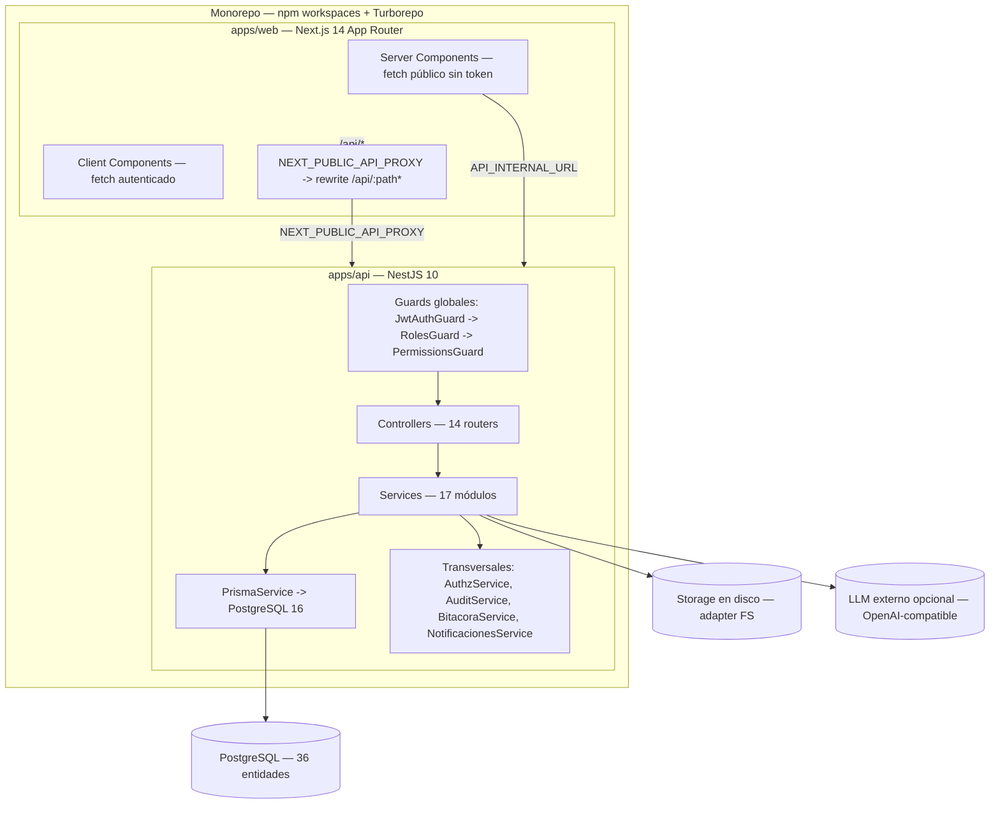

**Notas verificadas:**
- No existe capa Repository: Prisma se usa directamente en los servicios.
- No hay throttling global: el único rate limit es `LoginAttemptService` (en memoria, 5/15 min por `ip:email`).
- Los transversales se invocan por **llamada directa**, dentro o fuera de la transacción (no hay bus de eventos).
- 36 entidades (no 31): ver `docs/architecture/database-schema.md`.

## 2. Monorepo — Turborepo

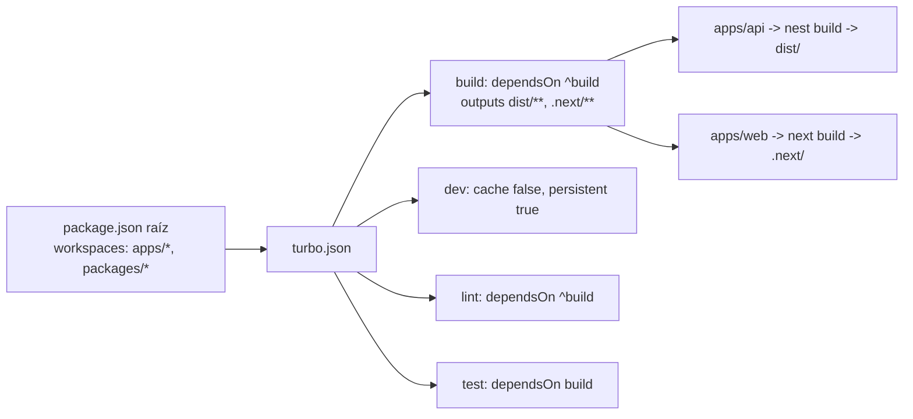

## 3. Flujo de autenticación

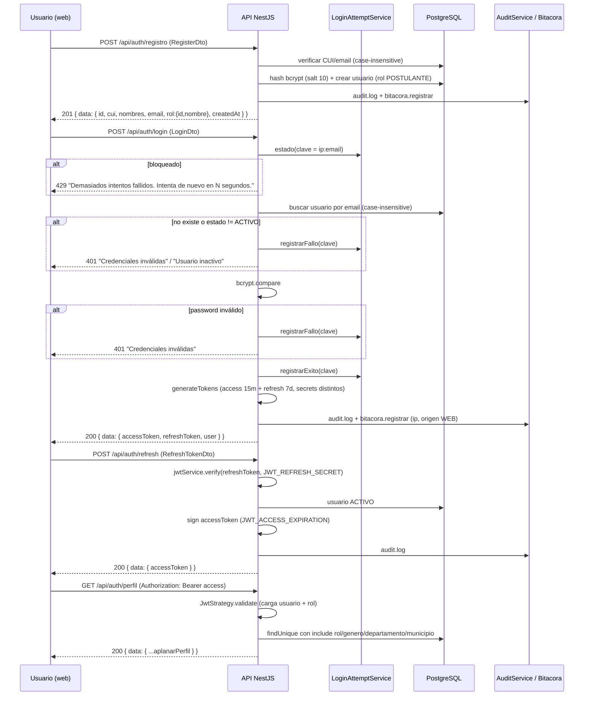

## 4. Flujo de solicitud (FSM corregida)

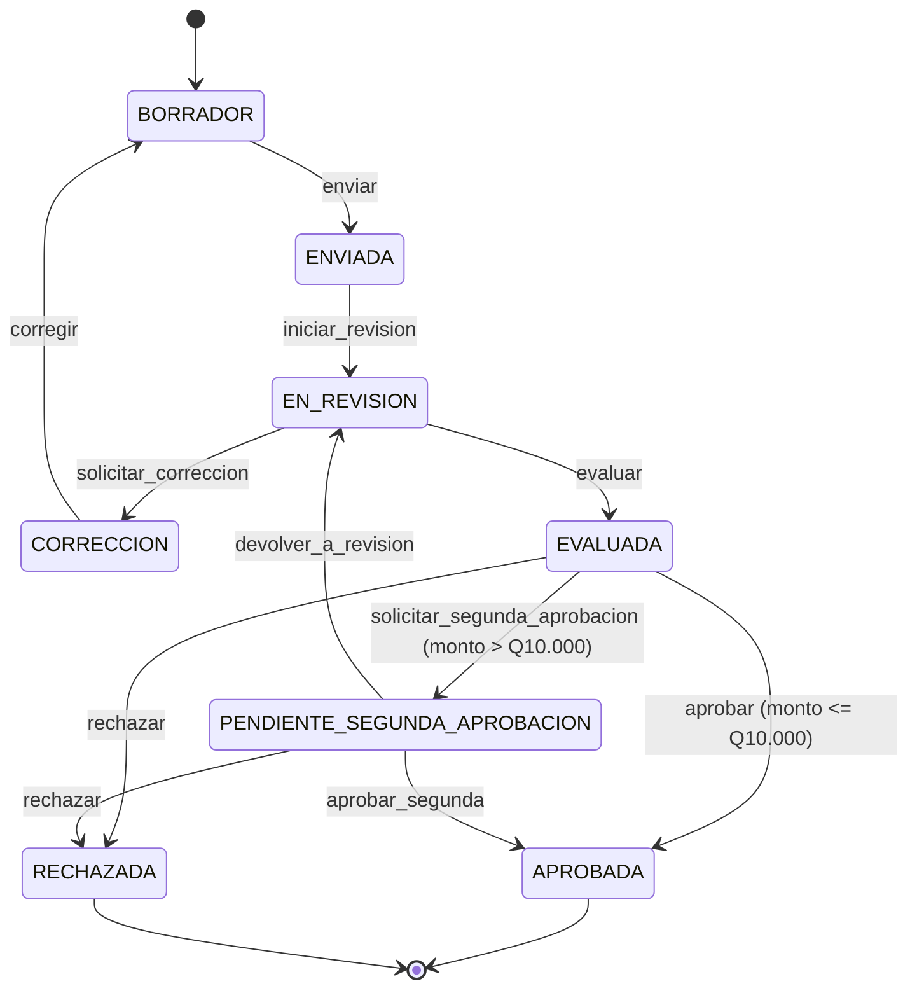

**Nota:** la acción `aprobar` se remapea automáticamente a `solicitar_segunda_aprobacion` cuando `montoOtorgable > UMBRAL_SEGUNDA_APROBACION_GTQ (10000)` (`common/constants/roles.ts:28`).

## 5. Segunda aprobación

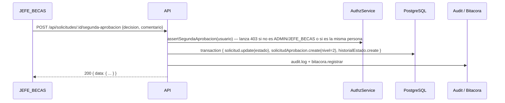

## 6. Eliminación de cuenta

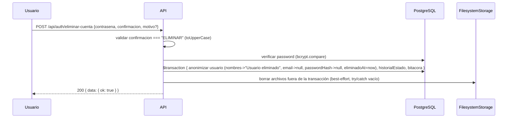

## 7. Cadena de permisos (Chain of Responsibility)

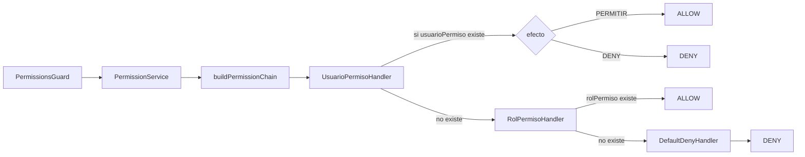

**Fail-closed:** `PermissionsGuard` con `@Permisos([])` deniega (no relaja). Orden global: `JwtAuthGuard → RolesGuard → PermissionsGuard`.

## 8. Asistente IA — flujo real (2 modos excluyentes)

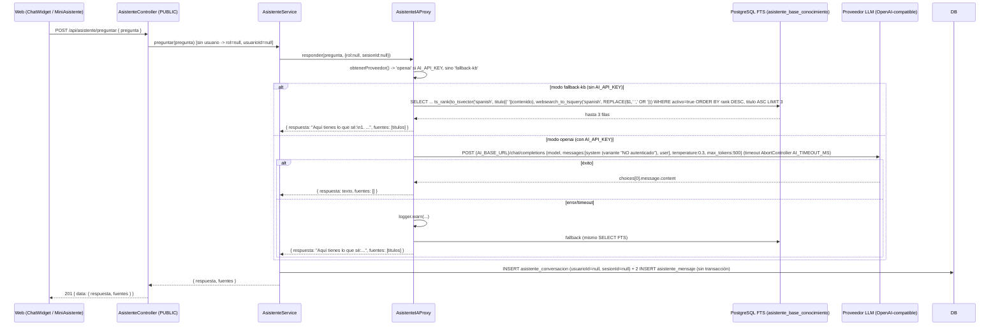

**⚠️ Esto NO es RAG:** no hay embeddings, vector store, chunking ni re-ranking. El LLM nunca recibe el contexto recuperado de la KB. `fuentes` solo se llena en modo fallback.

**⚠️ Bug documentado:** el controller es `@Public()` sin `@CurrentUser()` → `rol` siempre `null` y `usuarioId` siempre `null`. La "respuesta acotada por rol y sesión" del README no está operativa.

## 9. API ↔ Web con reverse-proxy

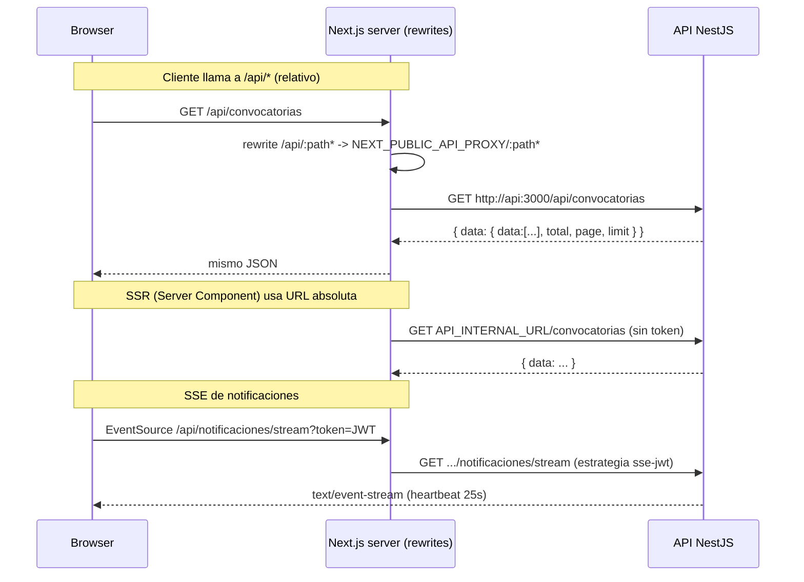

## 10. Transacción de transición de estado

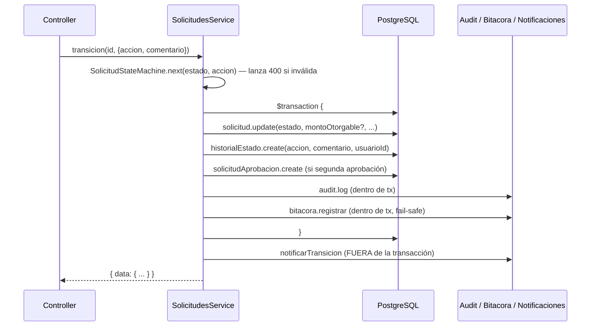

## 11. SSE de notificaciones

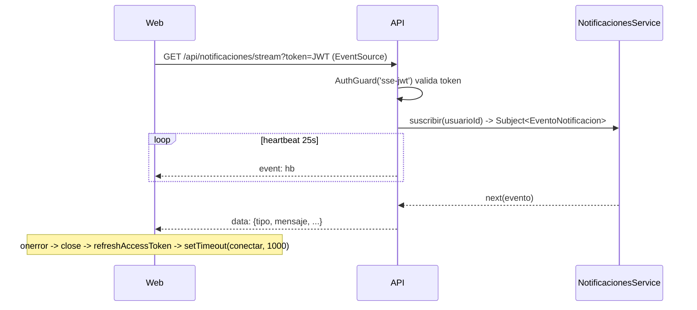

## 12. Subida y descarga segura de documentos

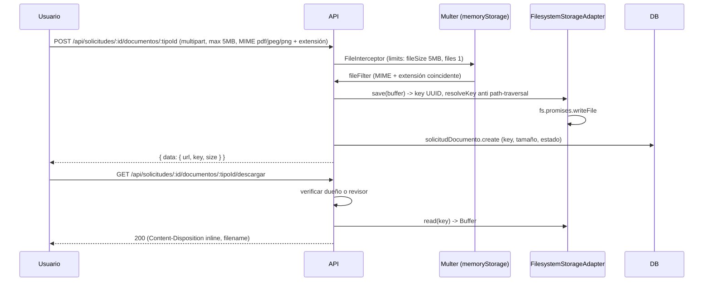

## 13. Despliegue en VM (PM2 vigente + Docker Compose alternativa)

### 13.1 PM2 (vigente — job `deploy-staging`)

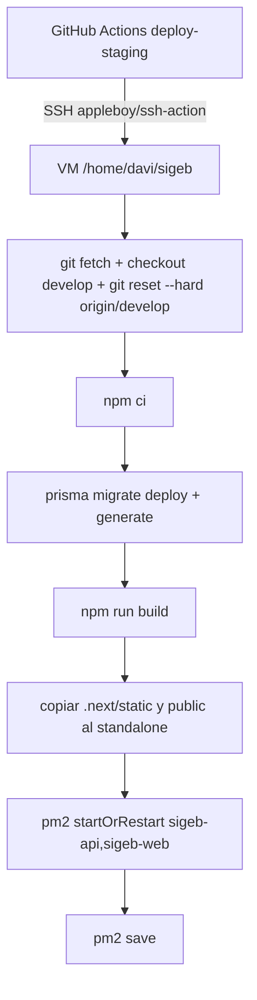

**Nombres reales:** `sigeb-api`, `sigeb-web`, `/home/davi/sigeb`, `sigeb.pm2.config.cjs`. Repo canónico: `https://github.com/Deividcodv/proyecto-analisis-Eduviagt.git` (fallback `sigeb-prod.git`).

### 13.2 Docker Compose (alternativa / dev)

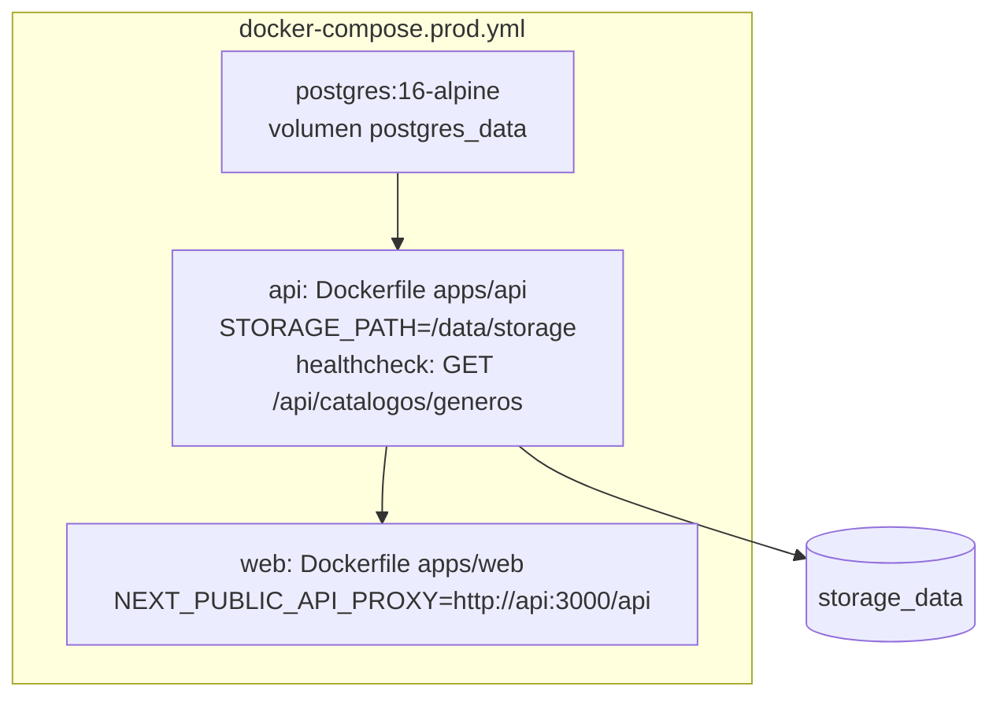

## 14. Pipeline CI (6 jobs)

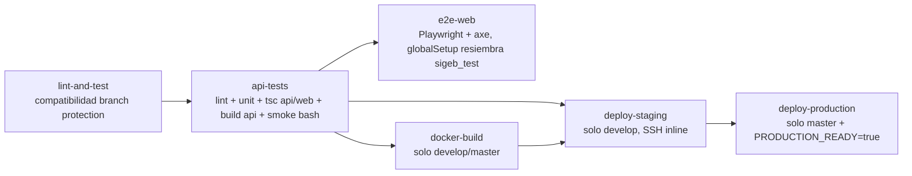

## 15. Estructura de carpetas del backend (real)

```mermaid
graph TB
  SRC[apps/api/src/] --> APP[app.module.ts]
  SRC --> AUTH[auth/]
  SRC --> USERS[users/ — Fachada de seguridad]
  SRC --> CAT[catalogos/]
  SRC --> CONV[convocatorias/ + state-machine]
  SRC --> SOL[solicitudes/ + state-machine + pdf/]
  SRC --> EVAL[evaluaciones/]
  SRC --> COM[comites/]
  SRC --> SES[sesiones/]
  SRC --> REP[reportes/]
  SRC --> ASI[asistente/ — proxy + providers + types]
  SRC --> AUD[audit/]
  SRC --> BIT[bitacora/]
  SRC --> NOT[notificaciones/ + SSE]
  SRC --> STO[storage/ — adapter FS]
  SRC --> PRI[prisma/ — PrismaService]
  SRC --> COMN[common/ — guards, decorators, interceptors, filters]
```

## 16. Modelo de datos (36 entidades)

Entidades por dominio:
- **Auth/Seguridad:** Usuario, Rol, Permiso, RolPermiso, UsuarioPermiso, ConfiguracionUsuario, UsuarioEliminado (anonimización)
- **Catálogos:** Genero, NivelAcademico, Departamento, Municipio, InstitucionEducativa, DocumentoTipo, Beca, CriterioEvaluacion
- **Convocatorias:** Convocatoria, ConvocatoriaDocumentoRequerido, ConvocatoriaReglaMonto
- **Solicitudes:** Solicitud, SolicitudPerfilAcademico, SolicitudPerfilFinanciero, SolicitudDocumento, SolicitudRespuesta, SolicitudAprobacion, HistorialEstado
- **Evaluación:** Evaluacion, EvaluacionCriterio
- **Comités:** Comite, ComiteMiembro, Sesion, SesionAgenda, Voto, Decision
- **Auditoría/Bitácora:** AuditLog, BitacoraSistema, Notificacion
- **Asistente:** AsistenteBaseConocimiento (33 filas), AsistenteConversacion, AsistenteMensaje

Enums (6, coinciden con `schema.prisma`): `ConvocatoriaEstado`, `SolicitudEstado`, `SesionEstado`, `DecisionResultado`, `DocumentoEstado`, `TipoReglaMonto`.

## 17. Machine de estados de convocatoria

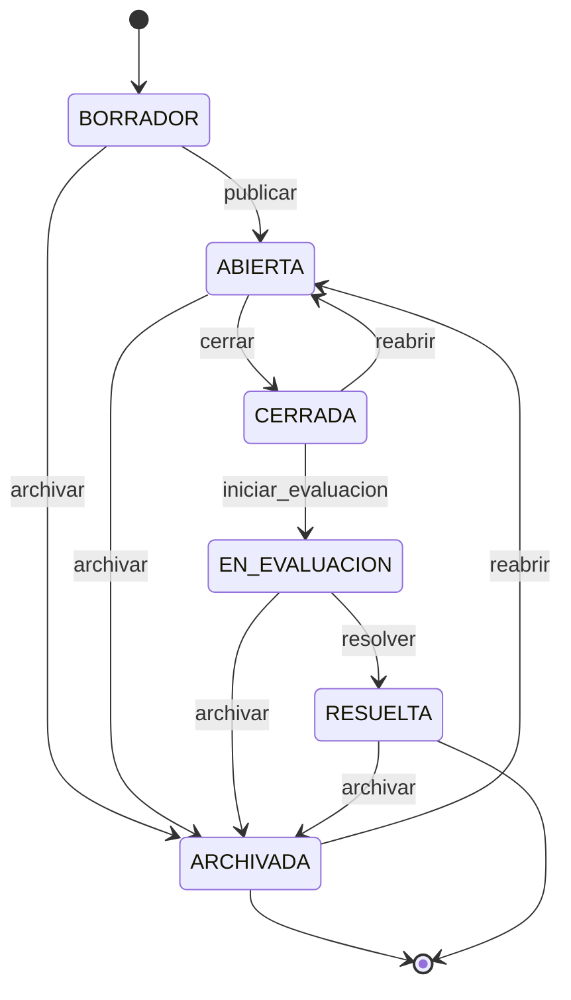

---

## 18. Filtrado de convocatorias públicas (server-side)

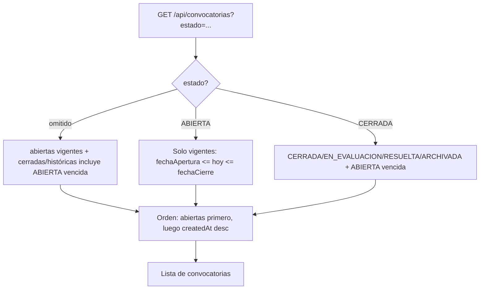

## 19. Cadena de datos de demostración

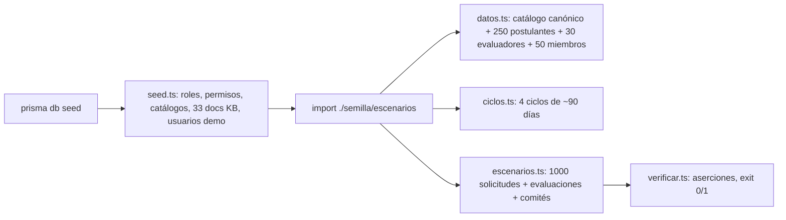

## Referencias

- `docs/architecture/ARQUITECTURA-REAL.md`
- `docs/architecture/asistente-ia.md`
- `docs/architecture/frontend.md`
- `docs/architecture/api-web-contrato.md`
- `docs/architecture/design-patterns.md`
- `docs/architecture/decisions.md`
- `docs/architecture/database-schema.md`
- `docs/architecture/ARQUITECTURA_TECNICA_DETALLADA_SIGEB_v1.1.md`