# Diagramas — EDUVIAGT

> Diagramas Mermaid de arquitectura, despliegue y flujos. Última actualización: Sprint 8.

---

## Arquitectura general (Monolito Modular)

```mermaid
flowchart TB
    subgraph Web["Frontend — apps/web (Next.js)"]
        UI[Páginas públicas, panel postulante, panel administrativo]
        Eduvi[Asistente Eduvi (chat flotante + soporte)]
    end

    subgraph Api["Backend — apps/api (NestJS)"]
        MW[Guards: throttling → JWT → autorización (Chain of Responsibility)]
        CTRL[Controladores REST — un router por dominio]
        SVC[Servicios de dominio — reglas de negocio + patrones]
        REPO[Repositorios — interfaz + implementación Prisma]
        MW --> CTRL --> SVC --> REPO

        subgraph Transversales["Servicios transversales"]
            AUTHZ[AuthzService (roles y permisos)]
            BITACORA[BitacoraService (Sprint 8)]
            NOTIF[NotificacionesService]
            STORAGE[DocumentStorage (Adapter)]
            PDF[PdfRenderer (Adapter)]
            IA[AsistenteIAProxy (Proxy + Strategy)]
        end
    end

    DB[(PostgreSQL — 31 entidades)]

    UI -->|fetch + Bearer token| MW
    Eduvi -->|POST /asistente/preguntar| MW
    REPO --> DB
    SVC --> TRANSVERSALES
```

---

## Despliegue (PM2 + nginx)

```mermaid
flowchart LR
    subgraph Internet
        U[Usuario / Navegador]
    end

    subgraph VM["VM Azure (Ubuntu)"]
        NGINX[nginx :3001]
        WEB[Next.js :3002]
        API[NestJS :3000]
        PG[(PostgreSQL :5432)]
        STORAGE2[/storage/ (documentos)/]
    end

    U -->|HTTPS (futuro)| NGINX
    NGINX --> WEB
    WEB -->|fetch /api| API
    API --> PG
    API --> STORAGE2
```

---

## Flujo de autenticación

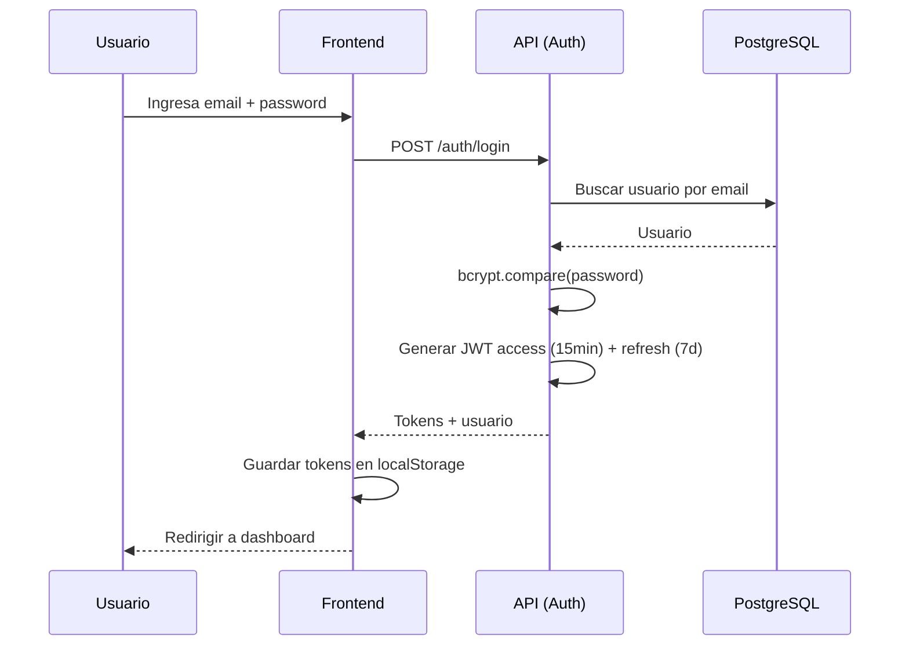

---

## Flujo de solicitud (ciclo de vida — Sprint 8)

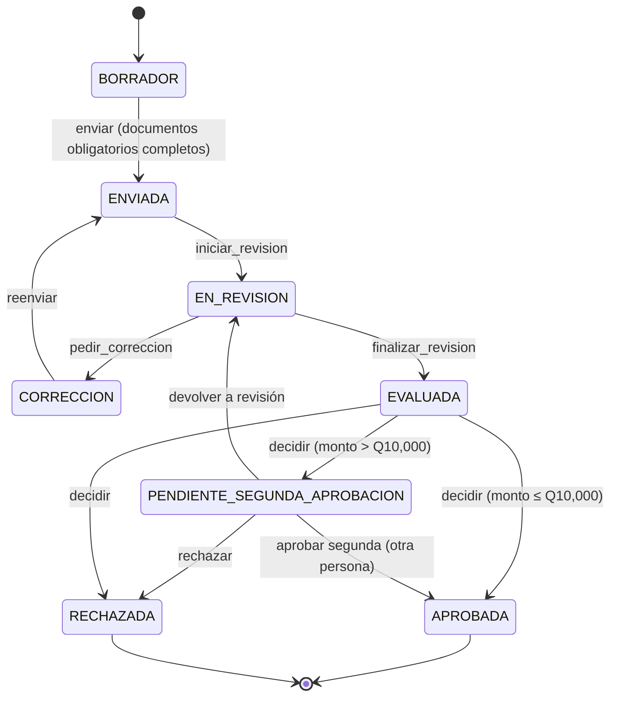

---

## Flujo de convocatoria

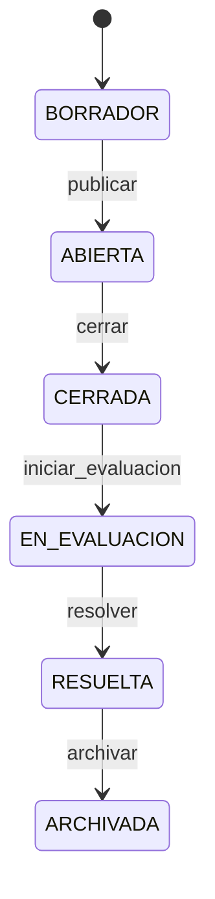

---

## Cadena de permisos (Chain of Responsibility)

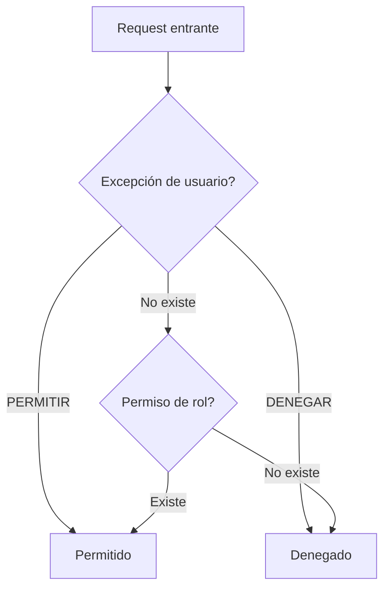

---

## Segunda aprobación (Sprint 8 — US-802)

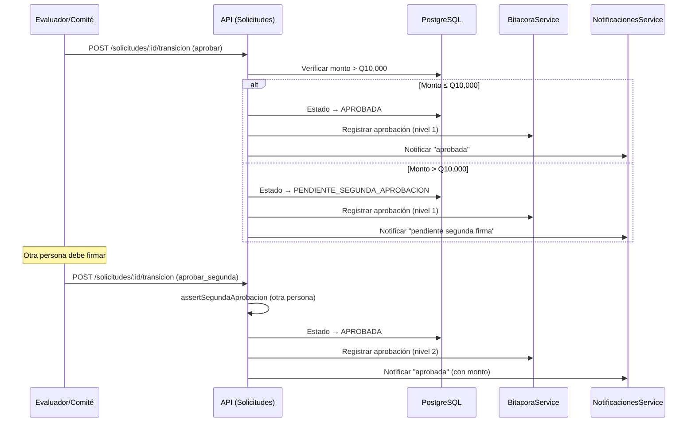

---

## Montos flexibles (Sprint 8 — US-801)

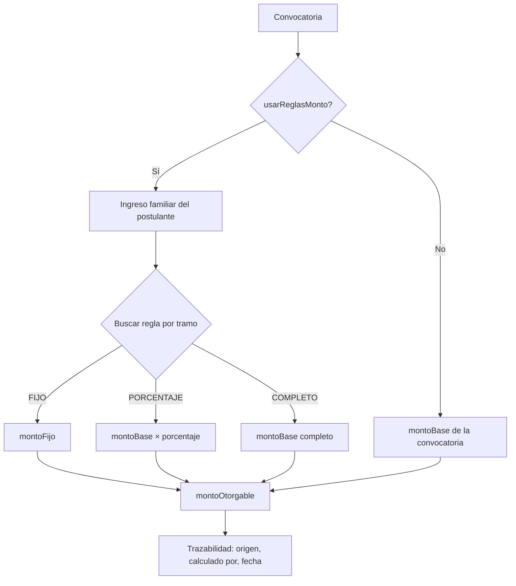

---

## Eliminación de cuenta (Sprint 8)

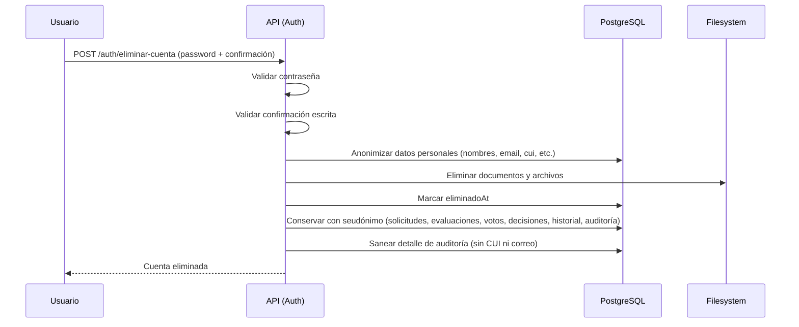

---

## Modelo de datos (seguridad)

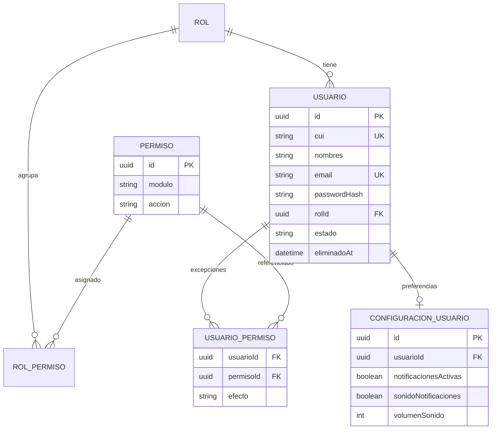

---

## Modelo de datos (becas + convocatorias + solicitudes)

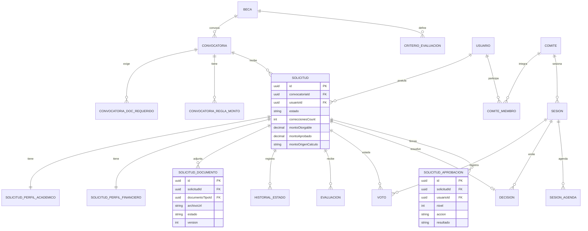

---

## Bitácora del sistema (Sprint 8)

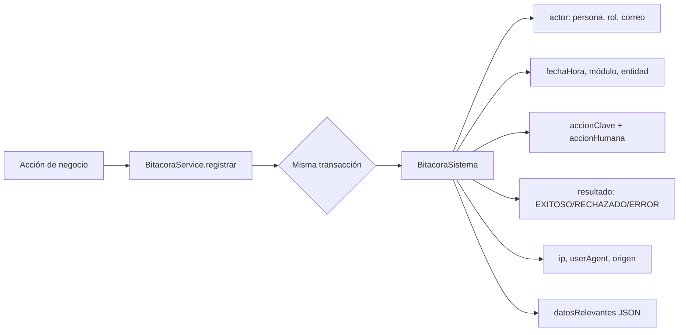

---

## Estructura de carpetas backend

```mermaid
flowchart TB
    subgraph Backend["apps/api/src/"]
        M[main.ts]
        AM[app.module.ts]
        C[common/ — guards, decoradores, interceptors, authz]
        AUTH[auth/ — registro, login, refresh, perfil, eliminar-cuenta]
        SEG[seguridad/ — roles, permisos, excepciones (matriz)]
        CAT[catalogos/ — género, nivel, depto, municipio, instituciones]
        BEC[becas/ — catálogo y criterios]
        CONV[convocatorias/ — CRUD + estados + montos + documentos]
        SOL[solicitudes/ — solicitud + perfiles + docs + estados + montos]
        DOC[documentos/ — tipos + storage adapter]
        EVA[evaluaciones/ — asignación, puntajes]
        COM[comites/ — comités, sesiones, votos, quórum]
        DEC[decisiones/ — aprobación/rechazo]
        REP[reportes/ — agregaciones + CSV]
        ASI[asistente/ — proxy IA + base conocimiento + Eduvi]
        AUD[auditoria/ — log de acciones sensibles]
        BIT[bitacora/ — bitácora inmutable (Sprint 8)]
        NOT[notificaciones/ — notificaciones + preferencias (Sprint 8)]
        STR[storage/ — adapter de documentos (Adapter)]
        PRIS[prisma/ — servicio conexión (Singleton)]
        SAL[salud/ — health check]
    end

    M --> AM
    AM --> AUTH
    AM --> SEG
    AM --> CAT
    AM --> BEC
    AM --> CONV
    AM --> SOL
    AM --> DOC
    AM --> EVA
    AM --> COM
    AM --> DEC
    AM --> REP
    AM --> ASI
    AM --> AUD
    AM --> BIT
    AM --> NOT
```

---

## Flujo de descarga segura de documentos (Sprint 8)

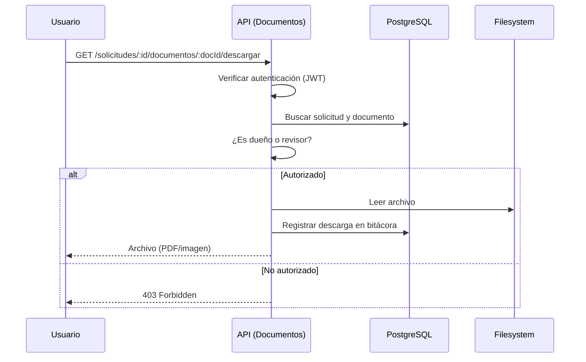

---

## Asistente Eduvi — flujo de pregunta

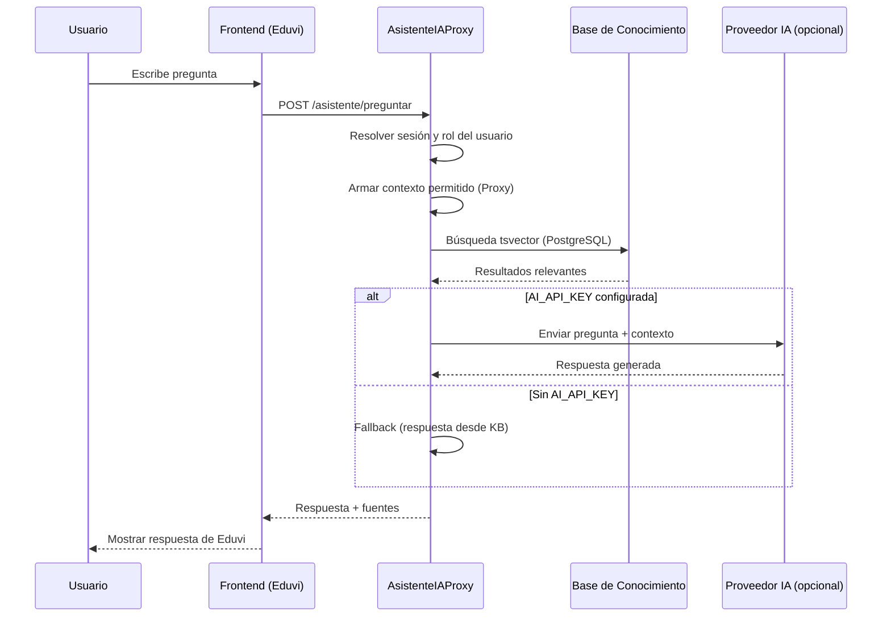

---

*Última actualización: Sprint 8 (2026-10-23)*