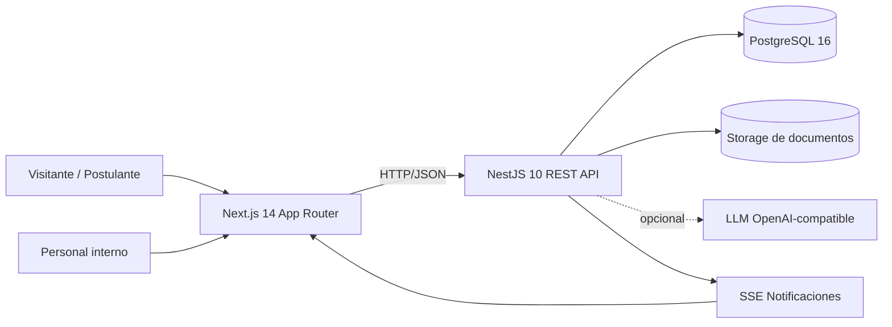
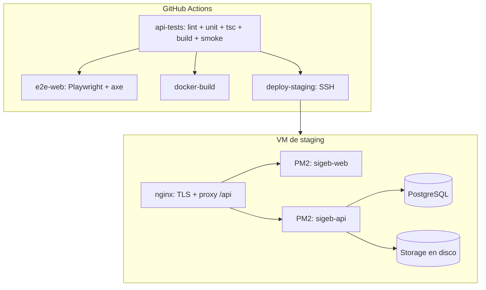
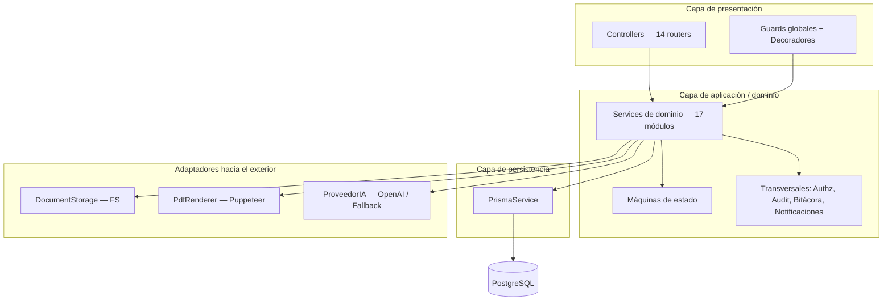
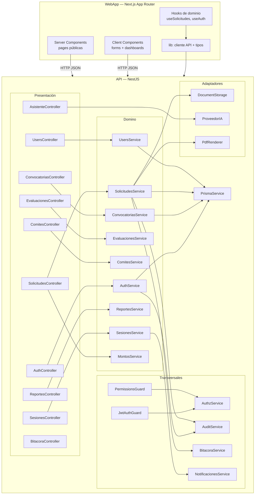
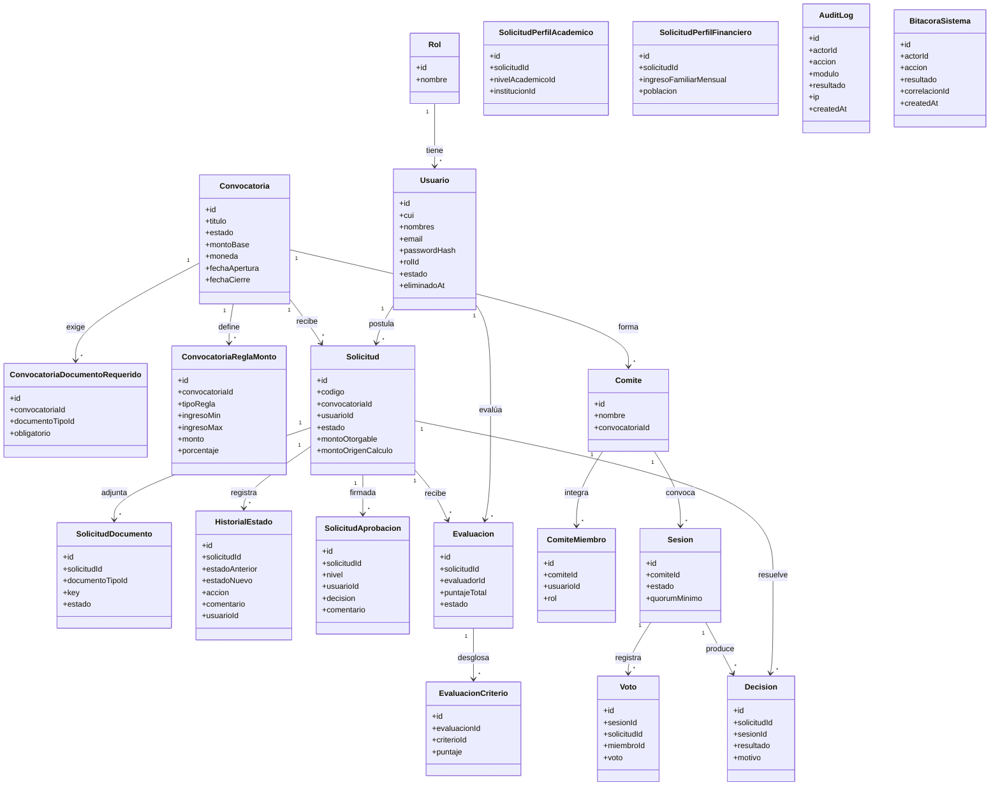
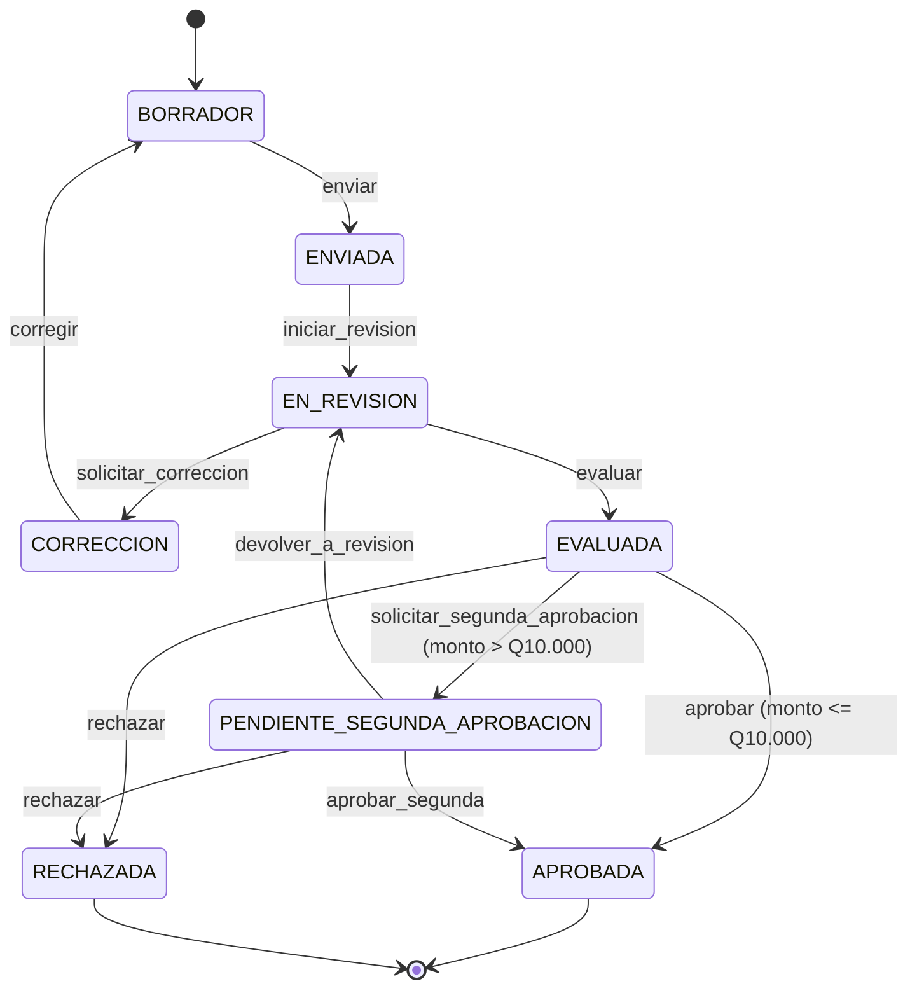
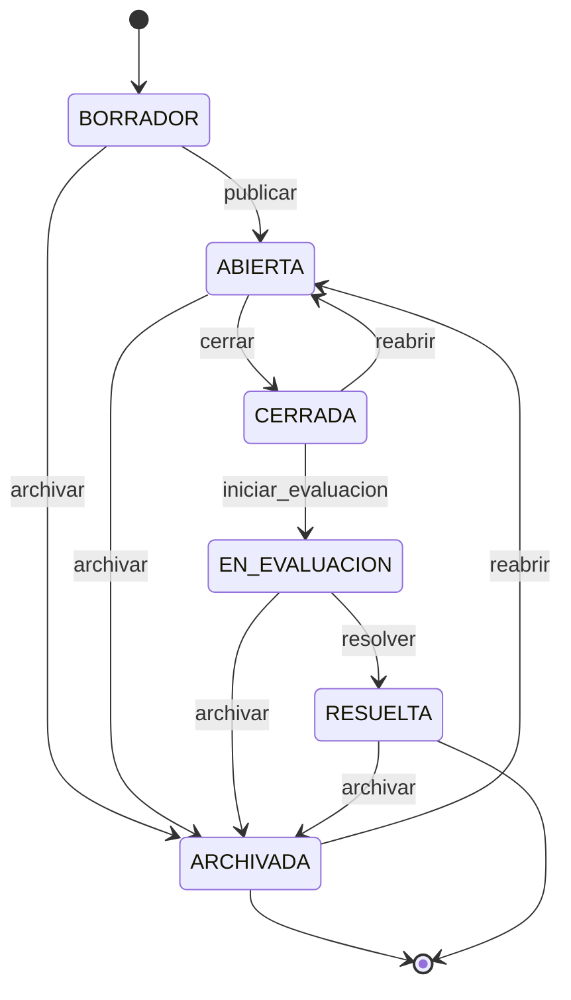

# Documento de Arquitectura de Software

> **Proyecto:** EDUVIAGT — Sistema Integral de Gestión de Becas
> **Curso:** 0910-037 · Análisis de Sistemas II · 8.º Ciclo
> **Arquitectos / equipo de diseño:** Chiroy Vásquez, Luis David (responsable) ·
> Lemus Meléndrez, Marcos Estuardo · Hernández González, Héctor Enrique ·
> Hernández García, José Manuel · Par Guerra, Yermerson Geovanny ·
> Guzmán Hernández, Hamilton Estuardo
> **Versión:** 1.0 · **Fecha de creación:** 2026-08-26 · **Última revisión:** 2026-10-28
> **Base:** Anexo 5 §2 y §3 del documento del proyecto final

> **Regla de oro de este documento:** si una afirmación aquí contradice el código, **el código manda** y este
> documento debe corregirse. Las referencias usan el formato `ruta/archivo.ts:línea`.

---

## 1. Resumen ejecutivo

EDUVIAGT es una **aplicación web monolítica modular por capas**, desplegada como dos procesos independientes
(API REST en NestJS + interfaz en Next.js) dentro de un monorepo con Turborepo, sobre PostgreSQL 16.

| Decisión | Valor |
|---|---|
| **Estilo arquitectónico** | Monolito modular por capas (MVC en el backend, App Router + Server/Client Components en el frontend) |
| **Estilo de comunicación** | REST/JSON sobre HTTP, prefijo global `/api` |
| **Persistencia** | Prisma 5 → PostgreSQL 16 (36 entidades) |
| **Autorización** | Chain of Responsibility *fail-closed* (usuario → rol → denegar) |
| **Almacenamiento de documentos** | Sistema de archivos local detrás de la interfaz `DocumentStorage` (patrón Adapter) |
| **Despliegue** | GitHub Actions → SSH → PM2 + nginx (vigente); Docker Compose como alternativa |
| **Patrones implementados** | 2 creacionales, 3 estructurales, 3 de comportamiento (mínimo exigido: 2/2/2) |

**Justificación resumida:** el problema de negocio es un flujo de trabajo lineal con reglas de estado complejas
y fuerte necesidad de trazabilidad, no un problema de escala/distribución. Un monolito modular con módulos de
dominio bien separados, DI por token e interfaces explícitas para los puntos de entrada al mundo externo
(archivos, PDF, IA) ofrece **bajo acoplamiento sin el costo operativo de los microservicios**, y permite
trabajar en paralelo sobre módulos distintos dentro del mismo sprint.

La justificación completa contra los criterios exigidos (mantenibilidad, escalabilidad, bajo acoplamiento,
reutilización, facilidad de cambio, complejidad) está en
[05-justificacion-arquitectura.md](05-justificacion-arquitectura.md).

---

## 2. Contexto del sistema

### 2.1 Actores

| Actor | Tipo | Interfaz principal |
|---|---|---|
| Visitante | Externo, no autenticado | Portal público, consulta de estado, asistente Eduvi |
| Postulante | Externo, autenticado | Dashboard, formulario multi-paso, carga de documentos |
| Evaluador | Interno | Bandeja de evaluaciones, puntuación por criterio |
| Miembro de comité | Interno | Votación en sesiones |
| Coordinador de comité | Interno | Comités, sesiones, cierre con quórum |
| Jefe de becas | Interno | Segunda aprobación de montos > Q10,000 |
| Administrador | Interno | Convocatorias, montos, matriz de seguridad, reportes, auditoría |

### 2.2 Restricciones

| # | Restricción | Impacto arquitectónico |
|---|---|---|
| R-1 | El MINEDUC opera en entorno institucional con servidor propio y base de datos local | Se evita el multi-tenant en la nube; el despliegue es auto-contenido (PM2 + Docker Compose) |
| R-2 | El volumen inicial es de ~1,000 solicitudes y 51 convocatorias por ciclo | No se justifica un modelo distribuido ni particionado |
| R-3 | Se deben manejar datos personales sensibles (CUI, ingresos familiares, documentos) | Requisito de anonimización, bitácora append-only y validación estricta de ficheros |
| R-4 | El producto debe evolucionar cada sprint con cambios del Product Owner | Se prioriza la modularidad y el bajo acoplamiento sobre el rendimiento máximo |
| R-5 | El equipo tiene 6 personas y 2 semanas por sprint | Se favorece el despliegue continuo de un solo artefacto frente a orquestación compleja |
| R-6 | Requisito del curso: justificar técnicamente toda decisión | Cada decisión estructural tiene ADR y justificación escrita |

---

## 3. Vista de contexto y de despliegue

### 3.1 Contexto del sistema

### 3.2 Topología de despliegue

**Detalle completo en** [`docs/architecture/diagrams.md`](../architecture/diagrams.md) §13 y §14.

---

## 4. Estilo arquitectónico y estructura

### 4.1 Monolito modular por capas

El backend se organiza en **capas** (presentación → aplicación/dominio → persistencia) y, dentro del dominio, en
**módulos de negocio** con frontera explícita. La comunicación entre módulos es por inyección de dependencias
y llamadas directas a servicio; **no existe bus de eventos** (decisión documentada como deuda técnica).

### 4.2 Módulos del backend (17)

| # | Módulo | Responsabilidad | Services principales |
|---|---|---|---|
| 1 | `app.module.ts` | Composición raíz | — |
| 2 | `prisma/` | Conexión a la base de datos | `PrismaService` |
| 3 | `common/` | Guards, decoradores, interceptores, filtros, servicios transversales | `AuthzService`, `PermissionService` |
| 4 | `storage/` | Almacenamiento de documentos | `FilesystemStorageAdapter` |
| 5 | `auth/` | Registro, login, refresh, perfil, eliminación de cuenta | `AuthService`, `EliminarCuentaService`, `LoginAttemptService` |
| 6 | `users/` | Roles, permisos, excepciones por usuario, configuración | `UsersService` (fachada), `RolesService`, `PermisosService`, `UsuariosService` |
| 7 | `catalogos/` | Género, nivel académico, departamento, municipio, instituciones, tipos de documento | `CatalogosService` |
| 8 | `convocatorias/` | CRUD, máquina de estados, documentos requeridos, reglas de monto | `ConvocatoriasService` |
| 9 | `solicitudes/` | Solicitud, perfiles, documentos, estados, montos, constancia PDF | `SolicitudesService`, `MontosService`, `SolicitudChecklistService`, `ConstanciasService` |
| 10 | `evaluaciones/` | Asignación, puntajes, score ponderado | `EvaluacionesService` |
| 11 | `comites/` | Comités y miembros | `ComitesService` |
| 12 | `sesiones/` | Sesiones, votos, quórum, decisiones | `SesionesService` |
| 13 | `reportes/` | Agregaciones y exportación CSV | `ReportesService` |
| 14 | `notificaciones/` | Notificaciones, preferencias de sonido, SSE | `NotificacionesService` |
| 15 | `audit/` | Auditoría de acciones | `AuditService` |
| 16 | `bitacora/` | Bitácora inmutable del sistema | `BitacoraService` |
| 17 | `asistente/` | Proxy de IA + base de conocimiento (FTS) | `AsistenteService`, `AsistenteIAProxy` |

Detalle verificado archivo por archivo en
[`docs/architecture/ARQUITECTURA-REAL.md`](../architecture/ARQUITECTURA-REAL.md) §2.

### 4.3 Frontend

Next.js 14 con **App Router**, Tailwind CSS y un design system propio. Las 25 rutas de `apps/web/src/app/`
se organizan en tres capas:

| Capa | Rutas | Restricción de sesión |
|---|---|---|
| **Portal público** | `/`, `/convocatorias`, `/convocatorias/[id]`, `/consulta`, `/nosotros`, `/faq`, `/requisitos`, `/transparencia`, `/contacto`, `/ayuda`, `/soporte`, `/privacidad`, `/terminos`, `/cookies` | Público; algunas SSR sin token |
| **Autenticado** | `/login`, `/registro`, `/perfil`, `/dashboard`, `/solicitudes`, `/solicitudes/nueva`, `/revision`, `/evaluador`, `/comite`, `/coordinador`, `/reportes`, `/auditoria`, `/admin` | Requiere JWT (access + refresh) |
| **API** | `/api/*` | Proxy por rewrite a `NEXT_PUBLIC_API_PROXY` |

Detalle en [`docs/architecture/frontend.md`](../architecture/frontend.md).

---

## 5. Componentes del sistema (diagrama de componentes)

### 5.1 Contrato entre componentes

| Interfaz | Forma | Evidencia |
|---|---|---|
| WebApp ↔ API | REST/JSON, prefijo `/api`, envelope `{ data }` | [`docs/architecture/api-web-contrato.md`](../architecture/api-web-contrato.md) |
| API ↔ PostgreSQL | Prisma Client, 36 modelos | [`docs/architecture/database-schema.md`](../architecture/database-schema.md) |
| API ↔ almacenamiento | Interfaz `DocumentStorage` (token `DOCUMENT_STORAGE`) | `apps/api/src/storage/storage.interface.ts:7` |
| API ↔ PDF | Interfaz `PdfRenderer` (token `PDF_RENDERER`) | `apps/api/src/solicitudes/pdf/pdf-renderer.interface.ts:8` |
| API ↔ IA | Interfaz `ProveedorIA` | `apps/api/src/asistente/asistente.types.ts:11` |
| WebApp ↔ API (SSE) | Server-Sent Events con token en query string | `apps/api/src/notificaciones/notificaciones.controller.ts` |

---

## 6. Modelo de dominio

### 6.1 Diagrama de clases (dominio principal)

> El diagrama muestra **el dominio principal**, no las 36 entidades. Las tablas de unión (`RolPermiso`,
> `UsuarioPermiso`, `SesionAgenda`, `Notificacion`, `AsistenteConversacion`, `AsistenteMensaje`,
> `AsistenteBaseConocimiento`, `ConfiguracionUsuario`) y los catálogos se detallan en
> [`docs/architecture/database-schema.md`](../architecture/database-schema.md).

### 6.2 Máquina de estados de la solicitud

**Regla de reescritura de la acción `aprobar`:** cuando `montoOtorgable > UMBRAL_SEGUNDA_APROBACION_GTQ (10000)`,
el servicio remapea automáticamente `aprobar` → `solicitar_segunda_aprobacion`, de modo que la separación de
poderes no depende de que el usuario recuerde invocarla.
Implementación: `apps/api/src/solicitudes/solicitud-state-machine.ts:26-47`.

### 6.3 Máquina de estados de la convocatoria

Implementación: `apps/api/src/convocatorias/convocatoria-state-machine.ts:19-53`.

---

## 7. Decisiones arquitectónicas (resumen de ADR)

El proyecto mantiene **22 Architecture Decision Records** en
[`docs/architecture/decisions.md`](../architecture/decisions.md). Las decisiones estructurales más relevantes:

| ADR | Decisión | Estado | Impacto |
|---|---|---|---|
| ADR-001 | NestJS como backend | Aceptado | Habilita DI nativa y módulos, base de los patrones Adapter/Proxy/State |
| ADR-002 | Next.js (App Router) como frontend | Aceptado | SSR para el portal público, separación Server/Client Components |
| ADR-003 | Prisma como ORM | Aceptado | Consultas parametrizadas por defecto (defensa ante SQL injection) y tipos derivados del esquema |
| ADR-004 | Monolito modular, no microservicios | Aceptado | Un solo despliegue; acoplamiento bajo mediante DIP |
| ADR-005 | PostgreSQL como base de datos | Aceptado | Integridad referencial, JSONB, FTS para el asistente |
| ADR-006 | JWT access/refresh | Aceptado | Stateless, secretos separados |
| ADR-007 | Filesystem local para documentos (Adapter) | Aceptado | Desacopla el almacenamiento; permite migrar a S3 sin tocar el dominio |
| ADR-012 | Segunda aprobación por monto | Aceptado | Separación de poderes para montos > Q10,000 |
| ADR-013 | Montos flexibles por tramos de ingreso | Aceptado | Politica configurable por convocatoria |
| ADR-014 | Bitácora inmutable | Aceptado | Trazabilidad append-only de toda acción sensible |
| ADR-015 | Eliminación de cuenta con anonimización | Aceptado | Derecho al olvido sin romper la trazabilidad |
| ADR-016 | Accesibilidad WCAG 2.2 AA | Aceptado | Criterio transversal de calidad de la UI |
| ADR-019 | Asistente: FTS + LLM opcional, sin RAG | Aceptado | Evita la dependencia de embeddings y vector store |
| ADR-020 | Envelope `{ data }` y error normalizado | Aceptado | Contrato uniforme para el frontend |
| ADR-021 | Despliegue en VM con PM2 | Aceptado | Costo operativo mínimo; Docker Compose como alternativa |
| ADR-022 | Rate limiting de login en memoria | Aceptado | Mitiga fuerza bruta; deuda técnica: no escala horizontalmente |

---

## 8. Atributos de calidad y cómo los soporta la arquitectura

| Atributo | Mecanismo arquitectónico | Evidencia |
|---|---|---|
| **Mantenibilidad** | Módulos por dominio, DI por token, servicios con responsabilidad única, 10+ ejemplos de SRP | [`docs/architecture/solid-principles.md`](../architecture/solid-principles.md) |
| **Trazabilidad / auditabilidad** | Cuatro registros independientes: `HistorialEstado`, `AuditLog`, `BitacoraSistema`, `SolicitudAprobacion` | `apps/api/src/bitacora/bitacora.service.ts:141-177` |
| **Seguridad** | Guards globales en orden fijo, autorización *fail-closed*, bcrypt, validación estricta de DTOs, sanitización de ficheros | `apps/api/src/common/guards/permissions.guard.ts` |
| **Extensibilidad** | 4 interfaces de adaptadores + tabla de transiciones como dato | `storage/`, `solicitudes/pdf/`, `asistente/` |
| **Escalabilidad** | Monolito con módulos extraíbles; índices en base de datos; paginación; sin estado en servidor para la lógica de negocio | `docs/architecture/database-schema.md` |
| **Disponibilidad** | Despliegue con PM2 (`startOrRestart`), healthcheck por endpoint público, migración versionada | `docker-compose.prod.yml`, job `deploy-staging` |
| **Usabilidad / accesibilidad** | Design system propio, responsive, WCAG 2.2 AA, mensajes en español comprensible | `docs/pruebas/50-a11y-visual.md` |
| **Testabilidad** | Pruebas unitarias de lógica pura (FSM, montos, cadena de permisos), pruebas de integración con Supertest, E2E con Playwright | `docs/entregables/09-plan-pruebas-agil.md` |

---

## 9. Restricciones y deuda técnica conocidas

La arquitectura es deliberadamente simple en los puntos donde el equipo identificó riesgos. Los siguientes
puntos **están documentados como deuda técnica** y no se presentan como resueltos:

| Deuda | Riesgo | Estado |
|---|---|---|
| Sin capa Repository (Prisma se usa directo en los servicios) | Acoplamiento del dominio al ORM | Documentada — ver `docs/standards/deuda-tecnica.md` |
| Sin bus de eventos (Observer) | Los transversales se invocan por llamada directa; acoplamiento de secuencia | Documentada |
| `RolesGuard` y `@Roles()` sin uso | Código muerto | Documentada |
| Rate limiting solo en memoria | No escala horizontalmente y se pierde al reiniciar | ADR-022 |
| `SOLICITUD_ESTADO` desalineado con la FSM | Riesgo de bug por divergencia de constantes | Documentada |
| Sin endpoint `/health` | El healthcheck consulta `/api/catalogos/generos` | Documentada |
| Circuit breaker sin contador de fallos | Solo existe degradación con timeout | Documentada |
| Sin `Dockerfile` para la base de datos con datos persistentes | El volumen es el mecanismo de persistencia | Documentada |

---

## 10. Referencias

- [Justificación de la Arquitectura](05-justificacion-arquitectura.md) — criterios exigidos por el proyecto
- [Justificación de Patrones de Diseño](06-justificacion-patrones-de-diseno.md) — 6 patrones con las 4 preguntas
- [Documento de Diseño del Sistema](07-documento-diseno.md) — casos de uso, componentes y clases
- [`docs/architecture/ARQUITECTURA-REAL.md`](../architecture/ARQUITECTURA-REAL.md) — inventario verificado del backend
- [`docs/architecture/decisions.md`](../architecture/decisions.md) — 22 ADR
- [`docs/architecture/diagrams.md`](../architecture/diagrams.md) — diagramas Mermaid completos
- [`docs/architecture/database-schema.md`](../architecture/database-schema.md) — esquema de 36 entidades
- [`docs/architecture/api-web-contrato.md`](../architecture/api-web-contrato.md) — contrato entre capas
- [`docs/architecture/ARQUITECTURA_TECNICA_DETALLADA_SIGEB_v1.1.md`](../architecture/ARQUITECTURA_TECNICA_DETALLADA_SIGEB_v1.1.md) — monorepo, despliegue, JWT, IA

---

*Última actualización: 2026-10-28*
