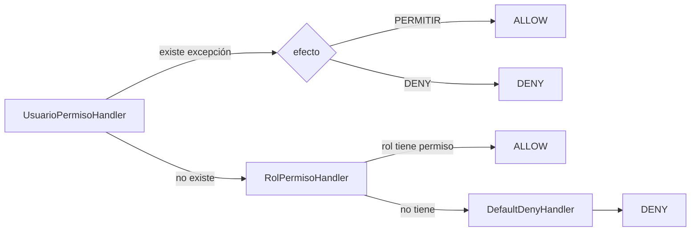

# Justificación de Patrones de Diseño

> **Proyecto:** EDUVIAGT — Sistema Integral de Gestión de Becas
> **Curso:** 0910-037 · Análisis de Sistemas II · 8.º Ciclo
> **Versión:** 1.0 · **Fecha:** 2026-10-28
> **Base:** sección «Patrones de Diseño» del documento del proyecto final
> Documento complementario a [04-documento-arquitectura.md](04-documento-arquitectura.md)

---

## 1. Propósito y alcance

El enunciado del proyecto es explícito:

> *«El objetivo del curso no es utilizar patrones por obligación, el objetivo es resolver problemas de diseño.
> Como mínimo deberá existir evidencia del uso de: 2 patrones creacionales, 2 patrones estructurales,
> 2 patrones de comportamiento.»*

Y exige que **cada patrón** incluya una justificación técnica que responda:

1. ¿Qué problema resuelve?
2. ¿Qué otras alternativas existían?
3. ¿Por qué se seleccionó ese patrón?
4. ¿Qué ventajas aporta al proyecto?

Este documento responde esas cuatro preguntas para **ocho patrones implementados y verificables en el código**
(2 creacionales, 3 estructurales, 3 de comportamiento), por encima del mínimo exigido.

---

## 2. Resumen de cumplimiento

| Categoría | Patrón | Estado | Archivo principal | § |
|---|---|---|---|---|
| **Creacional** | Singleton | Implementado (por DI) | `apps/api/src/prisma/prisma.service.ts` | 3.1 |
| **Creacional** | Factory Method / Provider (DI con tokens) | Implementado | `apps/api/src/common/guards/permission.service.ts`, `storage/storage.module.ts` | 3.2 |
| **Estructural** | Adapter | Implementado (3 adaptadores) | `apps/api/src/storage/filesystem.adapter.ts` | 3.3 |
| **Estructural** | Proxy | Implementado | `apps/api/src/asistente/asistente.proxy.ts` | 3.4 |
| **Estructural** | Decorator | Implementado (4 decoradores) | `apps/api/src/common/decorators/` | 3.5 |
| **Comportamental** | State | Implementado (2 máquinas de estado) | `apps/api/src/solicitudes/solicitud-state-machine.ts` | 3.6 |
| **Comportamental** | Chain of Responsibility | Implementado (*fail-closed*) | `apps/api/src/common/guards/permission-chain.ts` | 3.7 |
| **Comportamental** | Strategy | Implementado | `apps/api/src/asistente/asistente.types.ts` | 3.8 |

**Mínimo exigido: 2 + 2 + 2 = 6. Evidencia entregada: 2 + 3 + 3 = 8.**

### 2.1 Patrones documentados como NO implementados

Por honestidad técnica, el equipo documenta en `docs/architecture/design-patterns.md` §3 los patrones que
**no** existen en el código, aunque la documentación anterior del proyecto los afirmara. No se presentan como
evidencia:

| Patrón | Estado real | Nota |
|---|---|---|
| Observer / Event Bus | **No implementado** | No hay `@nestjs/event-emitter`; los transversales se invocan por llamada directa |
| Builder | **No implementado** | El único `build()` es el `DocumentBuilder` de Swagger |
| Repository | **No implementado** | Prisma se usa directamente en los servicios |
| CQRS | **No implementado** | Sin `@nestjs/cqrs` |
| Cache / Redis | **No implementado** | Sin `cache-manager` |
| Middleware | **No implementado** | Sin `app.use(...)` |
| Adapter S3 | **No implementado** | Solo existe `FilesystemStorageAdapter` |

---

## 3. Patrones implementados — justificación detallada

### 3.1 Creacional — Singleton

**Ubicación:** `apps/api/src/prisma/prisma.service.ts` (13 líneas)

```typescript
@Injectable()
export class PrismaService extends PrismaClient implements OnModuleInit, OnModuleDestroy {
  async onModuleInit()    { await this.$connect(); }
  async onModuleDestroy() { await this.$disconnect(); }
}
```

**¿Qué problema resuelve?**

El pool de conexiones a PostgreSQL es un recurso **caro y no replicable**. Si cada servicio de dominio
instanciara su propio `PrismaClient`, el sistema abriría decenas de pools contra la misma base de datos:
agotamiento del límite `max_connections`, degradation de rendimiento y una fuga de conexiones al reiniciar
el proceso. El patrón Singleton garantiza **una única instancia del pool compartida por toda la aplicación**.

**¿Qué otras alternativas existían?**

| Alternativa | Evaluación |
|---|---|
| Instanciar `PrismaClient` en cada servicio | Descartada: N pools, agotamiento de conexiones, fugas al reinicio |
| Pool externo (PgBouncer) | Descartada para esta escala: infraestructura adicional sin beneficio con ~1,000 registros y un servidor institucional propio |
| Repositorio con conexión por llamada | Descartada: reintroduce el problema original |

**¿Por qué se seleccionó este patrón?**

Porque la unicidad del recurso es una **responsabilidad del contenedor de objetos**, no del código de
aplicación. En NestJS se consigue de forma idiomática: `PrismaModule` es `@Global()` y declara un único
provider `PrismaService`, de modo que el framework se encarga del ciclo de vida (conexión en `onModuleInit`,
desconexión en `onModuleDestroy`). El equipo implementa el patrón **mediante el contenedor de inyección de
dependencias**, y no con el patrón estático clásico `private static instance` + `getInstance()` — decisión
explícitamente documentada, porque la variante estática impediría las pruebas y el apagado ordenado.

**¿Qué ventajas aporta al proyecto?**

- **Rendimiento y estabilidad:** un solo pool, una sola conexión de control.
- **Testabilidad:** las pruebas unitarias inyectan un doble de `PrismaService` sin abrir conexiones reales.
- **Apagado limpio:** `onModuleDestroy` cierra la conexión, evitando conexiones colgadas en el despliegue con PM2.
- **Configuración única:** los parámetros de conexión se resuelven en un único punto (`ConfigService` + `.env`).
- **Simplicidad:** los 17 módulos obtienen la misma instancia sin conocer cómo se crea.

**Verificación:** `apps/api/src/prisma/prisma.module.ts` (módulo `@Global()`) y la ausencia de cualquier
`new PrismaClient()` fuera de este servicio.

---

### 3.2 Creacional — Factory Method / Provider con tokens (Dependency Injection)

**Ubicaciones:**
- `apps/api/src/common/guards/permission.service.ts:8-16` — token `PERMISSION_SERVICE`
- `apps/api/src/storage/storage.module.ts` — token `DOCUMENT_STORAGE`
- `apps/api/src/solicitudes/solicitudes.module.ts` — token `PDF_RENDERER`

```typescript
export const DOCUMENT_STORAGE = 'DOCUMENT_STORAGE';

@Module({
  providers: [
    { provide: DOCUMENT_STORAGE, useClass: FilesystemStorageAdapter },
  ],
  exports: [DOCUMENT_STORAGE],
})
export class StorageModule {}
```

```typescript
@Injectable()
export class SolicitudesService {
  constructor(
    @Inject(DOCUMENT_STORAGE) private readonly storage: DocumentStorage,
    private readonly prisma: PrismaService,
  ) {}
}
```

**¿Qué problema resuelve?**

El sistema tiene **cuatro puntos de salida al mundo externo** (ficheros, PDF, proveedor de IA y resolución de
permisos) y cada uno tiene más de una implementación posible o reglas de construcción no triviales (el
*fallback* de IA se elige en tiempo de ejecución según exista `AI_API_KEY`; la cadena de permisos se compone
de tres eslabones). Sin un mecanismo de fábrica, cada consumidor tendría que **saber cómo se construye** su
dependencia: qué clase instanciar, en qué orden, con qué configuración.

**¿Qué otras alternativas existían?**

| Alternativa | Evaluación |
|---|---|
| `new FilesystemStorageAdapter()` dentro del servicio | Descartada: acopla el dominio a la infraestructura y rompe la sustituibilidad y las pruebas |
| Variable de entorno leída en el constructor | Descartada: la decisión queda dispersa en cada consumidor |
| `if/else` en cada consumidor para elegir implementación | Descartada: duplica la lógica de selección en N lugares |
| Contenedor de IoC externo (Reflex, Autofac) | Descartada: NestJS ya ofrece DI nativa, con ciclo de vida y decoradores integrados |

**¿Por qué se seleccionó este patrón?**

Porque NestJS implementa la inyección de dependencias con el **patrón Factory Method**: el módulo declara el
*factory* (qué clase concreta se instancia) y el token es la clave bajo la que se registra. El consumidor pide
**la abstracción** (`DocumentStorage`) y el contenedor entrega **la implementación** (`FilesystemStorageAdapter`).
Se eligió sobre el `if/else` en el consumidor porque:

1. **La selección ocurre en un solo lugar** (el módulo), de modo que el criterio de decisión es auditable.
2. **El binding puede cambiar sin tocar al consumidor**, que es el requisito del OCP.
3. **El doble de prueba se inyecta sin tocar producción** (basta con registrar otro provider en el módulo de test).
4. **El ciclo de vida lo gestiona el framework**, incluidos los `@Global()` que evitan reimportar módulos.

**¿Qué ventajas aporta al proyecto?**

- **Sustitución de implementación sin refactor del consumidor:** migrar a S3, a otro motor de PDF o a otro
  proveedor de IA es **cambiar una línea en el módulo correspondiente**.
- **Pruebas unitarias aisladas:** los servicios se prueban con dobles de `DocumentStorage`, `PdfRenderer` y
  `PermissionService`; ninguna prueba toca el disco ni la red.
- **Trazabilidad de dependencias:** el binding se lee en un solo archivo por componente.
- **Coexistencia de implementaciones:** el asistente mantiene simultáneamente `OpenAIProveedor` y
  `FallbackProveedor`, y el proxy elige en tiempo de ejecución (ver §3.4 y §3.8).

**Verificación:** los tres tokens y sus providers; ninguna clase de dominio importa una implementación
concreta de almacenamiento, PDF o IA.

---

### 3.3 Estructural — Adapter

**Ubicaciones:**
- `apps/api/src/storage/storage.interface.ts:7` (interfaz) + `apps/api/src/storage/filesystem.adapter.ts`
- `apps/api/src/solicitudes/pdf/pdf-renderer.interface.ts:8` + `puppeteer-pdf-renderer.ts`
- `apps/api/src/asistente/asistente.types.ts:11` + `asistente/providers/*`

```typescript
export interface DocumentStorage {
  save(buffer: Buffer, options: { folder?: string; name?: string; contentType?: string }): Promise<StoredFile>;
  read(key: string): Promise<Buffer>;
  delete(key: string): Promise<void>;
  exists(key: string): Promise<boolean>;
}
```

**¿Qué problema resuelve?**

El dominio tiene que **guardar y recuperar ficheros** (documentos de la postulación, constancias PDF), pero
el mechanism de almacenamiento es un detalle de infraestructura que:
- no debe conocer el dominio (el dominio no debe saber si el fichero vive en disco, en S3 o en una BD);
- puede tener **reglas de seguridad propias** que no son reglas de negocio (normalización de rutas, prevention
  del *path traversal*, generación de UUID, límite de tamaño);
- **cambiará** a lo largo del proyecto (el enunciado anticipa "integración con otras entidades").

Un `Adapter` traduce la interfaz del cliente a la interfaz del proveedor, de modo que ambos pueden cambiar de
forma independiente.

**¿Qué otras alternativas existían?**

| Alternativa | Evaluación |
|---|---|
| Escribir y leer ficheros directamente desde el servicio | Descartada: mezcla negocio con infraestructura, duplica la validación de rutas en 3 servicios y hace imposible migrar a almacenamiento en la nube |
| Guardar los documentos como `bytea` en PostgreSQL | Descartada: infla la base de datos con binarios, complica las copias de seguridad y no aporta nada al dominio |
| Usar un CDN público | Descartada: los documentos contienen datos personales sensibles (CUI, ingresos familiares); no pueden ser públicos |
| Guardar la ruta en la base y que el frontend la consuma directamente | Descartada: expone rutas del servidor y elimina la verificación de propiedad del documento |

**¿Por qué se seleccionó este patrón?**

Porque es la solución canónica a la **inversión de dependencias en la frontera del sistema**: el servicio de
dominio depende de una interfaz mínima (`save`, `read`, `delete`, `exists`) y un adapter concreto traduce
esa interfaz al almacenamiento real. Además, el adapter concentrate las medidas de seguridad propias del
almacenamiento en un único lugar: `FilesystemStorageAdapter` normaliza la clave, genera un `randomUUID()`
como nombre y verifica con `resolveKey()` que la ruta resuelta empiece por la raíz (prevención de
*path traversal*).

**¿Qué ventajas aporta al proyecto?**

- **Seguridad centralizada:** las reglas de manipulación de ficheros viven en un solo archivo, auditable.
- **Portabilidad:** migrar a S3/Azure requiere **implementar la interfaz y cambiar el binding del token**, sin
  tocar `SolicitudesService`, `SolicitudDocumentoService` ni `EliminarCuentaService` (ADR-007).
- **Pruebas:** el doble de `DocumentStorage` permite probar la lógica de solicitud sin tocar el disco.
- **Interoperabilidad en un solo punto:** los tres adaptadores (ficheros, PDF e IA) siguen la misma convención
  —interfaz + token + provider—, por lo que el equipo aplica el mismo criterio mental en los tres casos.

**Verificación:** `storage.interface.ts:7`, `filesystem.adapter.ts`, `pdf-renderer.interface.ts:8`,
`asistente.types.ts:11` y el binding en los respectivos `*.module.ts`.

---

### 3.4 Estructural — Proxy

**Ubicación:** `apps/api/src/asistente/asistente.proxy.ts` (53 líneas)

```typescript
async responder(pregunta: string, contexto: ContextoIA): Promise<RespuestaIA> {
  const nombre = this.obtenerProveedor();       // 'openai' si hay AI_API_KEY, si no 'fallback-kb'
  const proveedor = this.resolver(nombre);
  if (nombre === 'fallback-kb') return proveedor.responder(pregunta, contexto);
  try {
    return await proveedor.responder(pregunta, contexto);
  } catch (e) {
    this.logger.warn(`Proveedor ${nombre} no disponible (${(e as Error).message}), degradando a fallback-kb`);
    return this.fallback.responder(pregunta, contexto);
  }
}
```

**¿Qué problema resuelve?**

El asistente Eduvi depende de un **servicio externo opcional** (un LLM OpenAI-compatible) que puede estar
ausente, lento, sin credenciales o caído. Si el servicio de dominio llamara directamente al proveedor externo,
se cumple una de estas dos cosas: (a) la aplicación no funciona sin credenciales de un tercero, o (b) el
servicio de dominio queda contaminado con lógica de degradación, timeout y logging.

**¿Qué otras alternativas existían?**

| Alternativa | Evaluación |
|---|---|
| Llamada directa al proveedor desde `AsistenteService` | Descartada: acopla el dominio a OpenAI, elimina la degradación y hace que el CI dependa de un tercero |
| `try/catch` en cada consumidor del asistente | Descartada: duplica la política de degradación y no cubre el timeout |
| Circuit Breaker completo con estados y contador de fallos | **Descartada por simplicidad consciente:** el equipo la registró como deuda técnica; el problema actual (indisponibilidad del proveedor) se resuelve con timeout + fallback determinista |
| No tener asistente en absoluto | Descartada: es un requisito de valor para el postulante (orientación sin cuenta) |

**¿Por qué se seleccionó este patrón?**

Porque el Proxy es exactamente la estructura que **encapsula el acceso a un objeto remoto y añade política**
—en este caso, la política de *degradación elegante* y de *timeout*. El proxy:

1. **Decide el proveedor activo** según la configuración (`AI_API_KEY`).
2. **Aplica un timeout** con `AbortController` (`AI_TIMEOUT_MS`, 15 s por defecto).
3. **Captura el fallo** y degrada al `FallbackProveedor` (recuperación léxica con Full Text Search de
   PostgreSQL), de modo que la respuesta llega igual, solo que con otra fuente.
4. **Centraliza el logging** del incidente, que queda como `logger.warn` con el motivo.

Se eligió la **variante simple** (degradación con un único intento, sin reintentos ni estados persistidos)
porque el asistente es una funcionalidad de soporte: es preferible una respuesta aproximada pero inmediata a
un error o a un bloqueo de 15 segundos. El coste asumido —no reintentar— se documenta en
`docs/architecture/design-patterns.md` §2.15.

**¿Qué ventajas aporta al proyecto?**

- **Disponibilidad del producto:** el asistente nunca deja al usuario sin respuesta por un fallo externo.
- **Cero dependencia obligatoria de terceros:** la aplicación funciona al 100 % sin credenciales de IA.
- **Desacoplamiento del dominio:** `AsistenteService` depende del contrato `ProveedorIA`, no de OpenAI.
- **Testabilidad:** en CI se usa siempre el `fallback-kb`, de modo que las pruebas son deterministas y no
  consumen cuota ni requieren red.
- **Observabilidad:** cada degradación deja traza con el nombre del proveedor y el motivo.

**Verificación:** `asistente.proxy.ts:22-52`, `providers/openai.provider.ts` (timeout) y
`providers/fallback.provider.ts` (consulta FTS).

---

### 3.5 Estructural — Decorator

**Ubicación:** `apps/api/src/common/decorators/`
- `public.decorator.ts` — `@Public()`
- `roles.decorator.ts` — `@Roles(...)`
- `permisos.decorator.ts` — `@Permisos(...)`
- `current-user.decorator.ts` — `@CurrentUser()`

```typescript
export const IS_PUBLIC_KEY = 'isPublic';
export const Public = () => SetMetadata(IS_PUBLIC_KEY, true);
```

```typescript
export const Permisos = (...permisos: string[]) => SetMetadata(PERMISOS_KEY, permisos);
```

**¿Qué problema resuelve?**

Cada endpoint REST necesita declarar **metadatos transversales**: si es público, qué roles lo usan, qué
permisos exige y cómo obtener el usuario autenticado. Resolverlo de forma procedural —dentro de cada método
del controller— obligaría a repetir las mismas cuatro comprobaciones en decenas de endpoints, con el riesgo
de que un endpoint olvide una.

**¿Qué otras alternativas existían?**

| Alternativa | Evaluación |
|---|---|
| Comprobaciones imperativas dentro de cada método del controller | Descartada: duplicación masiva, forgetting garantia, y mezcla de lógica de autorización con lógica de negocio |
| Un único guard que leyera una tabla en base de datos por endpoint | Descartada: convertiría cada petición en una consulta extra y perdería la detección estática de errores |
| Middleware global con la configuración de permisos | Descartada: la autorización por endpoint es intrínsecamente distinta del flujo general de la petición; además el proyecto no usa middleware |
| Un guard por permiso (uno por cada permiso del sistema) | Descartada: docenas de clases para un problema que se resuelve con metadatos |

**¿Por qué se seleccionó este patrón?**

Porque el Decorator permite **añadir comportamiento o metadatos a una función sin modificarla**, que es
exactamente la forma natural de expressar estas políticas:

- El decorador **no altera la firma ni el cuerpo del método**: el controller sigue siendo una función de
  negocio legible.
- La **declaración queda junto al endpoint**, de modo que se lee en la misma pantalla: `@Permisos('solicitud:crear')`
  es autoexplicativo.
- El guard genérico se mantiene **en un solo lugar**: añadir un tipo de metadato nuevo (por ejemplo,
  `@Auditable('solicitud')`) no requiere tocar ningún controller.
- Es **declarativo y verificable**: los permisos exigidos se pueden extraer del código por análisis estático,
  lo que alimenta la documentación de la API.

**¿Qué ventajas aporta al proyecto?**

- **Legibilidad y mantenimiento:** la política de acceso de cada endpoint es visible en una línea.
- **Un único punto de enforcement:** `JwtAuthGuard` → `RolesGuard` → `PermissionsGuard`, registrados como
  `APP_GUARD` en `common/common.module.ts:24-35`, con orden de ejecución determinista.
- **Extensibilidad:** añadir `@Public()` a una ruta es una línea; no hay que tocar el guard.
- **Consistencia *fail-closed*:** `PermissionsGuard` con `@Permisos([])` **deniega** en lugar de permitir, de
  modo que el olvido de un permiso nunca abre un acceso por accidente.

**Verificación:** los 4 archivos de `common/decorators/`, el registro de los 3 guards en `common.module.ts:24-35`
y `permissions.guard.ts`.

> **Nota de honestidad técnica:** `@Roles()` y `RolesGuard` están registrados pero **no se usan en ningún
> controller** (código muerto documentado en `docs/architecture/design-patterns.md` §2.6 y §5). El patrón
> Decorator se sustenta sobre `@Public()`, `@Permisos()` y `@CurrentUser()`, que sí tienen uso real.

---

### 3.6 Comportamental — State

**Ubicaciones:**
- `apps/api/src/solicitudes/solicitud-state-machine.ts` (82 líneas) — 8 estados, 10 transiciones
- `apps/api/src/convocatorias/convocatoria-state-machine.ts` — 6 estados, 12 transiciones

```typescript
const TRANSITIONS: Record<SolicitudEstado, Partial<Record<SolicitudTransicion, SolicitudEstado>>> = {
  BORRADOR: { enviar: 'ENVIADA' },
  ENVIADA: { iniciar_revision: 'EN_REVISION' },
  EN_REVISION: { solicitar_correccion: 'CORRECCION', evaluar: 'EVALUADA' },
  CORRECCION: { corregir: 'BORRADOR' },
  EVALUADA: {
    aprobar: 'APROBADA',
    rechazar: 'RECHAZADA',
    solicitar_segunda_aprobacion: 'PENDIENTE_SEGUNDA_APROBACION',
  },
  PENDIENTE_SEGUNDA_APROBACION: {
    aprobar_segunda: 'APROBADA',
    rechazar: 'RECHAZADA',
    devolver_a_revision: 'EN_REVISION',
  },
  APROBADA: {},
  RECHAZADA: {},
};

static next(estadoActual: SolicitudEstado, accion: SolicitudTransicion): SolicitudEstado {
  const destino = TRANSITIONS[estadoActual]?.[accion];
  if (!destino) {
    throw new BadRequestException(`Transición no válida: "${accion}" no se puede realizar desde el estado "${estadoActual}"`);
  }
  return destino;
}
```

**¿Qué problema resuelve?**

El ciclo de vida de una solicitud tiene **reglas de transición estrictas**: no se puede aprobar una solicitud
que no ha sido evaluada, no se puede corregir una solicitud ya evaluada, una solicitud aprobada es terminal.
Codificar esto con `if/else` produce un bloque de condicionales que se entrelaza con la lógica de negocio, y
cada nuevo estado o transición obliga a revisar **todos** los caminos posibles.

**¿Qué otras alternativas existían?**

| Alternativa | Evaluación |
|---|---|
| `if/else` sobre el estado dentro del service | Descartada: lógica entrelazada con el negocio, difícilmente comprobable y frágil frente a cambios |
| Máquina de estados como librería (XState) | Descartada por coste de dependencia: la lógica es una tabla simple y el proyecto no necesita grafos, acciones ni eventos |
| Bandera booleana por etapa (`enRevision`, `evaluada`, `aprobada`) | Descartada: las combinaciones imposibles no se pueden representar, y el estado devient ambiguo |
| Sin máquina de estados, transiciones libres | Descartada por riesgo: permitiría aprobar una solicitud sin evaluación |

**¿Por qué se seleccionó este patrón?**

Porque el patrón State **delimita las transiciones válidas como un dato** y el comportamiento de transición
queda en **un solo punto verificable**. La decisión tiene tres efectos:

1. **La tabla de transiciones ES la especificación.** Es legible por el docente y por un revisor externo sin
   necesidad de leer el service.
2. **Una transición inválida falla de forma explícita y homogeneous**, con un mensaje en español y código HTTP
   400, en lugar de dejar el registro en un estado imposible.
3. **El patrón es agnostic-free**: añadir el estado `PENDIENTE_SEGUNDA_APROBACION` (requisito del Sprint 8)
   fue **editar una tabla**, sin reescribir el flujo de decisión. Ese es el argumento decisivo a favor del
   patrón frente a los condicionales.

Además, cada máquina de estado está **en su propio archivo**, de modo que la FSM de convocatoria y la de
solicitud evolucionan de manera independiente (SRP).

**¿Qué ventajas aporta al proyecto?**

- **Trazabilidad:** cada transición queda registrada en `HistorialEstado` con estado anterior, nuevo, acción,
  comentario y actor.
- **Invariantes garantizados:** el sistema no puede representar estados imposibles; los estados terminales
  (`APROBADA`, `RECHAZADA`) tienen tabla vacía.
- **Testabilidad aislada:** la FSM es lógica pura, sin dependencias de base de datos, por lo que se cubre con
  pruebas unitarias exhaustivas de todas las combinaciones válidas e inválidas.
- **Extensibilidad de bajo coste:** incorporar la segunda aprobación fue una modificación de datos, no de
  lógica.

**Verificación:** `solicitud-state-machine.ts:26-47` (tabla), `:60-82` (`next` e `isAllowed`),
`convocatoria-state-machine.ts:19-53`, y el diagrama en
[`docs/architecture/diagrams.md`](../architecture/diagrams.md) §4 y §17.

---

### 3.7 Comportamental — Chain of Responsibility

**Ubicación:** `apps/api/src/common/guards/permission-chain.ts` (88 líneas)

```typescript
export class PermissionHandler {
  protected next: PermissionHandler | null = null;
  setNext(handler: PermissionHandler): PermissionHandler { this.next = handler; return this; }
  handle(_userId: string, _permisoKey: string): Promise<PermissionDecision> {
    throw new Error('Method not implemented');
  }
  protected async toNext(userId: string, permisoKey: string) {
    if (!this.next) return 'DENY' as PermissionDecision;
    return this.next.handle(userId, permisoKey);
  }
}
```

Cadena montada en `buildPermissionChain()`:



**¿Qué problema resuelve?**

La autorización real del MINEDUC no es «un rol tiene permiso o no tiene permiso», sino una regla de **tres
niveles con precedencia**:

1. El **usuario individual** puede tener una excepción que **concede** o **deniega** un permiso concreto
   (por ejemplo: el Director de Scholarships no puede aprobar su propia solicitud).
2. Si no hay excepción individual, aplica el **permiso del rol**.
3. Si nada aplica, se **deniega**.

Escribir esto con `if/else` anidados en cada endpoint produce cuatro variantes por endpoint, con la
consecuencia previsible de que alguna se implemente con la precedencia equivocada.

**¿Qué otras alternativas existían?**

| Alternativa | Evaluación |
|---|---|
| `if (rol === 'ADMIN' \|\| ...) ` por endpoint | Descartada: N copias de la misma lógica, con divergencia garantizada |
| RBAC puro (solo rol) | **Insuficiente:** no permite la excepción individual, que es un requisito real de la Sprint 8 (ADR-011) |
| Un servicio de permisos con un `switch` grande | Descartada: mezcla las reglas en un solo método; añadir una regla exige revisar todo el `switch` |
| Biblioteca de permisos (CASL, access-control) | Descartada: la regla de precedencia (excepción > rol > denegar) es específica del negocio; una librería genérica no la modela mejor y añade una dependencia |
| Policy engine externo (OPA) | Descartada: desproporcionado para 6 roles y ~30 permisos |

**¿Por qué se seleccionó este patrón?**

Porque el patrón Chain of Responsibility modela **exactamente** la regla de precedencia: cada eslabón
responde por un nivel de la decisión y, si no puede resolver, **delega en el siguiente** mediante `toNext()`.
Además, la cadena es **componible y extensible**: añadir un nivel nuevo (por ejemplo, un permiso por
convocatoria específica) es **añadir un eslabón y una línea en `buildPermissionChain()`**, sin modificar los
eslabones existentes — lo que respeta el Open/Closed Principle.

La decisión de diseño más importante del patrón es el **`DefaultDenyHandler` como último eslabón**: la
cadena **siempre resuelve**, y el resultado por defecto es `DENY`. Combinado con un `PermissionsGuard` que
también deniega cuando `@Permisos([])` (array vacío), el sistema es **fail-closed en dos niveles**: no
basta con olvidar configurar un permiso para abrir un acceso.

**¿Qué ventajas aporta al proyecto?**

- **Una sola implementación de la regla de autorización** para toda la aplicación, testeable de forma aislada.
- **Precedencia explícita y auditable:** la documentación puede describir el orden exacto
  (excepción individual → rol → denegar) sin ambigüedad.
- **Extensibilidad por composición:** añadir una regla nueva es añadir un eslabón.
- **Cierre seguro por defecto:** el último eslabón siempre deniega; el sistema no falla abierto.
- **Compatibilidad con el Sprint 8:** la excepción individual por usuario (ADR-011) se implementó **añadiendo
  un eslabón**, no reescribiendo el control de acceso.

**Verificación:** `permission-chain.ts:5-88` (clase base y 3 eslabones), `:77-88` (constructor de la cadena),
`common/guards/permissions.guard.ts` (guard *fail-closed*) y el diagrama en
[`docs/architecture/diagrams.md`](../architecture/diagrams.md) §7.

> **Nota de honestidad técnica:** el esqueleto de `PermissionHandler` es una **implementación parcial de
> Template Method**: la clase base declara `handle()` y `toNext()`, pero no usa `abstract` y cada eslabón
> duplica la comprobación. El equipo lo documenta como deuda técnica en
> `docs/architecture/design-patterns.md` §2.11 en lugar de presentarlo como un Template Method completo.

---

### 3.8 Comportamental — Strategy

**Ubicaciones:**
- `apps/api/src/asistente/asistente.types.ts:11-14` (contrato `ProveedorIA`)
- `apps/api/src/asistente/providers/openai.provider.ts`
- `apps/api/src/asistente/providers/fallback.provider.ts`
- `apps/api/src/asistente/asistente.proxy.ts:40-52` (selección)

```typescript
export interface ProveedorIA {
  responder(pregunta: string, contexto: ContextoIA): Promise<RespuestaIA>;
  readonly nombre: string;
}
```

**¿Qué problema resuelve?**

El asistente puede responder de **dos maneras muy distintas**: (a) con un modelo de lenguaje externo que
redacta la respuesta, o (b) con recuperación léxica sobre la base de conocimiento del propio sistema
(Full Text Search de PostgreSQL). Son algoritmos distintos, con entradas y salidas equivalentes desde el
punto de vista de quien pregunta. Si el `AsistenteService` implementara ambos con `if/else`, el servicio
mezclaría dos algoritmos no relacionados con la orquestación del asistente.

**¿Qué otras alternativas existían?**

| Alternativa | Evaluación |
|---|---|
| `if (useLLM) ... else ...` dentro de `AsistenteService` | Descartada: mezcla dos algoritmos en el servicio de dominio y hace la prueba unitaria del servicio dependa del proveedor |
| Herencia: `ProveedorOpenAI extends ProveedorBase` | Descartada: acopla la jerarquía de clases al detalle; no permite combinar o añadir proveedores sin modificar la base |
| Callable/función inyectada | Descartada: menos explícito y sin contrato tipado con estado (`nombre`) |
| No tener modo fallback | Descartada: la aplicación dependería de un tercero y el CI no sería determinista |

**¿Por qué se seleccionó este patrón?**

Porque Strategy permite **intercambiar el algoritmo en tiempo de ejecución** manteniendo el contrato, y porque
el enunciado del proyecto exige que las decisiones de arquitectura se justifiquen técnicamente: la elección
tiene que ser **verificable en el código**, no declarativa.

La razón de negocio es que **el sistema debe funcionar sin credenciales de IA**: el MINEDUC puede desplegar
la plataforma sin contratar un LLM externo, y el CI no debe depender de un servicio de terceros. Strategy
resuelve exactamente eso: la decisión se toma en un único punto (`obtenerProveedor()`, según `AI_API_KEY`) y
las dos implementaciones son intercambiables bajo el mismo contrato.

**¿Qué ventajas aporta al proyecto?**

- **Adición de proveedores sin refactor:** un tercer proveedor (por ejemplo, un modelo local o un servicio
  institucional) se implementa contra `ProveedorIA` y se registra; el resto del sistema no cambia.
- **Determinismo en las pruebas:** el CI siempre resuelve al `fallback-kb`, con lo que las pruebas no
  dependen de la red ni de la cuota.
- **Degradación combinada con Proxy:** el Strategy elige el algoritmo y el Proxy lo protege de los fallos
  (§3.4). Son responsabilidades distintas y cada patrón resuelve la suya.
- **Testabilidad por contrato:** ambos proveedores se prueban contra el mismo conjunto de casos.

**Verificación:** `asistente.types.ts:11-14` (contrato), los dos providers, `asistente.proxy.ts:40-52`
(selección por configuración) y `docs/architecture/asistente-ia.md` (descripción del flujo real).

> **Nota de honestidad técnica:** el comportamiento Strategy en el cálculo de montos se implementa hoy con un
> `switch` sobre `TIPO_REGLA_MONTO` (`solicitudes/montos.service.ts:230-261`) y no con clases polimórficas.
> El equipo lo documenta como tal en `docs/architecture/design-patterns.md` §2.9; la justificación anterior no
> presenta el `switch` como una aplicación canónica del patrón.

---

## 4. Trazabilidad patrón → problema de negocio

| Patrón | Problema de negocio que resuelve | Beneficio para el MINEDUC |
|---|---|---|
| **Singleton** | El pool de conexiones es un recurso único y costoso | Estabilidad operativa del sistema institucional |
| **Factory / DI con tokens** | 4 puntos de salida al exterior con implementaciones intercambiables | Cambiar de tecnología sin reescribir el sistema |
| **Adapter** | Guardar y recuperar documentos con reglas de seguridad propias | Datos personales protegidos y almacenamiento migrable |
| **Proxy** | Dependencia de un LLM externo que puede fallar | El asistente nunca deja al usuario sin respuesta |
| **Decorator** | Metadatos transversales en decenas de endpoints | Política de acceso legible y uniforme |
| **State** | Reglas estrictas del ciclo de vida de la solicitud y de la convocatoria | Integridad del proceso; ninguna solicitud se salta etapas |
| **Chain of Responsibility** | Permiso por rol más excepción individual, con precedencia | Separación de poderes y control interno efectivo |
| **Strategy** | Dos algoritmos de respuesta al usuario (LLM y base de conocimiento) | La plataforma funciona con o sin IA externa |

---

## 5. Conclusiones

1. **Se cumple el mínimo exigido con holgura:** 8 patrones implementados y verificables (2 creacionales,
   3 estructurales, 3 de comportamiento) frente a los 6 requeridos.
2. **Cada patrón responde a un problema real del dominio**, no a un capricho de catálogo: State modela el
   ciclo de la beca, Chain of Responsibility modela la regla de control interno, Adapter aísla el
   almacenamiento de documentos, Proxy protege la disponibilidad del asistente, Strategy permite funcionar
   sin IA externa.
3. **Cada patrón tiene una justificación trazable al código**, con archivo y línea, de modo que cualquier
   revisor externo puede verificar la afirmación sinifted al equipo.
4. **El equipo distingue lo implementado de lo no implementado.** Los patrones que no existen (Observer,
   Builder, Repository, CQRS) están documentados como tales, y los patrones de uso parcial (Template Method,
   Command, Circuit Breaker) se declaran como parciales con su limitación concreta. Esta distinción es, en
   sí, evidencia de rigor técnico.

---

## 6. Referencias

- [`docs/architecture/design-patterns.md`](../architecture/design-patterns.md) — inventario verificado con archivo:línea
- [`docs/architecture/solid-principles.md`](../architecture/solid-principles.md) — relación entre patrones y SOLID
- [Documento de Arquitectura](04-documento-arquitectura.md) — §2, resumen ejecutivo de la arquitectura
- [Justificación de la Arquitectura](05-justificacion-arquitectura.md) — §3.3 Bajo acoplamiento
- [`docs/architecture/decisions.md`](../architecture/decisions.md) — ADR-004, 007, 009, 011, 019, 022
- [`docs/architecture/diagrams.md`](../architecture/diagrams.md) — diagramas de la cadena de permisos y de las máquinas de estado

---

*Última actualización: 2026-10-28*
