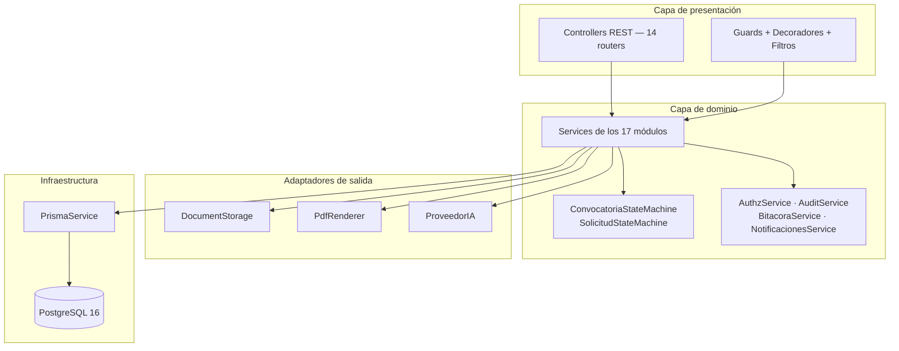
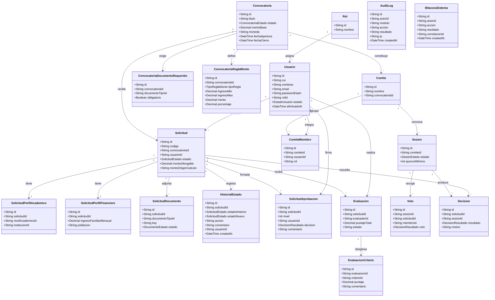
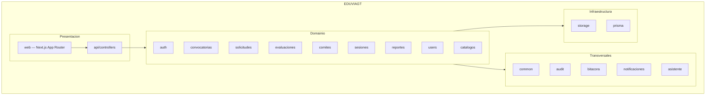

# Documento de Diseño del Sistema

> **Proyecto:** EDUVIAGT — Sistema Integral de Gestión de Becas
> **Curso:** 0910-037 · Análisis de Sistemas II · 8.º Ciclo
> **Equipo de diseño:** Chiroy Vásquez, Luis David (responsable) ·
> Lemus Meléndrez, Marcos Estuardo · Hernández González, Héctor Enrique ·
> Hernández García, José Manuel · Par Guerra, Yermerson Geovanny ·
> Guzmán Hernández, Hamilton Estuardo
> **Versión:** 1.0 · **Fecha de creación:** 2026-08-26 · **Última revisión:** 2026-10-28
> **Base:** Anexo 5 §3 del documento del proyecto final

> Este documento describe **cómo se diseña el sistema**: qué hace, quién lo usa, con qué reglas y con qué
> estructura interna. La justificación de *por qué* se eligió esta arquitectura está en
> [05-justificacion-arquitectura.md](05-justificacion-arquitectura.md), y la justificación de los patrones en
> [06-justificacion-patrones-de-diseno.md](06-justificacion-patrones-de-diseno.md).

---

## 1. Información general

| Campo | Valor |
|---|---|
| **Nombre del proyecto** | EDUVIAGT — Plataforma Nacional para la Gestión Integral de Becas |
| **Arquitecto(s) / equipo de diseño** | 6 integrantes (ver arriba) |
| **Estilo arquitectónico** | Monolito modular por capas (monorepo Turborepo) |
| **Lenguajes** | TypeScript 5 (API y web) |
| **Persistencia** | PostgreSQL 16 con Prisma 5 |
| **Versión del documento** | 1.0 |

---

## 2. Vista de casos de uso

### 2.1 Diagrama de casos de uso general

```mermaid
graph LR
  VIS((Visitante))
  POS((Postulante))
  EVAL((Evaluador))
  MEM((Miembro de Comité))
  COORD((Coordinador de Comité))
  JEFE((Jefe de Becas))
  ADM((Administrador))
  SYS((Sistema))

  subgraph PU[Portal público]
    UC1[Consultar convocatorias]
    UC2[Ver detalle de convocatoria]
    UC3[Consultar estado de beca]
    UC4[Preguntar al asistente Eduvi]
  end

  subgraph AUT[Autenticación]
    UC5[Registrarse]
    UC6[Iniciar sesión]
    UC7[Gestionar perfil]
    UC8[Eliminar cuenta]
  end

  subgraph SOL[Gestión de solicitudes]
    UC9[Crear solicitud]
    UC10[Completar perfil académico]
    UC11[Completar perfil financiero]
    UC12[Cargar documentos]
    UC13[Ver checklist de completitud]
    UC14[Enviar solicitud]
    UC15[Descargar constancia PDF]
  end

  subgraph ADM_G[Administración de convocatorias]
    UC16[Crear y editar convocatoria]
    UC17[Configurar documentos requeridos]
    UC18[Configurar reglas de monto]
    UC19[Cambiar estado de convocatoria]
  end

  subgraph EVA[Evaluación]
    UC20[Ver solicitudes asignadas]
    UC21[Asignar evaluadores]
    UC22[Puntuar por criterio]
    UC23[Consultar score ponderado]
  end

  subgraph COM[Comités y sesiones]
    UC24[Gestionar comités]
    UC25[Gestionar miembros]
    UC26[Convocar sesión]
    UC27[Votar]
    UC28[Finalizar sesión con quórum]
  end

  subgraph DEC[Decisión]
    UC29[Aprobar solicitud]
    UC30[Rechazar solicitud]
    UC31[Segunda aprobación]
    UC32[Devolver a revisión]
  end

  subgraph REP[Reportes y auditoría]
    UC33[Ver reportes agregados]
    UC34[Exportar a CSV]
    UC35[Consultar auditoría]
    UC36[Consultar bitácora]
  end

  subgraph SEG[Seguridad]
    UC37[Gestionar roles y permisos]
    UC38[Asignar excepción por usuario]
    UC39[Gestionar usuarios]
  end

  VIS --> UC1
  VIS --> UC2
  VIS --> UC3
  VIS --> UC4
  POS --> UC5
  POS --> UC6
  POS --> UC7
  POS --> UC8
  POS --> UC9
  POS --> UC10
  POS --> UC11
  POS --> UC12
  POS --> UC13
  POS --> UC14
  POS --> UC15
  EVAL --> UC20
  EVAL --> UC22
  EVAL --> UC23
  COORD --> UC21
  COORD --> UC24
  COORD --> UC25
  COORD --> UC26
  COORD --> UC28
  MEM --> UC27
  COORD --> UC29
  COORD --> UC30
  JEFE --> UC31
  JEFE --> UC32
  ADM --> UC16
  ADM --> UC17
  ADM --> UC18
  ADM --> UC19
  ADM --> UC33
  ADM --> UC34
  ADM --> UC35
  ADM --> UC36
  ADM --> UC37
  ADM --> UC38
  ADM --> UC39
  ADM --> UC7

  UC1 --> SYS
  UC2 --> SYS
  UC3 --> SYS
  UC4 --> SYS
  UC9 --> SYS
  UC14 --> SYS
  UC16 --> SYS
  UC22 --> SYS
  UC27 --> SYS
  UC28 --> SYS
  UC29 --> SYS
  UC31 --> SYS
  UC33 --> SYS
  UC37 --> SYS
```

### 2.2 Relación de los casos de uso con los requisitos del proyecto

| Requisito del enunciado | Casos de uso que lo cubren | Endpoint principal |
|---|---|---|
| Administrar convocatorias | UC16, UC17, UC18, UC19 | `POST/PATCH /api/convocatorias`, `POST /api/convocatorias/:id/transicion` |
| Registrar estudiantes | UC5, UC6, UC7 | `POST /api/auth/registro`, `POST /api/auth/login` |
| Gestionar solicitudes | UC9–UC15 | `POST /api/solicitudes`, `PUT /api/solicitudes/:id/perfil-academico` |
| Cargar documentación | UC12 | `POST /api/solicitudes/:id/documentos/:tipoId` |
| Administrar evaluaciones | UC20–UC23 | `PUT /api/evaluaciones/solicitudes/:id/criterios/:criterioId` |
| Gestionar comités evaluadores | UC24–UC28 | `POST /api/comites`, `POST /api/sesiones/:id/votos` |
| Aprobar o rechazar solicitudes | UC29, UC30, UC31, UC32 | `POST /api/solicitudes/:id/transicion`, `POST /api/solicitudes/:id/segunda-aprobacion` |
| Consultar el estado de una beca | UC3, UC15 | `GET /api/solicitudes/consulta/:codigo` |
| Generar reportes básicos | UC33, UC34 | `GET /api/reportes/*`, `GET /api/reportes/:tipo/csv` |

---

## 3. Detalle de los casos de uso

Formato: actor · precondiciones · flujo principal · flujos alternativos · postcondiciones · regla de negocio.

### UC-09 — Crear solicitud de beca

| Campo | Descripción |
|---|---|
| **Actor** | Postulante |
| **Precondiciones** | Estar autenticado; la convocatoria existe y está en estado `ABIERTA`; el postulante no tiene ya una solicitud activa para esa convocatoria |
| **Flujo principal** | 1. El postulante abre "Mis solicitudes" → "Postularme". 2. El sistema valida que la convocatoria esté abierta y vigente. 3. El sistema crea la solicitud en estado `BORRADOR`, genera un `codigo` legible y registra el alta en `HistorialEstado` y en la bitácora. 4. El sistema devuelve la solicitud y redirige al formulario multi-paso. |
| **Flujos alternativos** | **a)** La convocatoria no está abierta → el sistema informa el estado actual y no crea la solicitud. **b)** El postulante ya tiene una solicitud en `BORRADOR` para esa convocatoria → se devuelve la existente en lugar de crear otra. **c)** El postulante ya tiene una solicitud `ENVIADA` o posterior → se rechaza con mensaje claro. |
| **Postcondiciones** | Existe una solicitud en `BORRADOR` vinculada al postulante y a la convocatoria; el historial registra la creación |
| **Regla de negocio** | Una solicitud por postulante y convocatoria en estados no terminales. El `codigo` de consulta pública se genera al crear la solicitud |

### UC-14 — Enviar la solicitud

| Campo | Descripción |
|---|---|
| **Actor** | Postulante |
| **Precondiciones** | La solicitud está en `BORRADOR`; el postulante es el propietario |
| **Flujo principal** | 1. El postulante revisa el checklist y pulsa "Enviar". 2. El sistema valida: (a) documentos obligatorios cargados, (b) perfil académico completo, (c) perfil financiero completo. 3. El sistema cambia el estado a `ENVIADA` dentro de una transacción. 4. Se registra `HistorialEstado`, `AuditLog` y `BitacoraSistema`. 5. Se notifica al postulante y a los evaluadores asignables. |
| **Flujos alternativos** | **a)** Faltan documentos → el sistema devuelve el checklist de faltantes y **no** cambia el estado. **b)** Faltan perfiles → mensaje en español indicando qué sección falta. **c)** La convocatoria se cerró entre la creación y el envío → se rechaza el envío. |
| **Postcondiciones** | La solicitud está en `ENVIADA` y es visible para el proceso de revisión |
| **Regla de negocio** | La transición `BORRADOR --enviar--> ENVIADA` solo es válida si se cumplen las precondiciones; el cambio de estado y su historial se escriben **en la misma transacción** |

### UC-22 — Puntuar una solicitud por criterio

| Campo | Descripción |
|---|---|
| **Actor** | Evaluador |
| **Precondiciones** | El evaluador tiene asignada la solicitud; la solicitud está en `EN_REVISION` |
| **Flujo principal** | 1. El evaluador abre "Mis evaluaciones". 2. El sistema lista únicamente las solicitudes asignadas a esa persona. 3. El evaluador asigna un puntaje por criterio y puede añadir comentario. 4. El sistema guarda la puntuación y recalcula el **score ponderado** de la solicitud. |
| **Flujos alternativos** | **a)** El evaluador intenta puntuar una solicitud que no tiene asignada → 403 con mensaje explicativo. **b)** El evaluador yaكمة puntuó → se muestra su puntuación anterior, editable. **c)** El evaluador declara conflicto de interés → marca la solicitud como no evaluable. |
| **Postcondiciones** | La evaluación queda registrada con su criterio, puntaje y autor; el score de la solicitud se actualiza |
| **Regla de negocio** | El score es la **media ponderada** de los criterios de la beca; los pesos se definen en la configuración de la beca |

### UC-28 — Finalizar una sesión de comité

| Campo | Descripción |
|---|---|
| **Actor** | Coordinador de comité |
| **Precondiciones** | Existe una sesión en curso con agenda cargada |
| **Flujo principal** | 1. El coordinador revisa la sesión y los votos emitidos. 2. El sistema calcula el **quórum** y lo muestra (presentes / mínimo requerido). 3. Si hay quórum, el sistema genera una **decisión por solicitud** (aprobada / rechazada / devuelta a revisión). 4. La solicitud cambia de estado y se registra la decisión con su motivo. |
| **Flujos alternativos** | **a)** No hay quórum → el sistema **impide finalizar** y explica cuántos votos faltan. **b)** Un miembro votó dos veces → se conserva el primer voto y se rechaza el segundo. **c)** Una solicitud no alcanzó consenso → se genera una decisión de "no aprobada" con la justificación del coordinador. |
| **Postcondiciones** | La sesión queda en estado `FINALIZADA`; existe una `Decision` por cada solicitud de la agenda |
| **Regla de negocio** | El quórum se calcula sobre los **miembros registrados** en el comité. Cada miembro emite **un solo voto** por solicitud |

### UC-29 — Aprobar una solicitud

| Campo | Descripción |
|---|---|
| **Actor** | Coordinador de comité |
| **Precondiciones** | La solicitud está en `EVALUADA`; existe una decisión de comité favorable; el monto ya fue calculado |
| **Flujo principal** | 1. El coordinador selecciona "Aprobar" e introduce el comentario de aprobación. 2. El sistema comprueba el monto otorgable. 3. Si el monto es **≤ Q10,000.00**, la solicitud pasa a `APROBADA` y se firma la aprobación de nivel 1. 4. Si el monto es **> Q10,000.00**, el sistema **remapea** la acción a `solicitar_segunda_aprobacion` y la solicitud pasa a `PENDIENTE_SEGUNDA_APROBACION`. 5. En ambos casos se registran `HistorialEstado`, `AuditLog`, `BitacoraSistema` y la firma en `SolicitudAprobacion`. |
| **Flujos alternativos** | **a)** El monto supera el umbral → el sistema informa que se requiere segunda aprobación y **no** aprueba en primera instancia. **b)** La transición no es válida desde el estado actual → 400 con el mensaje de transición no válida. **c)** El actor no tiene el permiso `solicitud:aprobar-primera` → 403. |
| **Postcondiciones** | La solicitud queda `APROBADA` (monto bajo) o `PENDIENTE_SEGUNDA_APROBACION` (monto alto), con la firma registrada |
| **Regla de negocio** | **Separación de poderes:** toda aprobación de monto superior a Q10,000.00 requiere la firma de un segundo aprobador **distinto** del primero (`UMBRAL_SEGUNDA_APROBACION_GTQ = 10000`) |

### UC-31 — Segunda aprobación

| Campo | Descripción |
|---|---|
| **Actor** | Jefe de becas (o administrador) |
| **Precondiciones** | La solicitud está en `PENDIENTE_SEGUNDA_APROBACION`; ya existe una firma de nivel 1 |
| **Flujo principal** | 1. El jefe de becas abre la solicitud en estado `PENDIENTE_SEGUNDA_APROBACION`. 2. El sistema muestra el monto, la evaluación y la firma previa. 3. El jefe decide: aprobar, rechazar o devolver a revisión. 4. El sistema aplica la transición y registra la firma de nivel 2. |
| **Flujos alternativos** | **a)** El actor es la **misma persona** que firmó la primera aprobación → **403**, con el mensaje de que la segunda firma debe ser de otra persona. **b)** El actor no tiene el rol `JEFE_BECAS` ni `ADMIN` → 403. **c)** El monto fue ajustado por debajo del umbral tras la primera firma → el sistema mantiene el requisito de segunda aprobación, por trazabilidad. |
| **Postcondiciones** | La solicitud queda `APROBADA`, `RECHAZADA` o de vuelta en `EN_REVISION`, con las dos firmas registradas |
| **Regla de negocio** | La separación de poderes se valida **en el servidor**, no en la interfaz. El nivel de firma se guarda en `SolicitudAprobacion.nivel` |

### UC-03 — Consultar el estado de una beca (público)

| Campo | Descripción |
|---|---|
| **Actor** | Visitante (no autenticado) |
| **Precondiciones** | El postulante conoce su código de solicitud |
| **Flujo principal** | 1. El visitante accede a `/consulta`. 2. Introduce el código y pulsa "Consultar". 3. El sistema devuelve el estado actual, la convocatoria asociada y la fecha de la última actualización. |
| **Flujos alternativos** | **a)** El código no existe → mensaje "no se encontraron solicitudes" **sin revelar información**. **b)** La solicitud está eliminada por el titular (anonimizada) → mensaje genérico de no encontrada. |
| **Postcondiciones** | Ninguno: es una operación de solo lectura, sin efectos colaterales |
| **Regla de negocio** | **No se expone información personal** en la consulta pública: solo estado, convocatoria y fecha. El endpoint es `@Public()` |

### UC-12 — Cargar un documento

| Campo | Descripción |
|---|---|
| **Actor** | Postulante |
| **Precondiciones** | Existe una solicitud en `BORRADOR` o `CORRECCION` del postulante |
| **Flujo principal** | 1. El postulante selecciona el tipo de documento y adjunta el fichero. 2. El sistema valida tamaño (≤ 5 MB), MIME permitido (PDF/JPEG/PNG) y correspondencia entre extensión y MIME. 3. El adapter guarda el fichero con nombre UUID y registra la fila en `SolicitudDocumento`. 4. El checklist se actualiza. |
| **Flujos alternativos** | **a)** El fichero excede 5 MB o el tipo no está permitido → 400 con el motivo. **b)** La extensión y el MIME no coinciden → 400 (prevención de falsificación de tipo). **c)** El postulante ya había subido un documento de ese tipo → se **reemplaza** el anterior. |
| **Postcondiciones** | El documento está almacenado y referenciado; el checklist refleja el avance |
| **Regla de negocio** | La clave del fichero es un UUID y la ruta se valida contra la raíz de almacenamiento (**prevención de path traversal**) |

---

## 4. Diagramas de componentes y clases

### 4.1 Diagrama de componentes

Ver la versión completa, con todas las dependencias, en
[04-documento-arquitectura.md](04-documento-arquitectura.md) §5. Resumen por capa:

### 4.2 Diagrama de clases del dominio principal

### 4.3 Diagrama de estados

Las dos máquinas de estado se muestran en
[04-documento-arquitectura.md](04-documento-arquitectura.md) §6.2 y §6.3, y su implementación (tabla de
transiciones) es la base del patrón State documentado en
[06-justificacion-patrones-de-diseno.md](06-justificacion-patrones-de-diseno.md) §3.6.

### 4.4 Diagrama de paquetes (módulos)

### 4.5 Diagrama de despliegue

Ver [04-documento-arquitectura.md](04-documento-arquitectura.md) §3.2 y
[`docs/architecture/diagrams.md`](../architecture/diagrams.md) §13.

---

## 5. Reglas de negocio del dominio

Las reglas que gobiernan el comportamiento del sistema y que deben ser preservadas en cualquier refactor.

| # | Regla | Dónde se implementa |
|---|---|---|
| RN-01 | Una convocatoria solo admite postulaciones entre `fechaApertura` y `fechaCierre` y en estado `ABIERTA`. | `ConvocatoriasService` |
| RN-02 | Solo se puede enviar una solicitud si faltan cero documentos obligatorios y los dos perfiles están completos. | `SolicitudesService.enviar` + `SolicitudChecklistService` |
| RN-03 | Una transición de estado no registrada en la tabla es inválida y se rechaza con HTTP 400. | `SolicitudStateMachine.next` / `ConvocatoriaStateMachine.next` |
| RN-04 | Toda transición válida deja registro en `HistorialEstado` con estado anterior, nuevo, acción, comentario y actor. | `SolicitudesService.transicion` |
| RN-05 | El monto otorgable se calcula según las reglas `FIJO / PORCENTAJE / COMPLETO` de la convocatoria, con el tramo de ingreso familiar del solicitante. | `MontosService` |
| RN-06 | Toda monto superior a Q10,000.00 requiere una segunda firma de un aprobador **distinto** del primero. | `AuthzService.assertSegundaAprobacion` + FSM |
| RN-07 | El override manual de un monto exige justificación y queda registrado con autor y fecha. | `SolicitudesService.overrideMonto` |
| RN-08 | Un miembro de comité emite **un solo voto** por solicitud y sesión. | `SesionesService.votar` |
| RN-09 | Una sesión no puede finalizarse sin quórum. | `SesionesService.finalizar` |
| RN-10 | Un evaluador solo ve y puntúa las solicitudes que tiene asignadas. | `AuthzService.assertAcceso` + `EvaluacionesService.mias` |
| RN-11 | La consulta pública de estado no revela datos personales. | `GET /solicitudes/consulta/:codigo` |
| RN-12 | La eliminación de cuenta anonimiza los datos personales pero conserva el historial de estados y las decisiones. | `EliminarCuentaService` |
| RN-13 | Toda acción sensible se registra en `AuditLog` y en `BitacoraSistema` (append-only). | `AuditService`, `BitacoraService` |
| RN-14 | Un permiso no configurado **deniega** el acceso (*fail-closed*). | `PermissionsGuard` + `DefaultDenyHandler` |

---

## 6. Modelo de datos — resumen

El esquema completo de las 36 entidades está en
[`docs/architecture/database-schema.md`](../architecture/database-schema.md).

| Dominio | Entidades | Enums |
|---|---|---|
| **Autenticación y seguridad** | Usuario, Rol, Permiso, RolPermiso, UsuarioPermiso, ConfiguracionUsuario | — |
| **Catálogos** | Genero, NivelAcademico, Departamento, Municipio, InstitucionEducativa, DocumentoTipo, Beca, CriterioEvaluacion | — |
| **Convocatorias** | Convocatoria, ConvocatoriaDocumentoRequerido, ConvocatoriaReglaMonto | `ConvocatoriaEstado`, `TipoReglaMonto` |
| **Solicitudes** | Solicitud, SolicitudPerfilAcademico, SolicitudPerfilFinanciero, SolicitudDocumento, SolicitudRespuesta, SolicitudAprobacion, HistorialEstado | `SolicitudEstado`, `DocumentoEstado` |
| **Evaluación** | Evaluacion, EvaluacionCriterio | — |
| **Comités y sesiones** | Comite, ComiteMiembro, Sesion, SesionAgenda, Voto, Decision | `SesionEstado`, `DecisionResultado` |
| **Auditoría y bitácora** | AuditLog, BitacoraSistema, Notificacion | — |
| **Asistente** | AsistenteBaseConocimiento, AsistenteConversacion, AsistenteMensaje | — |

**Roles del sistema:** `ADMIN`, `POSTULANTE`, `EVALUADOR`, `COORDINADOR_COMITE`, `MIEMBRO_COMITE`, `JEFE_BECAS`.

---

## 7. Contrato de la API (resumen)

Convención transversal: envelope `{ data }` en las respuestas correctas y
`{ statusCode, message, timestamp }` en los errores.

| Prefijo | Recurso | Autenticación |
|---|---|---|
| `/api/auth` | registro, login, refresh, perfil, eliminar cuenta | Pública / JWT |
| `/api/catalogos` | 8 catálogos públicos + CRUD administrativo | Pública (lectura) / `catalogo:gestionar` |
| `/api/convocatorias` | listado público, detalle, documentos, montos, transiciones | Pública (lectura) / `convocatoria:*` |
| `/api/solicitudes` | CRUD, perfiles, documentos, checklist, transiciones, segunda aprobación, constancia, score | JWT + `solicitud:*` |
| `/api/evaluaciones` | mis evaluaciones, asignación de evaluadores, puntuación | JWT + `evaluacion:*` |
| `/api/comites` | comités y miembros | JWT + `comite:*` |
| `/api/sesiones` | sesiones, votos, cierre | JWT + `sesion:*`, `voto:crear` |
| `/api/reportes` | 11 endpoints de agregación y export CSV | JWT + `reporte:ver` |
| `/api/seguridad` | roles, permisos, usuarios, excepciones | JWT + `permiso:editar` |
| `/api/notificaciones` | listado, no leídas, marcar leída, stream SSE | JWT |
| `/api/bitacora`, `/api/audit` | auditoría y bitácora | JWT + `auditoria:ver` |
| `/api/asistente` | preguntar a Eduvi | Pública |

Detalle completo en [`docs/architecture/api-contracts.md`](../architecture/api-contracts.md) y
[`docs/architecture/api-web-contrato.md`](../architecture/api-web-contrato.md).

---

## 8. Diseño de la interfaz

| Decisión | Detalle |
|---|---|
| **Design system propio** | Tailwind CSS con tokens de color, tipografía y espaciado propios; identidad brutalista/maximalista (ADR-008, ADR-010) |
| **Separación público / interno** | El portal público y los paneles internos comparten el design system pero tienen layouts diferenciados |
| **Responsive** | Diseño mobile-first; se verificó el desbordamiento horizontal del selector en móvil (commit `496c296`) |
| **Accesibilidad** | WCAG 2.2 AA: foco visible, skip link, trampa de foco en el menú lateral, `prefers-reduced-motion`, contraste verificado con axe (ADR-016) |
| **Formularios** | React Hook Form + Zod en login y registro; el formulario de solicitud es multi-paso con estado controlado |
| **Notificaciones** | Campana con sonido configurable (respeta `prefers-reduced-motion`) y stream SSE |

---

## 9. Referencias

- [Documento de Arquitectura](04-documento-arquitectura.md) — esqueleto del sistema y diagramas generales
- [Justificación de la Arquitectura](05-justificacion-arquitectura.md) — criterios del enunciado
- [Justificación de Patrones de Diseño](06-justificacion-patrones-de-diseno.md) — evidencia en el código
- [`docs/architecture/diagrams.md`](../architecture/diagrams.md) — diagramas Mermaid completos
- [`docs/architecture/database-schema.md`](../architecture/database-schema.md) — esquema de base de datos
- [`docs/architecture/api-contracts.md`](../architecture/api-contracts.md) — contratos de la API
- [`docs/architecture/frontend.md`](../architecture/frontend.md) — arquitectura del frontend

---

*Última actualización: 2026-10-28*
