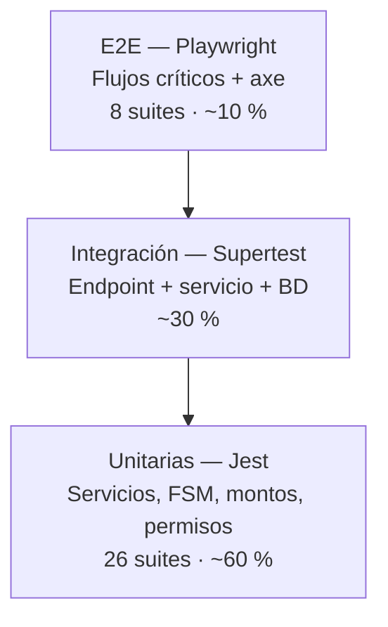

# Plan de Pruebas Ágil

> **Proyecto:** EDUVIAGT — Sistema Integral de Gestión de Becas
> **Curso:** 0910-037 · Análisis de Sistemas II · 8.º Ciclo
> **Versión:** 1.0 · **Fecha de creación:** 2026-08-26 · **Última revisión:** 2026-10-28
> **Base:** Anexo 7 del documento del proyecto final

---

## 1. Información general

| Campo | Valor |
|---|---|
| **Nombre del proyecto** | EDUVIAGT — Sistema Integral de Gestión de Becas |
| **Responsable de pruebas** | Todo el equipo Scrum (responsabilidad compartida) |
| **Herramientas** | Jest · Supertest · Playwright · `@axe-core/playwright` · GitHub Actions |

---

## 2. Propósito

El propósito de este documento es describir la **estrategia, el alcance y los métodos** que el equipo utiliza
para verificar y validar la calidad del producto. El plan asegura que cada incremento de software entregado no
solo funcione como se espera, sino que además sea **robusto, usable y conforme a la Definición de "Hecho"**.

A diferencia de un plan tradicional, este documento es una **guía de alto nivel**: los planes de prueba
detallados para cada Historia de Usuario se definen a través de sus **Criterios de Aceptación**, y el detalle
técnico de la estrategia vive en
[`docs/standards/testing-strategy.md`](../standards/testing-strategy.md).

---

## 3. Objetivos

1. **Identificar y reportar defectos lo antes posible** en el ciclo de desarrollo (*Shift-Left Testing*).
2. **Verificar que cada Historia de Usuario implementada cumple sus Criterios de Aceptación.**
3. **Validar que el incremento de producto entregado en cada Sprint aporta valor real** y satisface las
   necesidades del usuario.
4. **Asegurar que las nuevas funcionalidades no rompen el código existente** (pruebas de regresión).
5. **Construir confianza en la calidad del producto** para el Product Owner y los stakeholders.
6. **Proporcionar retroalimentación rápida** al equipo de desarrollo.
7. **Verificar los atributos de calidad no funcionales** que el enunciado evalúa: seguridad, accesibilidad,
   mantenibilidad y trazabilidad.

---

## 4. Alcance

### 4.1 Funcionalidades en alcance (in-scope)

El alcance de las pruebas cubre **todas las funcionalidades definidas en el Product Backlog**. Para cada Sprint,
el alcance se limita a las Historias de Usuario seleccionadas en la Sprint Planning, **más** la suite de
regresión completa.

| Épica | Funcionalidad | Tipo de prueba predominante |
|---|---|---|
| EPIC-01 | Gestión de Convocatorias | Unitarias (FSM) + integración (CRUD, transición) + E2E (panel admin) |
| EPIC-02 | Cuentas, Autenticación y Seguridad | Unitarias (cadena de permisos) + integración (JWT, roles) + E2E (login/registro) |
| EPIC-03 | Solicitudes y Perfiles | Unitarias (servicio) + integración (validaciones) + E2E (formulario multi-paso) |
| EPIC-04 | Documentación y Checklist | Unitarias (checklist) + integración (subida, MIME, path traversal) |
| EPIC-05 | Evaluación | Unitarias (score ponderado) + integración (asignación, puntuación) |
| EPIC-06 | Comités y Sesiones | Unitarias (quórum) + integración (voto único, cierre) |
| EPIC-07 | Decisión y Aprobación | Unitarias (FSM) + integración (segunda aprobación, auto-aprobación) |
| EPIC-08 | Portal Público y Consulta | E2E (navegación, filtros, consulta de estado) |
| EPIC-09 | Reportes y Estadísticas | Integración (agregaciones) + E2E (exportación CSV) |
| EPIC-10 | Asistente Eduvi | Unitarias (proveedores) + integración (FTS, fallback) |
| EPIC-11 | Auditoría, Bitácora y Privacidad | Integración (registro de acciones) + E2E (anonimización) |
| EPIC-12 | UX y Accesibilidad | E2E + axe (WCAG 2.2 AA) + revisión manual |
| EPIC-13 | CI/CD y Operación | Verificación en el pipeline (build, smoke, despliegue) |

**Regresión permanente:** además de las historias del sprint, la **suite completa** se ejecuta en cada PR. No
existe el concepto de "no se toca esta parte" en este repositorio.

### 4.2 Funcionalidades fuera de alcance (out-of-scope)

Las siguientes áreas **no** son objeto de pruebas formales bajo este plan, salvo indicación expresa del
Product Owner:

| # | Área fuera de alcance | Justificación |
|---|---|---|
| 1 | Pruebas de carga y estrés con más de 1,000 usuarios concurrentes | El volumen real del MINEDUC es de ~1,000 solicitudes **totales** por ciclo, no concurrentes. Se documenta la arquitectura preparado para escalar en §5.4 en lugar de ejecutar pruebas de carga costosas |
| 2 | Pruebas de compatibilidad en navegadores obsoletos (Internet Explorer, versiones antiguas de Chrome/Firefox) | El producto se despliega en navegadores modernos del entorno institucional |
| 3 | Pruebas de hardware o de la infraestructura de red subyacente | Fuera del control del equipo (servidor institucional) |
| 4 | Prueba de penetración y auditoría de seguridad externa | Fuera del alcance del curso; el equipo sí aplica revisión de seguridad en el code review y adheres a las directrices de `docs/standards/security-guidelines.md` |
| 5 | Pruebas de disponibilidad y de recuperación ante desastres (disaster recovery) | El despliegue en producción está deshabilitado en el semestre (`PRODUCTION_READY`) |
| 6 | Verificación de la calidad del LLM externo (precisión de las respuestas del asistente) | El asistente es un soporte informativo; la calidad de la respuesta depende de un tercero. Sí se prueba la **degradación**, que es responsabilidad del equipo |
| 7 | Pruebas de accesibilidad con usuarios con discapacidad real | Se cubre con auditoría automática (axe) y revisión manual contra WCAG 2.2 AA |

---

## 5. Estrategia de pruebas

### 5.1 Enfoque: la pirámide de pruebas



La pirámide se integra directamente en el flujo de trabajo de cada Sprint: las pruebas unitarias se escriben
**antes** de la implementación (TDD), las de integración se ejecutan al cerrar la historia, y las E2E se
ejecutan en el pipeline antes de cada Sprint Review.

### 5.2 Niveles de prueba

#### Nivel 1 — Pruebas unitarias

| Campo | Detalle |
|---|---|
| **Quién** | Los desarrolladores, de forma individual para su propio código |
| **Cuándo** | Continuamente durante la escritura del código; es un requisito del DoD |
| **Qué** | Las piezas más pequeñas de código (métodos, clases, funciones puras) de forma aislada |
| **Herramientas** | Jest + `@nestjs/testing`, con dobles de las dependencias externas |
| **Ubicación** | Junto al archivo probado, con sufijo `.spec.ts` |
| **Cobertura** | Statements ≥ 49 % · Branches ≥ 40 % · Functions ≥ 48 % · Lines ≥ 49 % |

**Casos de alto valor específico de EDUVIAGT**

| Unidad probada | Casos que deben cubrirse |
|---|---|
| `SolicitudStateMachine` | Todas las transiciones válidas + todas las inválidas (12 combinaciones) |
| `ConvocatoriaStateMachine` | Publicar, cerrar, reabrir, archivar, resolver y cada transición inválida |
| `PermissionChain` | Excepción que concede, excepción que deniega, permiso por rol, sin permiso → `DENY` |
| `MontosService` | Regla FIJO, PORCENTAJE y COMPLETO; tranche no encontrado; monto nulo; override |
| `LoginAttemptService` | 5 intentos permitidos, bloqueo al 6.º, reinicio de la ventana de 15 min |
| `FilesystemStorageAdapter` | Guardado, lectura, borrado, existencia, **path traversal bloqueado** |
| `AsistenteIAProxy` | Selección de proveedor, timeout, degradación al fallback |
| `AuthzService` | Separación de poderes: el segundo aprobador no puede ser el primero |

#### Nivel 2 — Pruebas de integración

| Campo | Detalle |
|---|---|
| **Quién** | Los desarrolladores |
| **Cuándo** | Después de las pruebas unitarias, para verificar la colaboración entre componentes |
| **Qué** | La interacción entre módulos, servicios o con la base de datos |
| **Herramientas** | Supertest sobre la aplicación NestJS completa; base de datos de pruebas |

**Casos de alto valor específico de EDUVIAGT**

| Flujo | Verificaciones |
|---|---|
| Registro | CUI duplicado → 409; email duplicado → 409; hash bcrypt con coste ≥ 10; rol `POSTULANTE` asignado |
| Login | Credenciales inválidas → 401; usuario inactivo → 401; 6.º intento → 429; Access y Refresh con secretos distintos |
| Autorización | Permiso ausente → 403; `@Permisos([])` → 403 (*fail-closed*); usuario con excepción `DENY` → 403 |
| Envío de solicitud | Faltan documentos → 400 con checklist; faltan perfiles → 400; envío válido → estado `ENVIADA` + historial + bitácora |
| Transición de estado | Transición inválida → 400 con mensaje explicativo; transición válida → estado, historial, auditoría y bitácora en la **misma transacción** |
| Segunda aprobación | Mismo usuario que firmó la 1.ª → 403; monto ≤ umbral → aprueba directamente; monto > umbral → `PENDIENTE_SEGUNDA_APROBACION` |
| Votación | Voto duplicado del mismo miembro → rechazado; sin quórum → no se puede finalizar |
| Subida de documento | MIME no permitido → 400; extensión ≠ MIME → 400; > 5 MB → 400; path traversal → bloqueado |
| Consulta pública | Código inexistente → respuesta genérica sin revelar información |
| Eliminación de cuenta | Anonimización correcta; el historial de estados **se conserva** |

#### Nivel 3 — Pruebas de sistema y de aceptación

| Campo | Detalle |
|---|---|
| **Quién** | Pruebas manuales exploratorias por todo el equipo; pruebas de aceptación formales por el Product Owner |
| **Cuándo** | Cuando una Historia de Usuario está «lista para validación» en el entorno de staging |
| **Qué** | El sistema de extremo a extremo desde la perspectiva del usuario, validando flujos completos y Criterios de Aceptación |

**Flujos E2E cubiertos (8 suites)**

| # | Flujo | Prioridad |
|---|---|---|
| 1 | Registro → Login → Ver dashboard | Alta |
| 2 | Crear solicitud → Subir documentos → Enviar | Alta |
| 3 | Ver convocatorias → Filtrar → Postularme | Alta |
| 4 | Login admin → Gestionar convocatoria → Cambiar estado | Media |
| 5 | Consultar estado de beca (público) | Media |
| 6 | Evaluador → Ver asignadas → Puntuar por criterio | Alta |
| 7 | Coordinador → Crear sesión → Votar → Finalizar con quórum | Alta |
| 8 | Jefe de becas → Segunda aprobación de monto alto | Alta |

### 5.3 Tipos de prueba adicionales

| Tipo | Descripción | Cuándo |
|---|---|---|
| **Regresión** | Conjunto de pruebas (idealmente automatizadas) que verifica que las funcionalidades nuevas no han afectado a las existentes | Antes de cada Sprint Review; en **cada** PR se ejecuta la suite completa |
| **Usabilidad exploratoria** | El equipo dedica un bloque de tiempo a «jugar» con la aplicación para encontrar fallos y proponer mejoras de usabilidad desde la perspectiva del usuario final | Un bloque por sprint, dentro de la Retrospective o justo antes de la Review |
| **Accesibilidad** | Auditoría automática con axe + revisión manual de los criterios WCAG 2.2 AA | En cada PR que toca la interfaz; y al cierre de cada sprint |
| **Contractual** | Verificación del envelope `{ data }` y del formato de error `{ statusCode, message, timestamp }` en todos los endpoints | En cada PR de API |
| **Smoke** | Verificación de que la aplicación arranca y responde en `/api/catalogos/generos` tras el build | En el job `api-tests` del CI |

### 5.4 Estrategia de escalabilidad (en lugar de pruebas de carga)

Dado que las pruebas de carga masivas están fuera de alcance (§4.2), el equipo aplica una **estrategia
sustitutiva** para asegurar que el sistema soporta el volumen previsto:

| Medida | Descripción | Evidencia |
|---|---|---|
| **Base de datos sembrada a escala** | La base de pruebas contiene 51 convocatorias, 1,000 solicitudes, 250 postulantes, 30 evaluadores y 50 miembros de comité | `apps/api/prisma/semilla/` y `docs/architecture/datos-demostracion.md` |
| **Pruebas sobre datos realistas** | La suite E2E se ejecuta contra esa base, no contra una base con 3 registros | Job `e2e-web` con `globalSetup` que resiembra |
| **Índices verificados** | Los índices del esquema cubren los filtros más frecuentes (`estado`, `convocatoriaId`, `usuarioId`, `codigo`) | `apps/api/prisma/schema.prisma` |
| **Paginación obligatoria** | Ningún listado devuelve el conjunto completo sin paginar | DTOs de paginación en los servicios de listado |
| **Consultas agregadas en base de datos** | Los reportes usan `groupBy`/`count` en SQL, no carga en memoria | `apps/api/src/reportes/reportes.service.ts` |
| **Medición del tiempo de respuesta** | El smoke test del CI mide el tiempo de arranque y respuesta de un endpoint público | Job `api-tests` |
| **Diseño preparado para escalar** | La arquitectura permite extraer módulos y añadir caché sin reescribir el dominio | [05-justificacion-arquitectura.md](05-justificacion-arquitectura.md) §3.2 |

### 5.5 Criterios de entrada y de salida

#### Criterios de entrada (para iniciar las pruebas)

Una Historia de Usuario puede pasar a validación cuando:

1. El código está completo y compila sin errores de TypeScript.
2. Las pruebas unitarias y de integración propias **pasan**.
3. El code review está **aprobado** por al menos un par.
4. Las migraciones de base de datos están aplicadas en el entorno de pruebas.
5. La historia está desplegada en **staging**.

#### Criterios de salida (para finalizar las pruebas)

1. La Historia de Usuario cumple **todos** los puntos de la Definition of Done.
2. La **suite completa** (unitarias + integración + E2E) está en verde.
3. Las pruebas de accesibilidad (axe) no reportan errores en las pantallas afectadas.
4. El **Product Owner ha realizado la UAT** y ha aceptado la historia (acta de aprobación).
5. Los defectos encontrados de severidad Crítica o Alta están cerrados.
6. La documentación técnica está actualizada.

---

## 6. Entorno y configuración

### 6.1 Entornos

| Entorno | Propósito | Configuración |
|---|---|---|
| **Desarrollo (local)** | Pruebas unitarias y desarrollo inicial | Máquinas de los desarrolladores con Windows, Node.js 20, PostgreSQL 16 en Docker (`docker-compose.yml`), `npm run dev` |
| **Integración / pruebas (staging)** | Pruebas de integración y UAT del Product Owner | VM con PostgreSQL 16; despliegue por el job `deploy-staging`; simula el entorno de producción |
| **CI (GitHub Actions)** | Ejecución desatendida de la suite en cada PR | Contenedores efímeros con PostgreSQL 16 de servicio; `sigeb_test` como base de pruebas |

### 6.2 Datos de prueba

| Regla | Detalle |
|---|---|
| **Determinismo** | Los datos de prueba se generan con semillas fijas; el mismo conjunto en cada ejecución |
| **Aislamiento** | Cada test es independiente: no depende del orden ni del estado de otros tests |
| **Nunca datos reales** | Los datos personales del seed son **ficticios**; no se usan datos de postulantes reales |
| **Resiembra** | El `globalSetup` de Playwright resiembra `sigeb_test` antes de la suite E2E |
| **Limpieza** | Las pruebas de integración usan transacciones que se revierten o una base limpia por ejecución |

### 6.3 Navegadores soportados

| Navegador | Soporte | Verificación |
|---|---|---|
| Google Chrome (última versión) | Sí | E2E automatizado (Playwright) |
| Mozilla Firefox (última versión) | Sí | E2E automatizado (Playwright) |
| Microsoft Edge (última versión) | Sí | Revisión manual |
| Safari (última versión) | Sí | Revisión manual |
| Navegadores obsoletos (IE, versiones antiguas) | No | Fuera de alcance (§4.2) |

### 6.4 Dispositivos y viewports

| Viewport | Uso | Verificación |
|---|---|---|
| Móvil (375 × 667) | Postulación y consulta | E2E + revisión manual |
| Tablet (768 × 1024) | Evaluación y comité | Revisión manual |
| Escritorio (1440 × 900) | Panel administrativo | E2E + revisión manual |

---

## 7. Herramientas y ejecución

### 7.1 Comandos

```bash
# Backend — suite completa
npm run test:api

# Backend — solo unitarias
cd apps/api && npm run test

# Backend — cobertura (con umbral)
cd apps/api && npm run test:cov

# Frontend — E2E con Playwright (incluye axe)
cd apps/web && npm run test:e2e

# Todo el monorepo
npm test
```

### 7.2 Ejecución en CI

El pipeline de GitHub Actions ejecuta, en **cada Pull Request**:

```text
api-tests      →  npm run lint
                  npm run test:cov        (con umbral de cobertura)
                  tsc --noEmit  (api y web)
                  npm run build --filter=api
                  smoke test de arranque

e2e-web        →  playwright test         (con axe y resiembra de sigeb_test)
```

**Regla de bloqueo:** un PR no puede fusionarse a `develop` si cualquiera de estos pasos falla.

### 7.3 Cuando una prueba falla

1. El pipeline marca el PR en rojo y bloquea el merge.
2. El autor **investiga y corrige** en el mismo PR (no se desertan los tests: `it.skip` requiere justificación
   escrita y aprobación en el review).
3. Si la prueba es incorrecta (no el código), se corrige la prueba **y** se documenta el motivo en el PR.
4. Los tests omitidos o condicionados (`skip`, `only`) se reportan en la retrospectiva como deuda técnica.

---

## 8. Gestión de defectos

### 8.1 Registro

Los defectos se registran en el **Product Backlog** (GitHub Projects) con la etiqueta `Bug` y son priorizados por
el Product Owner como cualquier otra historia.

### 8.2 Formato del reporte de defecto

| Campo | Contenido |
|---|---|
| **Título** | Descriptivo y específico (por ejemplo: «El selector de nivel académico desborda horizontalmente en móvil») |
| **Severidad** | Crítico · Alto · Medio · Bajo |
| **Prioridad** | Alta · Media · Baja |
| **Entorno** | Navegador, versión, viewport, ambiente (local / staging / producción) |
| **Commit** | SHA donde se reproduce |
| **Pasos para reproducir** | Numerados y deterministas |
| **Resultado esperado** | Qué debería ocurrir |
| **Resultado obtenido** | Qué ocurrió realmente |
| **Evidencia** | Capturas de pantalla, vídeo o fragmento de log |
| **Causa raíz** |cuando se haya determinado (obligatorio para Críticos y Altos antes de cerrar) |

### 8.3 Severidad

| Nivel | Definición | Tiempo objetivo de corrección |
|---|---|---|
| **Crítico** | Impide el uso del sistema o provoca pérdida/corrupción de datos | Inmediato; bloquea el sprint |
| **Alto** | Rompe una funcionalidad esencial sin alternativa viable | En el sprint en curso |
| **Medio** | Rompe una funcionalidad con alternativa o afecta la usabilidad | En el sprint en curso o en el siguiente |
| **Bajo** | Cosmético, de documentación o de confort | Backlog futuro, priorizado por el PO |

### 8.4 Acta de aprobación del Product Owner

Cada historia cerrada incluye una **acta de aceptación del Product Owner**: un comentario en la tarea (o el
registro en la minuta del Sprint Review) que confirma que la historia fue probada en staging y cumple los
criterios de aceptación.

---

## 9. Resultados esperados (deliverables)

Las actividades de prueba no producen un único documento final, sino un **conjunto de artefactos continuos**:

| # | Artefacto | Dónde vive | Actualizado |
|---|---|---|---|
| 1 | **Suite de pruebas automatizadas** | `apps/api/src/**/*.spec.ts` (26 suites) y `apps/web/e2e/` (8 suites) | En cada PR |
| 2 | **Reportes de ejecución de pruebas** | Salida del job `api-tests` y `e2e-web` en GitHub Actions | En cada PR |
| 3 | **Informe de cobertura** | Salida de `npm run test:cov` (Jest) | En cada PR |
| 4 | **Registro de defectos (Bug Log)** | Tablero de GitHub Projects con etiqueta `Bug` | Continuous |
| 5 | **Acta de aprobación del Product Owner** | Comentario en la tarea o en la minuta del Sprint Review | Al cierre de cada historia |
| 6 | **Documentación de pruebas** | `docs/pruebas/`: baseline, caja blanca, funcional API, funcional web, contenido, a11y visual e informe de hallazgos | Por sprint |
| 7 | **Métricas de calidad** | Tabla QM-01 a QM-12 del [Plan de Calidad](08-plan-aseguramiento-calidad.md) §9 | En cada retrospectiva |

---

## 10. Cobertura de los requisitos no funcionales

Los NFR del [Documento de Visión](03-documento-vision.md) §6 no se verifican todos con el mismo tipo de prueba:

| NFR | Tipo de verificación | Estado |
|---|---|---|
| NFR-P-01 · Carga de páginas < 3 s | Smoke test del CI con medición de tiempo | Parcial (se mide el arranque y un endpoint público; medición completa de Lighthouse fuera de alcance) |
| NFR-P-02 · API < 500 ms (p95) | Consultas sobre la base con 1,000 solicitudes | Parcial (diseño de índices y agregaciones verificado; medición p95 instrumentada como mejora) |
| NFR-P-03 · 100 usuarios concurrentes | Diseño preparado + pruebas sobre datos a escala | Fuera de alcance formal (§4.2) |
| NFR-S-01 · bcrypt ≥ 10 | Prueba unitaria sobre el hash almacenado | ✅ Cubierto |
| NFR-S-02 · Consultas parametrizadas | Prisma parametriza por defecto + revisión de código | ✅ Cubierto por diseño |
| NFR-S-03 · Autorización *fail-closed* | Prueba unitaria de la cadena + prueba de integración del guard | ✅ Cubierto |
| NFR-S-04 · Secretos separados | Revisión de configuración + prueba de refresh | ✅ Cubierto |
| NFR-S-05 · Límite de intentos de login | Prueba unitaria de `LoginAttemptService` + prueba de integración (429) | ✅ Cubierto |
| NFR-S-06 · Validación y path traversal de ficheros | Prueba unitaria del adapter + prueba de integración de subida | ✅ Cubierto |
| NFR-S-07 · Registro de acciones sensibles | Prueba de integración sobre `AuditLog` y `BitacoraSistema` | ✅ Cubierto |
| NFR-S-08 · Sin secretos versionados | `.gitignore` + escaneo en CI | ✅ Cubierto |
| NFR-U-01 · Registro en < 10 clics | Recorrido manual + E2E | ✅ Cubierto |
| NFR-U-02 · Errores en español | Prueba de integración sobre el filtro de excepciones | ✅ Cubierto |
| NFR-U-03 · Responsive | E2E en viewports + revisión manual | ✅ Cubierto |
| NFR-U-04 · WCAG 2.2 AA | axe en E2E + revisión manual | ✅ Cubierto |
| NFR-C-01 · Navegadores soportados | E2E en Chrome y Firefox + revisión manual en Edge/Safari | ✅ Cubierto |
| NFR-D-02 · Migraciones versionadas | Verificación en el pipeline (`migrate deploy`) | ✅ Cubierto |
| NFR-D-03 · Umbral de cobertura | `jest.config` con `coverageThreshold` | ✅ Cubierto |
| NFR-D-04 · Lint sin errores | Job `lint-and-test` | ✅ Cubierto |

---

## 11. Conclusiones

El plan de pruebas de EDUVIAGT se apoya en tres decisiones:

1. **Los criterios de aceptación son el plan de prueba.** Cada historia define qué debe verificarse, de modo
   que el plan de pruebas detallado por historia **nace con la historia** y no se escribe después.
2. **La pirámide de pruebas está sesgada a la base.** El 60 % del esfuerzo está en pruebas unitarias de lógica
   pura —máquinas de estado, cadena de permisos, cálculo de montos—, que son rápidas, deterministas y
   detectan los defectos más temprano.
3. **La calidad se comprueba en el pipeline, no en la confianza.** La suite completa se ejecuta en cada PR y
   un pipeline en rojo bloquea el merge. No hay ventanas de integración manual que posponen la detección.

---

## 12. Referencias

- [Plan de Aseguramiento de Calidad Ágil](08-plan-aseguramiento-calidad.md) — normas, procesos y métricas
- [Documento de Visión](03-documento-vision.md) §6 y §8 — NFR y Definition of Done
- [`docs/standards/testing-strategy.md`](../standards/testing-strategy.md) — estrategia de testing con ejemplos
- [`docs/pruebas/00-baseline.md`](../pruebas/00-baseline.md) — línea base de calidad
- [`docs/pruebas/10-caja-blanca.md`](../pruebas/10-caja-blanca.md) — pruebas de caja blanca
- [`docs/pruebas/20-funcional-api.md`](../pruebas/20-funcional-api.md) — pruebas funcionales de la API
- [`docs/pruebas/30-funcional-web.md`](../pruebas/30-funcional-web.md) — pruebas funcionales del frontend
- [`docs/pruebas/50-a11y-visual.md`](../pruebas/50-a11y-visual.md) — pruebas de accesibilidad
- [`docs/pruebas/60-informe-hallazgos.md`](../pruebas/60-informe-hallazgos.md) — informe de hallazgos

---

*Última actualización: 2026-10-28*
